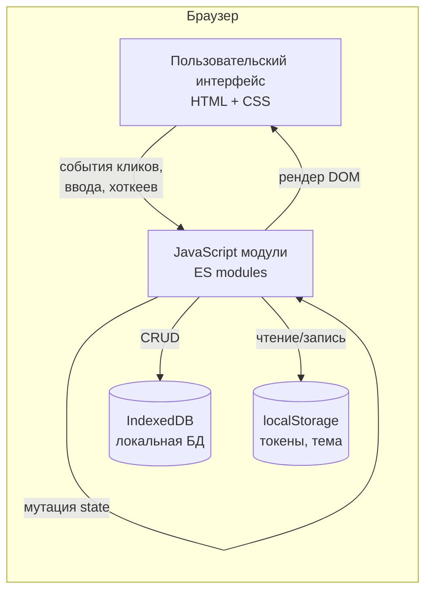
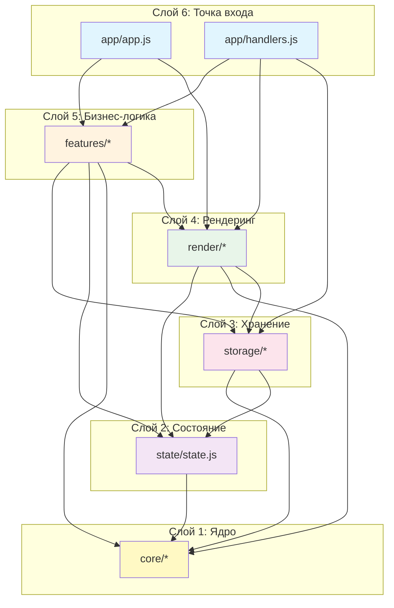
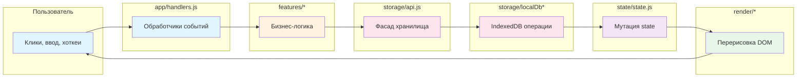
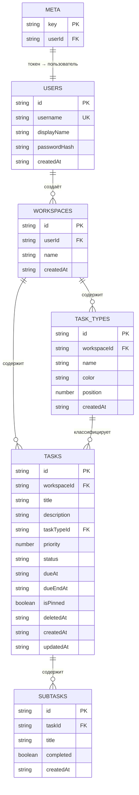
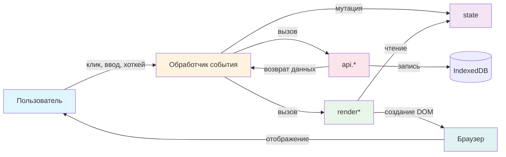

# Irsalio

Персональный таск-менеджер на чистом JavaScript. Работает в браузере, хранит данные локально через IndexedDB.

**Версия:** 1.0.0  
**Дата документации:** 1 Сентября 2026 

---

> 🔗 **Демо:** https://Irsanama.github.io/Irsalio/

> 📦 **Репозиторий:** https://github.com/Irsanama/Irsalio

---

## Оглавление

> Навигация по документу.

### Часть 2. Что такое Irsalio

- [3. Введение](#3-введение)
  - [Что это за приложение](#что-это-за-приложение)
  - [Для кого оно](#для-кого-оно)
  - [Какие задачи решает](#какие-задачи-решает)
  - [Чем отличается от других таск-менеджеров](#чем-отличается-от-других-таск-менеджеров)
- [4. Ключевые возможности](#4-ключевые-возможности)
- [5. Как это работает](#5-как-это-работает)
  - [Общая схема](#общая-схема)
  - [Где хранятся данные](#где-хранятся-данные)
  - [Локальный режим и приватность](#локальный-режим-и-приватность)

### Часть 3. Руководство пользователя

- [6. Быстрый старт](#6-быстрый-старт)
  - [Открытие приложения](#открытие-приложения)
  - [Регистрация и первый вход](#регистрация-и-первый-вход)
  - [Создание первой задачи](#создание-первой-задачи)
- [7. Работа с задачами](#7-работа-с-задачами)
  - [Создание задачи](#создание-задачи)
  - [Режим просмотра и редактирования](#режим-просмотра-и-редактирования)
  - [Удаление, восстановление, окончательное удаление](#удаление-восстановление-окончательное-удаление)
  - [Избранное (пин)](#избранное-пин)
  - [Подзадачи и прогресс](#подзадачи-и-прогресс)
  - [Приоритеты, статусы, типы](#приоритеты-статусы-типы)
  - [Markdown в описании задачи](#markdown-в-описании-задачи)
- [8. Календарь](#8-календарь)
  - [Неделя: сетка 24×7](#неделя-сетка-247)
  - [Месяц: компактный вид](#месяц-компактный-вид)
  - [Год: 12 мини-месяцев](#год-12-мини-месяцев)
  - [Перетаскивание задач (Drag-and-Drop)](#перетаскивание-задач-drag-and-drop)
  - [Создание задачи кликом по ячейке](#создание-задачи-кликом-по-ячейке)
  - [Навигация по периодам](#навигация-по-периодам)
- [9. Дашборд](#9-дашборд)
  - [KPI-карточки](#kpi-карточки)
  - [Распределение по типам](#распределение-по-типам)
  - [Недавно обновлённые](#недавно-обновлённые)
- [10. Экран «Внимание»](#10-экран-внимание)
  - [Просроченные задачи](#просроченные-задачи)
  - [Скоро истекающие](#скоро-истекающие)
- [11. Поиск и фильтры](#11-поиск-и-фильтры)
  - [Command Palette (Ctrl+K)](#command-palette-ctrlk)
  - [Фильтры по статусу](#фильтры-по-статусу)
  - [Фильтры по типу](#фильтры-по-типу)
  - [Сортировка](#сортировка)
- [12. Настройки](#12-настройки)
  - [Профиль и смена пароля](#профиль-и-смена-пароля)
  - [Рабочие пространства](#рабочие-пространства)
  - [Экспорт и импорт JSON](#экспорт-и-импорт-json)
  - [Очистка данных](#очистка-данных)
  - [Тёмная и светлая тема](#тёмная-и-светлая-тема)
- [13. Горячие клавиши](#13-горячие-клавиши)
- [14. Мобильная версия](#14-мобильная-версия)

### Часть 4. Установка и запуск

- [15. Быстрый старт без установки](#15-быстрый-старт-без-установки)
- [16. Локальный запуск для разработчиков](#16-локальный-запуск-для-разработчиков)
  - [Требования](#требования)
  - [Скачивание и запуск](#скачивание-и-запуск)
  - [Типичные проблемы](#типичные-проблемы)
- [17. Деплой на GitHub Pages](#17-деплой-на-github-pages)
  - [Пошаговая инструкция](#пошаговая-инструкция)
  - [Обновление после изменений](#обновление-после-изменений)

### Часть 5. Техническая архитектура

- [18. Технологический стек](#18-технологический-стек)
  - [Почему чистый JS без фреймворков](#почему-чистый-js-без-фреймворков)
  - [Поддерживаемые браузеры](#поддерживаемые-браузеры)
- [19. Структура проекта](#19-структура-проекта)
  - [Полное дерево файлов](#полное-дерево-файлов)
  - [Логика группировки модулей](#логика-группировки-модулей)
- [20. Модули JavaScript](#20-модули-javascript)
  - [core/ — базовые утилиты](#core--базовые-утилиты)
  - [state/ — глобальное состояние](#state--глобальное-состояние)
  - [storage/ — слой хранения](#storage--слой-хранения)
  - [render/ — рендеринг UI](#render--рендеринг-ui)
  - [features/ — бизнес-логика](#features--бизнес-логика)
  - [app/ — точка входа](#app--точка-входа)
- [21. Хранение данных (IndexedDB)](#21-хранение-данных-indexeddb)
  - [Что такое IndexedDB](#что-такое-indexeddb)
  - [Схема базы данных](#схема-базы-данных)
  - [Object stores и индексы](#object-stores-и-индексы)
  - [Чтение, запись, транзакции](#чтение-запись-транзакции)
  - [Очистка базы](#очистка-базы)
- [22. Управление состоянием](#22-управление-состоянием)
  - [Объект state](#объект-state)
  - [Мутации и рендеринг](#мутации-и-рендеринг)
- [23. Стили и дизайн](#23-стили-и-дизайн)
  - [CSS custom properties](#css-custom-properties)
  - [Светлая и тёмная темы](#светлая-и-тёмная-темы)
  - [Модульная структура CSS](#модульная-структура-css)
  - [Типографика и шрифты](#типографика-и-шрифты)
  - [Адаптивность (responsive)](#адаптивность-responsive)
- [24. Поток данных](#24-поток-данных)
  - [Схема: событие → обработчик → состояние → DOM](#схема-событие--обработчик--состояние--dom)
  - [Примеры потоков](#примеры-потоков)

### Часть 6. Для разработчиков

- [25. Как добавить новую функцию](#25-как-добавить-новую-функцию)
  - [Пример: поле «метка» для задачи](#пример-поле-метка-для-задачи)
  - [Полный пошаговый чеклист](#полный-пошаговый-чеклист)
- [26. Соглашения о коде](#26-соглашения-о-коде)
  - [Именование](#именование)
  - [Структура модулей](#структура-модулей)
  - [Комментарии и JSDoc](#комментарии-и-jsdoc)
- [27. Отладка](#27-отладка)
  - [DevTools и IndexedDB](#devtools-и-indexeddb)
  - [Отлов ошибок](#отлов-ошибок)
  - [Полезные команды консоли](#полезные-команды-консоли)
- [28. Известные ограничения](#28-известные-ограничения)
- [29. Будущее развитие](#29-будущее-развитие)
  - [Серверный режим (REST API)](#серверный-режим-rest-api)
  - [Планируемые функции](#планируемые-функции)

### Часть 7. Приложения

- [30. Глоссарий](#30-глоссарий)
- [31. FAQ](#31-faq)
- [32. Changelog](#32-changelog)
- [33. Контакты и ссылки](#33-контакты-и-ссылки)

---

### 3. Введение

#### Что это за приложение

Irsalio — это список задач, который работает прямо в браузере. Вы открываете сайт, регистрируете локальный аккаунт (без отправки данных куда-либо) и сразу начинаете записывать дела.

Под капотом — чистый JavaScript с ES-модулями. Весь код собран вручную: HTML + CSS + JS-модули, которые браузер загружает напрямую. Это полноценное рабочее приложение — с календарём, дашбордом, Markdown в описаниях задач, drag-and-drop в недельной сетке, экспортом/импортом и полным набором горячих клавиш.

> **Главная фишка:** данные не улетают ни на какой сервер. Они лежат в IndexedDB — встроенной в браузер базе данных, привязанной к вашему устройству. Закрыли вкладку — задачи остались. Открыли через неделю — всё на месте. Но если вы почистите данные браузера, задачи удалятся вместе с ними. Именно поэтому в Irsalio есть функция экспорта в JSON — делайте бэкапы.

#### Для кого оно

Irsalio подойдёт, если:

- Вам нужен простой, но функциональный планировщик — без подписок и облаков.
- Вы не хотите отдавать свои задачи сторонним сервисам (Trello, Todoist, Notion).
- Вы работаете с задачами, которые нельзя хранить в облаке (конфиденциальные данные, рабочие списки, личные заметки).
- Вы разработчик и хотите посмотреть, как устроен таск-менеджер без фреймворков — весь исходный код открыт и разобран по модулям.
- У вас нестабильный интернет — приложение продолжает работать после первой загрузки страницы.

Irsalio **не** подойдёт, если:

- Вам нужна совместная работа с другими людьми (пока только персональный режим, мультипользовательский функционал запланирован в [разделе «Будущее развитие»](#29-будущее-развитие)).
- Вы хотите, чтобы задачи синхронизировались между компьютером, телефоном и планшетом автоматически. В текущей версии синхронизации нет — используйте экспорт/импорт JSON для переноса данных между устройствами.
- Вам критична серверная БД с автоматическими бэкапами.

#### Какие задачи решает

Конкретный список того, что вы сможете делать в Irsalio:

1. **Записывать задачи** с названием, описанием (с поддержкой Markdown), сроком выполнения, приоритетом и типом.
2. **Разделять дела по рабочим пространствам** — например, «Работа», «Дом», «Проект X». В каждом пространстве — свои типы задач и свой список дел.
3. **Видеть день и неделю** в виде часовых сеток и перетаскивать задачи мышью или пальцем, меняя время выполнения.
4. **Отслеживать просроченные** и «горящие» дела на отдельном экране «Внимание».
5. **Дробить большие задачи** на подзадачи с прогресс-баром выполнения.
6. **Искать** по названию и описанию через Command Palette (`Ctrl+K` / `⌘+K`).
7. **Работать в тёмной теме** — переключение одной кнопкой или хоткеем.

#### Чем отличается от других таск-менеджеров

| Критерий | Типичные облачные сервисы (Todoist, TickTick) | Irsalio |
|---|---|---|
| Где хранятся данные | На серверах компании | В браузере (IndexedDB) |
| Нужен ли аккаунт с email | Да, обязательно | Нет, только локальный логин/пароль |
| Синхронизация между устройствами | Автоматическая | Ручная (экспорт/импорт JSON) |
| Работа без интернета | Частично, через кэш | Полностью после первой загрузки |
| Стек | React/Vue/Angular + REST API | Чистый JS + ES-модули |
| Исходный код | Закрыт | Открыт, можно форкнуть |
| Подписка | Обычно платная | Бесплатно |

Проще говоря: Irsalio — это «мой собственный планировщик, который живёт у меня в компьютере и не рассказывает о моих делах ни одной третьей стороне».

> **Важно понимать:** приватность имеет обратную сторону. Если вы потеряете доступ к браузеру (сломается компьютер, очистите кэш, переустановите систему) — задачи пропадут. Делайте регулярные бэкапы через настройки (Экспорт в JSON) и храните файлы в надёжном месте.

---

### 4. Ключевые возможности

Ниже — полный список того, что умеет Irsalio. Каждая возможность описана отдельно, с пояснением, зачем она нужна и как её использовать.

#### 4.1. Рабочие пространства (Workspaces)

**Что это:** изолированные наборы задач внутри одного аккаунта. У каждого пространства — свои типы задач, свой список дел и свои метрики на дашборде.

**Зачем нужно:** не смешивать рабочие задачи с личными, проектные — с рутинными. Например, у вас может быть три пространства: `Работа`, `Дом`, `Книга`.

**Пример использования:**
1. Кликните по названию текущего пространства в верхней части сайдбара.
2. В открывшемся окне «Рабочие пространства» нажмите «Создать новое».
3. Введите название, например `Учёба`.
4. Приложение создаст пространство и автоматически добавит в него 4 базовых типа задач: «Работа», «Дом», «Встречи», «Личное» (см. [`js/storage/localDbWorkspaces.js`](#205-модуль-localdbworkspacesjs)).

**Подводные камни:**
- Удаление пространства удаляет **все** его задачи и типы безвозвратно — приложение запросит подтверждение.
- Экспорт сохраняется только для одного пространства за раз (не всех сразу).

---

#### 4.2. Типы задач (Task Types) с цветами

**Что это:** категории, к которым можно привязать задачу. У каждого типа есть название и цвет. Цвет отображается как цветная точка в сайдбаре и в бейджах.

**Зачем нужно:** быстро ориентироваться в списке задач визуально. Например, все «Встречи» — оранжевые, все «Срочные баги» — красные.

**Пример:** в `localDbWorkspaces.js` определён массив `DEFAULT_TASK_TYPES` с четырьмя предустановленными типами:

```js
const DEFAULT_TASK_TYPES = Object.freeze([
  { name: "Работа",   color: "#2563EB" }, // синий
  { name: "Дом",      color: "#16A34A" }, // зелёный
  { name: "Встречи",  color: "#D97706" }, // оранжевый
  { name: "Личное",   color: "#7C3AED" }, // фиолетовый
]);
```

**Палитра цветов:** при создании или редактировании типа доступно 8 предустановленных цветов (см. `TYPE_COLORS` в [`js/state/state.js`](#203-модуль-statestatejs)):

```js
"#201D18", "#6F6A63", "#9A7400", "#A63A2E",
"#3A7D46", "#5582B3", "#7A4A99", "#99527A"
```

> **Совет:** если вам нужен другой цвет — меняйте массив `TYPE_COLORS` в `state.js` и пересобирайте. Произвольные HEX-коды через UI пока задать нельзя.

---

#### 4.3. Задачи: полный набор полей

Каждая задача в Irsalio — это объект со следующими полями (см. модель в [`localDbTasks.js`](#207-модуль-localdbtasksjs)):

| Поле | Тип | Назначение |
|---|---|---|
| `id` | `string` (UUID) | Уникальный идентификатор |
| `workspaceId` | `string` | К какому пространству принадлежит |
| `title` | `string` | Название (обязательное) |
| `description` | `string` | Описание в Markdown |
| `taskTypeId` | `string \| null` | ID типа задачи |
| `priority` | `number` (1–4) | Приоритет |
| `status` | `"todo" \| "in_progress" \| "done"` | Статус выполнения |
| `dueAt` | `ISO-string \| null` | Начало срока |
| `dueEndAt` | `ISO-string \| null` | Конец срока (для диапазонов) |
| `isPinned` | `boolean` | В избранном (отображается со ★) |
| `deletedAt` | `ISO-string \| null` | Если не `null` — задача в корзине |
| `createdAt`, `updatedAt` | `ISO-string` | Метки времени |

**Приоритеты:** 4 уровня с цветовой индикацией.
- **1 — Низкий** (серый)
- **2 — Средний** (синий)
- **3 — Высокий** (оранжевый)
- **4 — Срочный** (красный)

**Статусы:** три варианта, переключаются кликом по бейджу в карточке.
- `todo` → «К выполнению»
- `in_progress` → «В работе»
- `done` → «Выполнено» (карточка становится полупрозрачной, название зачёркивается)

---

#### 4.4. Markdown в описании задачи

**Что это:** в поле «Описание» можно использовать Markdown-синтаксис. Приложение отрендерит его в HTML с соблюдением правил безопасности (защита от XSS).

**Поддерживаемые элементы:**

| Элемент | Синтаксис | Результат |
|---|---|---|
| Заголовок H1 | `# Заголовок` | Крупный заголовок |
| Заголовок H2 | `## Подзаголовок` | Средний заголовок |
| Заголовок H3 | `### Раздел` | Мелкий заголовок |
| **Жирный** | `**текст**` | **текст** |
| *Курсив* | `*текст*` | *текст* |
| Inline-код | `` `код` `` | `код` |
| Блок кода | ` ```код``` ` | Преформатированный блок |
| Цитата | `> цитата` | Вертикальная черта слева |
| Маркированный список | `- пункт` | • пункт |
| Нумерованный список | `1. пункт` | 1. пункт |
| Чек-лист | `- [ ] задача` | ☐ задача |
| Ссылка | `[текст](url)` | Кликабельная ссылка |

**Тулбар форматирования:** над полем описания отображается панель с кнопками для быстрой вставки Markdown-синтаксиса. Реализовано в [`js/features/markdownToolbar.js`](#2011-модуль-markdowntoolbarjs).

**Безопасность:** функция `renderMarkdown()` из [`js/features/markdown.js`](#2010-модуль-markdownjs) санитизирует HTML, удаляя опасные теги (`<script>`, `<iframe>`, `<form>` и др.) и обработчики событий (`onclick`, `onerror`). Ссылки открываются в новой вкладке с `rel="noopener noreferrer"`.

---

#### 4.5. Подзадачи и прогресс

**Что это:** у любой задачи можно создать чек-лист из подзадач. Сверху отображается прогресс-бар, цвет которого зависит от процента выполнения и срока.

**Логика цвета прогресс-бара** (см. `buildProgressBar()` в [`js/render/components.js`](#208-модуль-rendercomponentsjs)):

- **Зелёный** — 100% готово
- **Жёлтый** (focus) — от 66% до 99%
- **Оранжевый** (warning) — от 33% до 65%, либо срок скоро истекает
- **Красный** (danger) — меньше 33%, либо задача просрочена

**Пример:**
```
Подзадачи (3 из 5)
━━━━━━━━━━━━━━━━━━━ 60%  [оранжевый бар]
 ☑ Созвониться с клиентом
 ☑ Подготовить презентацию
 ☑ Отправить КП
 ☐ Дождаться ответа
 ☐ Подписать договор
```

---

#### 4.6. Корзина и восстановление

**Что это:** при удалении задачи она не пропадает сразу, а помечается полем `deletedAt` и попадает в раздел «Корзина» в сайдбаре. Оттуда задачу можно восстановить или удалить окончательно.

**Почему так:** защита от случайных удалений. Пока задача в корзине, её можно вернуть одной кнопкой. Окончательное удаление требует отдельного подтверждения и удаляет также все подзадачи.

**Очистка корзины:** в разделе «Корзина» появляется кнопка «Очистить корзину», которая удаляет все помеченные задачи разом (с подтверждением).

---

#### 4.7. Календарь: 3 режима просмотра

Приложение содержит три календарных представления, переключаются кнопками в шапке календаря:

**1. Неделя** — сетка 24 часа × 7 дней. Самая функциональная:
- Каждый час — 60 пикселей высоты.
- Задачи отображаются блоками с учётом длительности (от `dueAt` до `dueEndAt`).
- Пересекающиеся по времени задачи автоматически раскладываются в несколько колонок (алгоритм из [`calendarWeekGrid.js`](#2016-модуль-calendarweekgridjs)).
- **Drag-and-Drop:** перетащите задачу мышью или пальцем, чтобы изменить её время и день. Приложение округлит время до ближайших 15 минут (`SNAP_MINUTES = 15`).
- **Клик по пустой ячейке** создаёт задачу с предустановленным временем клика.
- Красная линия показывает текущее время, автоматически обновляется каждую минуту.

**2. Месяц** — классическая сетка 7×N. В каждой ячейке дня:
- До 3 превью задач (название + время).
- Если задач больше — счётчик `+N`.
- На мобильных — компактный режим без превью, только индикатор количества.

**3. Год** — 12 мини-календарей на одной сетке. Дни с задачами подсвечены, просроченные — красным. Клик по месяцу переключает в месячный вид.

---

#### 4.8. Дашборд (Dashboard)

**Что это:** сводка по текущему рабочему пространству. Состоит из трёх блоков:

1. **KPI-карточки** (4 штуки):
   - «Активных» — количество невыполненных задач.
   - «Выполнено» — всего завершённых.
   - «Просрочено» — просроченные активные задачи (красная карточка, если > 0).
   - «Сегодня» — запланированные на сегодня (оранжевая, если > 0).

2. **Распределение по типам** — горизонтальные бары с количеством задач каждого типа. Максимум 6 типов на графике, отсортированы по убыванию.

3. **Недавно обновлённые** — список из 5 последних изменённых задач с датой изменения.

---

#### 4.9. Экран «Внимание» (Attention)

**Что это:** отдельная вкладка, которая собирает задачи, требующие срочных действий:
- **Просроченные** — все невыполненные задачи, у которых `now > due_at` (или `due_end_at`).
- **Скоро истекают** — задачи со статусом `due-soon` (в течение 24 часов).

Если ни тех, ни других нет — отображается приветствие «Всё под контролем» с эмодзи ✅.

Бейдж с количеством таких задач отображается на вкладке «Внимание» в сайдбаре (скрывается, если счёт равен нулю).

---

#### 4.10. Command Palette (Ctrl+K / ⌘+K)

**Что это:** окно быстрого поиска и выполнения действий, аналог Spotlight в macOS или `Ctrl+P` в VS Code.

**Что можно делать:**
- Искать задачи по названию и описанию (полнотекстовый поиск).
- Переключаться между представлениями («Все», «Сегодня», «Корзина» и т.д.).
- Создавать новую задачу.
- Переключать тему.
- Открывать переключатель рабочих пространств.

**Особенности реализации:**
- Поиск через API с debounce 120 мс (чтобы не спамить запросами при быстром вводе).
- Счётчик запросов (`currentQueryId`) предотвращает race conditions: если вы быстро перепечатываете, результат старого запроса не перепишет новый.
- Если поле пустое — показываются 8 последних задач.

---

#### 4.11. Горячие клавиши

Полный список хоткеев, зарегистрированных в [`js/app/handlers.js`](#202-модуль-handlersjs):

| Клавиша | Действие |
|---|---|
| `Ctrl/Cmd + K` | Открыть Command Palette |
| `Alt + K` | Альтернативный способ открыть палитру |
| `N` | Создать новую задачу |
| `C` | Переключиться на вкладку «Календарь» |
| `E` | Открыть настройки |
| `Escape` | Закрыть панель задачи или сайдбар |

> **Важно:** хоткеи работают независимо от раскладки клавиатуры. Если у вас русская раскладка и вы нажимаете физическую клавишу `N` (на которой в русской раскладке `Т`), команда всё равно сработает. Это реализовано через маппинг `event.code` → `event.key` в константе `HOTKEY_LAYOUT_MAP`.

Хоткеи блокируются, когда фокус находится в поле ввода (чтобы вы случайно не открыли палитру, печатая название задачи).

---

#### 4.12. Светлая и тёмная темы

Переключение одной кнопкой (иконка солнца/луны в подвале сайдбара) или через Command Palette. Выбранная тема сохраняется в `localStorage` под ключом `irsalio_theme` и применяется при следующем открытии.

Все цвета определены через CSS-переменные в [`css/base.css`](#181-css-custom-properties) — это значит, что переключение темы сводится к замене значений переменных у селектора `[data-theme="dark"]`.

---

#### 4.13. Адаптивная вёрстка

Приложение работает на экранах от 320px и выше:

- **Мобильные (< 768px):** сайдбар скрыт, открывается кнопкой-гамбургером. Календарь поддерживает свайпы для навигации между неделями/месяцами. Внизу экрана — плавающая кнопка «+» для создания задач.
- **Планшеты (768–1023px):** сайдбар всегда виден, сетки календаря перестраиваются.
- **Десктоп (1024px+):** развёрнутая сетка дашборда, годового календаря (4 колонки месяцев вместо 2).

Тач-зоны на мобильных увеличены до минимум 44×44px (рекомендация Apple HIG).

---

#### 4.14. Экспорт и импорт JSON

**Экспорт** сохраняет текущее рабочее пространство в JSON-файл со структурой:

```json
{
  "version": 3,
  "exportedAt": "2026-9-1T10:30:00.000Z",
  "workspace": { "id": "...", "name": "Работа" },
  "types": [ ... ],
  "tasks": [ ... ],
  "subtasks": [ ... ]
}
```

**Импорт** принимает файл, валидирует версию (поддерживаются 1, 2, 3) и создаёт **новое** пространство с импортированными данными. Это защита от случайной перезаписи существующего пространства.

> **Внимание:** при импорте все ID генерируются заново (чтобы не было конфликтов с существующими записями). Связи между задачами и подзадачами сохраняются через внутренние маппинги.

---

### 5. Как это работает

#### Общая схема



Приложение работает по простой односторонней схеме:

1. **Пользователь** совершает действие (клик, ввод, хоткей).
2. **Обработчик события** (`handlers.js`) вызывает функцию из слоя `features` или напрямую меняет `state`.
3. **Состояние** (`state.js`) обновляется, затем вызываются функции рендеринга из `render/`.
4. **Рендер** перестраивает соответствующий участок DOM, обновляя UI.

Никаких фреймворков, никакой магии. Если вы откроете DevTools и напишете `state.tasks[0].title = "Новое название"; renderAll();`, задача обновится на экране. Это удобно для отладки и опасно для новичков — отсюда именование `renderAll()` как единой точки перерисовки.

#### Где хранятся данные

**IndexedDB** (читается «индекс-ди-би») — это встроенная в браузер NoSQL-база данных. Она:

- Хранится локально, на диске вашего компьютера.
- Переживает перезагрузку страницы и закрытие вкладки.
- Поддерживает транзакции, индексы и сложные запросы.
- Имеет лимиты, зависящие от браузера (обычно 1–2 ГБ на сайт).

> **Простыми словами:** представьте, что браузер выделил вашему сайту отдельный ящик на жёстком диске. Всё, что вы положите в этот ящик, останется там, пока вы сами его не выкинете или не почистите данные браузера.

В Irsalio IndexedDB используется для хранения:
- Пользователей (логин, хэш пароля).
- Рабочих пространств.
- Типов задач.
- Задач и подзадач.
- Токенов сессии.

**localStorage** используется только для небольших настроек:
- `irsalio_token` — токен текущей сессии.
- `irsalio_mode` — режим хранения (`local` или `server`).
- `irsalio_workspace_id` — ID последнего активного пространства.
- `irsalio_theme` — выбранная тема.

#### Локальный режим и приватность

В текущей версии Irsalio работает **только в локальном режиме**. Это означает:

1. **Нет никаких сетевых запросов** для хранения данных. Приложение после первой загрузки страницы работает полностью автономно.
2. **Нет отправки аналитики** — никаких Google Analytics, Metrika, трекеров.
3. **Нет сторонних скриптов**, кроме библиотеки `marked.js` для рендеринга Markdown (она загружается через `<script>` в `index.html` и работает локально).

**Что это даёт:**
- Даже если завтра GitHub Pages закроется, приложение можно скачать и открыть локально (`file://`).
- Ваши задачи не попадут в утечки данных — потому что их нигде, кроме вашего браузера, нет.
- Вы не зависите от доступности сервера и интернет-соединения.

**Что это забирает:**
- Автоматическую синхронизацию между устройствами.
- Серверные бэкапы.
- Защиту от потери данных при очистке кэша браузера.

> **Практический совет:** раз в неделю делайте экспорт в JSON и сохраняйте файл в облако или на внешний диск. Это займёт 5 секунд и спасёт вас от потери всех задач в случае переустановки системы.

---

Эта часть для тех, кто уже открыл Irsalio и хочет понять, что и как здесь работает. Без программирования, без терминологии — только пошаговые инструкции и практические советы.

---

### 6. Быстрый старт

#### Открытие приложения

Irsalio работает в браузере. Ничего устанавливать не нужно — ни плагинов, ни расширений, ни программ. Достаточно:

1. Открыть любой современный браузер (Chrome, Firefox, Safari, Edge).
2. Перейти по ссылке на GitHub Pages.
3. Дождаться загрузки страницы (обычно 1–2 секунды).

Первый запуск займёт чуть больше времени — браузер скачивает все JS-модули и инициализирует локальную базу данных. Это одноразовая операция. При повторных визитах приложение откроется мгновенно.

> **Важно:** Irsalio не будет работать в Internet Explorer и совсем старых версиях браузеров (Chrome до 90, Firefox до 88). Если у вас старый браузер — обновите его.

#### Регистрация и первый вход

При первом открытии вы увидите экран авторизации с двумя вкладками: **«Вход»** и **«Регистрация»**.

**Регистрация** — это создание локального аккаунта. Данные **никуда не отправляются**, они хранятся только в вашем браузере.

Поля формы:
- **Логин** — любое имя на латинице (например, `ivan` или `user123`). Минимум 1 символ.
- **Отображаемое имя** — то, как вас будут «звать» в приложении. Можно написать кириллицей: `Иван Петров`.
- **Пароль** — любая строка. Минимальных требований нет, но рекомендуется не меньше 6 символов.
- **Повтор пароля** — то же самое, для защиты от опечаток.

> **Подводный камень:** если вы забудете пароль, восстановить его будет **невозможно**. Данные зашифрованы SHA-256 хэшем, серверной части нет, и сброса через email тоже нет. Запишите пароль в надёжное место.

После нажатия **«Зарегистрироваться»** приложение:
1. Создаёт пользователя в IndexedDB.
2. Генерирует токен сессии (UUID).
3. Сохраняет токен в `localStorage`.
4. Создаёт первое рабочее пространство «Моё пространство».
5. Засевает 4 базовых типа задач: Работа, Дом, Встречи, Личное.

Всё это происходит в функции `enterApp()` из [`js/features/auth.js`](#203-модуль-authjs).

**Последующие входы:** если вы не вышли из аккаунта и не очистили данные браузера, приложение автоматически войдёт по сохранённому токену. Экран авторизации не появится.

#### Создание первой задачи

Есть четыре способа создать задачу:

1. **Кнопка «+» в сайдбаре** — самый очевидный путь. Откройте боковую панель и нажмите «Новая запись».
2. **Горячая клавиша `N`** — работает с любой раскладкой клавиатуры.
3. **Command Palette (`Ctrl/Cmd+K`)** — введите «Новая» и нажмите Enter.
4. **Клик по пустой ячейке календаря** — создаёт задачу с предустановленным временем.

После клика откроется правая панель в режиме редактирования. Заполните поля и нажмите «Сохранить».

---

### 7. Работа с задачами

#### Создание задачи

Когда вы нажимаете «Новая запись», открывается [`taskPanel.js`](#2012-модуль-taskpaneljs) в режиме `edit`. Это форма с полями:

| Поле | Обязательность | Назначение |
|---|---|---|
| Название | Да | Короткое описание задачи |
| Тип | Нет | Категория (Работа, Дом и т.д.) |
| Приоритет | Нет | От 1 (Низкий) до 4 (Срочный) |
| Статус | Нет | К выполнению / В работе / Выполнено |
| Срок | Нет | Дата и время (или диапазон) |
| Описание | Нет | Подробный текст с Markdown |
| Подзадачи | Нет | Чек-лист шагов |

**Название** — это единственное обязательное поле. Если оставить его пустым и нажать «Сохранить», приложение покажет ошибку «Название обязательно» и вернёт фокус в поле.

**Срок** поддерживает два режима:
- **Одно время** — задача привязана к конкретной дате и часу.
- **Диапазон** — задача длится от одного момента до другого (например, конференция с 10:00 до 12:00).

Если вы выбираете диапазон и указываете только начало, приложение автоматически подставит конец через 1 час.

> **Важно:** если конец срока окажется раньше начала — сохранение заблокируется с ошибкой «Конец срока должен быть после начала». Это проверка реализована в `validateDueRange()` внутри [`localDbTasks.js`](#207-модуль-localdbtasksjs).

#### Режим просмотра и редактирования

У каждой задачи два режима:

- **Просмотр (`view`)** — вы видите отрендеренный Markdown, бейджи статуса/приоритета, срок в читаемом формате. Карточка занимает всю правую панель.
- **Редактирование (`edit`)** — форма с полями ввода. Появляются выпадающие списки, datetime-local пикеры, Markdown-тулбар над описанием.

Переход из просмотра в редактирование — кнопка с иконкой карандаша. Обратно — кнопка «Сохранить» (для существующей задачи) или «Отмена» (если не было изменений).

**Защита от потери данных:** если вы что-то изменили в форме и пытаетесь закрыть панель, появится диалог «Несохранённые изменения». Это работает через флаг `state.panelDirty`, который устанавливается на каждое событие `input` в полях формы.

#### Удаление, восстановление, окончательное удаление

Удаление в Irsalio — двухэтапный процесс:

1. **Первый клик** — задача попадает в корзину. Технически это не удаление, а установка поля `deletedAt` (timestamp). Функция [`deleteTask()`](#207-модуль-localdbtasksjs) делает именно это.

2. **Второй клик** (в корзине) — выбор между «Вернуть» и «Удалить навсегда».
   - **Вернуть** — сбрасывает `deletedAt`, задача снова появляется в обычных списках.
   - **Удалить навсегда** — физически стирает запись из IndexedDB вместе со всеми подзадачами. Функция `permanentDeleteTask()`.

> **Внимание:** окончательное удаление **необратимо**. Подзадачи удаляются каскадно, без подтверждения для каждой. Если вы удалили задачу с 10 подзадачами — пропадут все 11 записей.

**Очистка корзины целиком:** в разделе «Корзина» появляется кнопка «Очистить корзину». Она удаляет все задачи с `deletedAt` параллельно через `Promise.allSettled()` — даже если одна из операций упадёт, остальные всё равно выполнятся.

#### Избранное (пин)

Любую задачу можно отметить звёздочкой — она попадёт в раздел «Избранное» в сайдбаре. Это удобно для задач, к которым вы возвращаетесь чаще всего.

Клик по иконке звезды переключает поле `isPinned` между `true` и `false`. Избранные задачи также отображаются со специальным значком ★ в недельной сетке календаря (через CSS-псевдоэлемент `::after` у `.week-task-block.is-pinned`).

#### Подзадачи и прогресс

В панели задачи есть секция «Подзадачи». Вы можете:
- Добавлять новые пункты через поле ввода внизу (Enter или кнопка «+»).
- Отмечать выполненные кликом по чекбоксу.
- Удалять ненужные через иконку крестика (появляется при наведении).

Над списком отображается прогресс-бар. Его цвет зависит от процента выполнения и срока:

| Процент / Условие | Цвет |
|---|---|
| 100% | Зелёный (`--success`) |
| 66–99% | Жёлтый (`--progress-mid`) |
| 33–65% | Оранжевый (`--warning`) |
| < 33% | Красный (`--danger`) |
| Просрочено | Красный, независимо от % |
| Скоро истекает | Оранжевый, независимо от % |

Логика расчёта цвета — в функции `buildProgressBar()` из [`js/render/components.js`](#209-модуль-rendercomponentsjs).

#### Приоритеты, статусы, типы

**Приоритеты (4 уровня):**
- `1` — Низкий (серый бейдж)
- `2` — Средний (синий)
- `3` — Высокий (оранжевый)
- `4` — Срочный (красный)

В карточке задачи приоритет отображается как кликабельный бейдж. Каждый клик циклически меняет значение: 1 → 2 → 3 → 4 → 1. Реализовано в `setupContentEvents()` — кейс `cycle-priority`.

**Статусы (3 варианта):**
- `todo` — К выполнению
- `in_progress` — В работе
- `done` — Выполнено

Переключение тоже циклическое через клик по статус-бейджу. Задачи со статусом `done` визуально затеняются (opacity: 0.6) и их название перечёркивается.

**Типы** — цветные категории. Создаются и редактируются через модальное окно [`openTypeEditor()`](#206-модуль-typeeditorjs). У типа два параметра: название и цвет (один из 8 предустановленных в `TYPE_COLORS`).

#### Markdown в описании задачи

В поле «Описание» поддерживается GitHub-Flavored Markdown. Рендеринг выполняет функция `renderMarkdown()` из [`js/features/markdown.js`](#2010-модуль-markdownjs) через библиотеку `marked.js`.

**Полный список поддерживаемых элементов:**

##### Заголовки

```markdown
# Заголовок H1
## Заголовок H2
### Заголовок H3
```

Результат — заголовки трёх уровней с разной крупностью шрифта. H4 и ниже не поддерживаются.

##### Форматирование текста

```markdown
**жирный текст**
*курсивный текст*
`inline-код`
```

##### Списки

```markdown
- пункт 1
- пункт 2
  - вложенный пункт

1. первый
2. второй
3. третий
```

##### Чек-листы

```markdown
- [x] сделано
- [ ] не сделано
- [ ] ещё не сделано
```

Чекбоксы в Markdown **нельзя** переключать из интерфейса — это чисто визуальное отображение. Чтобы управлять чек-листами интерактивно, используйте подзадачи задачи.

##### Блоки кода

````markdown
```
function hello() {
  console.log("world");
}
```
````

Код отображается моноширинным шрифтом (`Spline Sans Mono`) в сером блоке с горизонтальным скроллом для длинных строк. Подсветки синтаксиса нет.

##### Цитаты

```markdown
> Это цитата
> Может быть многострочной
```

Слева появляется вертикальная цветная черта (`--accent`).

##### Ссылки

```markdown
[Текст ссылки](https://example.com)
```

Все ссылки открываются в новой вкладке с `target="_blank"` и `rel="noopener noreferrer"`. Это защита от `window.opener`-уязвимостей.

> **Безопасность:** библиотека `marked.js` в Irsalio настроена на строгую санитизацию. Если вы попытаетесь вставить `<script>alert('xss')</script>` или `javascript:alert(1)` в URL — опасный контент будет удалён. Список блокируемых тегов: `script`, `iframe`, `object`, `embed`, `form`, `base`, `link`, `meta`, `applet`, `style`.

##### Markdown-тулбар

Над полем описания появляется панель с кнопками быстрого форматирования ([`markdownToolbar.js`](#2011-модуль-markdowntoolbarjs)):

| Кнопка | Действие |
|---|---|
| **B** | Обернуть выделение в `**...**` |
| *I* | Обернуть в `*...*` |
| H1/H2/H3 | Добавить `#`, `##`, `###` в начало строки |
| • | Маркированный список |
| 1. | Нумерованный список |
| ☑ | Чек-лист |
| 🔗 | Ссылка с шаблоном `[текст](url)` |
| `<>` | Inline-код |
| `{}` | Блок кода |
| `>` | Цитата |

Если перед нажатием кнопки выделение пустое, подставится плейсхолдер (например, `**жирный текст**`). Если выделение многострочное — префикс добавится к **каждой** строке, как и ожидается в Markdown-редакторах.

---

### 8. Календарь

Календарь в Irsalio — это три режима просмотра: **Неделя**, **Месяц** и **Год**. Переключение — через сегментированные кнопки в шапке календаря.

#### Неделя: сетка 24×7

Это самый насыщенный функционалом режим. Сетка представляет собой таблицу 7 колонок (Пн–Вс) × 24 строки (00:00–23:00). Высота каждого часа — 60 пикселей, общая высота сетки — 1440 px.

**Основные элементы:**
- **Шапка** — дни недели с датами. Текущий день подсвечен `--accent-soft`, выходные — красным.
- **Шкала времени слева** — подписи часов (1, 2, 3... 23, 0).
- **Фоновые линии** — сплошные для каждого часа, пунктирные для получасов.
- **Блоки задач** — прямоугольники, высота которых пропорциональна длительности задачи.
- **Красная линия** — индикатор текущего времени, обновляется каждую минуту.

Если вы открываете неделю с текущим днём, сетка автоматически прокручивается к текущему часу (функция `scrollToCurrentTime()` в [`calendarWeekGrid.js`](#2016-модуль-calendarweekgridjs)).

**Многодневные задачи:** если задача начинается 10 октября в 22:00 и заканчивается 11 октября в 02:00, она будет отображаться в двух колонках — по кусочку в каждом дне. Алгоритм обрезает задачу по границам суток (00:00 и 24:00).

**Пересекающиеся задачи:** если две задачи начинаются одновременно, они автоматически раскладываются по колонкам. Это реализовано через жадный алгоритм в `layoutCluster()`. Задача `_column` получает индекс виртуальной колонки, а `_totalColumns` — сколько всего колонок в этом кластере.

#### Месяц: компактный вид

Классическая сетка 7×N с днями месяца. В каждой ячейке:

- До 3 превью задач (название + время).
- Если задач больше — счётчик вида `+5`.
- Текущий день подсвечен синей рамкой.
- Выходные отмечены красным цветом шрифта и пунктирной границей.

На мобильных устройствах превью задач скрываются (CSS: `@media (max-width: 767.98px)`), остаётся только число-индикатор, если в этот день есть задачи.

#### Год: 12 мини-месяцев

Годовой вид показывает 12 маленьких календарей в сетке 2×6 (на мобильных 3×4). Дни с задачами подсвечены, дни с просроченными задачами — красным, сегодняшний день — обведён рамкой.

Клик по любому месяцу переключает в месячный режим с курсором на этот месяц. Это самый быстрый способ переместиться в далёкое прошлое или будущее.

#### Перетаскивание задач (Drag-and-Drop)

В недельной сетке задачи можно перетаскивать. Поддерживаются мышь и тач-устройства.

**На десктопе:**
1. Зажмите левую кнопку мыши на блоке задачи.
2. Перетащите в нужное место.
3. Отпустите кнопку.

**На мобильном:**
1. Долгое нажатие (400 мс) — появляется вибрация (если поддерживается).
2. Двигайте палец, не отрывая.
3. Отпустите в нужной ячейке.

Во время перетаскивания:
- Блок становится полупрозрачным и получает тень `--shadow-lg`.
- Рядом с курсором/пальцем появляется плавающий бейдж с новым временем (например, `14:30 – 15:15`).
- Сетка **не** автоматически прокручивается — держите задачу в видимой области.

**Округление времени:** новое время всегда округляется до ближайших 15 минут (`SNAP_MINUTES = 15`). Если вы бросили задачу в позицию 14:07, она прилипнет к 14:00 или 14:15. Это делается в функции `snapToGrid()` из [`js/core/dates.js`](#203-модуль-coredatesjs).

После отпускания вызывается `api.updateTask()` с новыми `dueAt` и `dueEndAt`. Длительность задачи сохраняется.

#### Создание задачи кликом по ячейке

**В недельном виде:** кликните в любую пустую область колонки дня. Появится круглая кнопка «+». Клик по ней — откроется панель создания задачи с предустановленным временем клика (округлённым до 15 минут).

**В месячном виде:** аналогично. Клик по дню создаёт задачу с дефолтным временем `12:00` этого дня.

Кнопка «+» исчезает, если:
- Кликнуть в другое место.
- Нажать `Escape`.
- Открыть другую задачу.

#### Навигация по периодам

Стрелки ‹ › в шапке календаря перемещают курсор:
- **Неделя** — на 7 дней вперёд/назад.
- **Месяц** — на 1 месяц.
- **Год** — на 1 год.

На мобильных работает **свайп**: проведите пальцем горизонтально по сетке. Если горизонтальное движение больше 40 px и вертикальное меньше 100 px — свайп засчитывается. Реализовано в `setupCalendarSwipe()` из [`js/app/handlers.js`](#202-модуль-handlersjs).

> **Подводный камень:** если вы начали свайп на блоке задачи, он не сработает — чтобы не конфликтовать с Drag-and-Drop.

---

### 9. Дашборд

Дашборд — это вкладка с метриками по текущему рабочему пространству. Она состоит из трёх блоков.

#### KPI-карточки

Четыре крупные карточки со счётчиками:

| Карточка | Что считает | Цветовой индикатор |
|---|---|---|
| **Активных** | Задачи со статусом `todo` или `in_progress`, не удалённые | Нейтральный |
| **Выполнено** | Задачи со статусом `done`, не удалённые | Зелёный (`--success`) |
| **Просрочено** | Невыполненные задачи, у которых `now > due_end_at` (или `due_at`) | Красный, если > 0 |
| **Сегодня** | Задачи со сроком в пределах сегодняшнего дня | Оранжевый, если > 0 |

Если просроченных задач нет, карточка «Просрочено» показывает «всё в порядке» вместо «требуют внимания».

Расчёт значений происходит в функции `renderDashboard()` из [`js/render/renderContent.js`](#2017-модуль-rendercontentjs). Используются фильтры `isTaskOverdue` и `isTaskDueSoon` из [`state.js`](#203-модуль-statestatejs).

#### Распределение по типам

Горизонтальные бары с количеством задач каждого типа. Максимум 6 типов на графике, отсортированные по убыванию. Типы, у которых задач меньше, обрезаются.

Каждый бар окрашивается в цвет соответствующего типа (через CSS-переменную `--bar-color`). Если тип не задан — используется нейтральный `--accent`.

#### Недавно обновлённые

Список из 5 последних изменённых задач (сортировка по `updated_at` в обратном порядке). Для каждой задачи показывается название и дата изменения в формате `1 сен · 14:30`.

Клик по задаче открывает её в режиме просмотра.

---

### 10. Экран «Внимание»

Отдельная вкладка, которая собирает задачи, требующие действий.

#### Просроченные задачи

Все задачи, для которых одновременно выполняются условия:
- Есть срок (`due_at` не null).
- Статус не `done`.
- Задача не удалена (`deleted_at` null).
- Текущее время больше `due_end_at` (или `due_at`, если `due_end_at` null).

Логика определения — в функции `isTaskOverdue()` из [`state.js`](#203-модуль-statestatejs), которая использует `getDueState()` из [`dates.js`](#203-модуль-coredatesjs).

#### Скоро истекающие

Задачи со статусом срока `due-soon`. К этой категории попадают задачи, у которых:
- Срок истекает в течение 24 часов.
- Или срок уже наступил (начался), но ещё не закончился (для задач с диапазоном).

#### Пустое состояние

Если ни просроченных, ни скоро истекающих задач нет — отображается приветствие «Всё под контролем» с эмодзи ✅.

**Бейдж в сайдбаре:** на вкладке «Внимание» отображается красная цифра с общим количеством таких задач. Если число равно нулю, бейдж скрывается (атрибут `hidden`). Обновление бейджа — функция `renderAttentionCount()` из [`renderSidebar.js`](#2019-модуль-rendersidebarjs).

---

### 11. Поиск и фильтры

#### Command Palette (Ctrl+K)

Основной инструмент быстрого поиска и навигации. Открывается:
- `Ctrl+K` (Windows/Linux) или `⌘+K` (macOS).
- `Alt+K` на любой раскладке.
- `Ctrl+Пробел` — альтернативная комбинация.
- Клик по иконке поиска в топбаре.

Реализация — в модуле [`js/features/modals/palette.js`](#206-модуль-palettejs).

**Что можно искать:**
- Задачи по названию и описанию.
- Глобальные действия: «Новая запись», «Переключить тему», «Рабочие пространства».
- Разделы: «Перейти: Все записи», «Перейти: Сегодня» и т.д.

**Как работает поиск:**
1. Вы вводите символ.
2. Срабатывает debounce на 120 мс.
3. Отправляется запрос к API (в локальном режиме — прямой вызов `fetchTasks()`).
4. Результаты обновляются в DOM.

**Защита от race conditions:** каждый запрос получает уникальный `queryId`. Если вы быстро печатаете и старый запрос возвращается позже нового — его результат игнорируется.

Если поле пустое — показываются 8 последних изменённых задач.

#### Фильтры по статусу

В топбаре (верхняя панель) есть выпадающий список со статусами:
- Все
- К выполнению (`todo`)
- В работе (`in_progress`)
- Выполнено (`done`)
- Просроченные (`overdue`) — псевдостатус, который фильтрует все просроченные задачи независимо от их реального статуса.

В разделе «Корзина» этот фильтр скрывается (он не имеет смысла для удалённых задач).

#### Фильтры по типу

В сайдбаре, в секции «Типы», клик по любому типу включает фильтр. Повторный клик — выключает. Отображаются только задачи выбранного типа.

Дополнительно в топбаре есть дублирующий выпадающий список `type-filter-select` для быстрого переключения без открытия сайдбара.

#### Сортировка

Выпадающий список `sort-select` в топбаре предлагает варианты:
- По дате создания (`created_at`) — по умолчанию.
- По сроку (`due_at`).
- По приоритету (`priority`).

Кнопка со стрелкой рядом меняет направление: по возрастанию / по убыванию.

> **Важно:** сортировка и фильтры действуют только в рамках текущего рабочего пространства и текущей вкладки. При смене пространства они сбрасываются.

---

### 12. Настройки

Модальное окно настроек открывается кнопкой с иконкой шестерёнки в подвале сайдбара или хоткеем `E`. Разбито на три секции.

#### Профиль и смена пароля

**Отображаемое имя:** одно поле ввода и кнопка «Сохранить имя». Изменение сохраняется через `api.updateProfile()`.

**Смена пароля:** три поля.
1. Текущий пароль — для проверки, что это вы.
2. Новый пароль.
3. Кнопка «Сменить пароль».

> **Важно:** если вы забыли текущий пароль, сменить его нельзя. Придётся очищать данные аккаунта (см. ниже) и создавать новый.

#### Рабочие пространства

Комбобокс с выпадающим списком всех пространств. Рядом — кнопка «Переименовать» для текущего выбранного.

**Экспорт** — сохраняет текущее пространство в JSON-файл с именем вида `irsalio-Работа-2026-9-1.json`. В файле:
```json
{
  "version": 3,
  "exportedAt": "2026-9-1T10:30:00.000Z",
  "workspace": { "id": "...", "name": "Работа", "userId": "..." },
  "types": [ ... ],
  "tasks": [ ... ],
  "subtasks": [ ... ]
}
```

**Импорт** — принимает JSON-файл и создаёт **новое** пространство с импортированными данными. Существующие пространства не затираются.

При импорте:
- Все ID (пространства, типов, задач, подзадач) генерируются заново.
- Внутренний маппинг сохраняет связи: задача → тип, подзадача → задача.
- Поддерживаются версии экспорта 1, 2 и 3. Старые версии автоматически мигрируют.

> **Внимание:** импорт не проверяет дубликаты по названию. Если вы импортируете одно и то же пространство дважды, получите два пространства с одинаковыми данными.

#### Очистка данных

Кнопка «Очистить данные аккаунта» в секции «Хранилище». Запрашивает подтверждение и:
- В **локальном режиме** — удаляет все ваши пространства, задачи и типы из IndexedDB. Токен сбрасывается, страница перезагружается на экран авторизации.
- В **серверном режиме** (будущее) — удаляет данные с сервера.

Другие пользователи (если они есть на том же компьютере) не страдают — удаление привязано к `userId`.

#### Тёмная и светлая тема

Переключается:
- Иконкой солнца/луны в подвале сайдбара.
- Через Command Palette → «Переключить тему».

Выбор сохраняется в `localStorage` под ключом `irsalio_theme`. При следующем открытии тема применяется автоматически через `applyTheme()` — функция устанавливает `document.documentElement.dataset.theme`.

---

### 13. Горячие клавиши

Полный список зарегистрирован в [`js/app/handlers.js`](#202-модуль-handlersjs) в функции `setupHotkeys()`.

| Комбинация | Действие |
|---|---|
| `Ctrl/Cmd + K` | Открыть Command Palette |
| `Alt + K` | Альтернативный способ открыть палитру |
| `Ctrl/Cmd + Пробел` | Ещё один вариант палитры |
| `N` | Создать новую задачу |
| `C` | Переключиться на вкладку «Календарь» |
| `E` | Открыть настройки |
| `Escape` | Закрыть панель задачи, сайдбар или модалку |

**Особенности реализации:**

1. **Работа с любой раскладкой.** Константа `HOTKEY_LAYOUT_MAP` маппит физические клавиши (`event.code`) на возможные символы:
   ```js
   {
     KeyK: ["k", "к", "л"],
     KeyN: ["n", "т"],
     KeyC: ["c", "с"],
     KeyE: ["e", "у"]
   }
   ```
   Поэтому хоткей `N` сработает, даже если у вас русская раскладка и клавиша физически помечена как `Т`.

2. **Блокировка при вводе.** Если фокус в `<input>`, `<textarea>`, `<select>` или элементе с `contenteditable`, одиночные хоткеи (N, C, E) не срабатывают. Это защита от случайного открытия палитры во время печати названия задачи.

3. **Capture phase.** Обработчики зарегистрированы с флагом `capture: true`, чтобы перехватывать события до того, как их остановят другие библиотеки.

4. **Блокировка при модалках.** Если открыто модальное окно или Command Palette, работают только палитра (если ещё не открыта) и `Escape`. Остальные хоткеи игнорируются.

---

### 14. Мобильная версия

Irsalio адаптирован для экранов от 360px и выше. Основные отличия от десктопа:

#### Что меняется визуально

1. **Сайдбар скрывается.** По умолчанию его нет, открывается кнопкой-гамбургером в левом верхнем углу топбара. При открытии появляется затемняющий фон (`sidebar-backdrop`), клик по которому закрывает сайдбар.

2. **Кнопка создания — плавающая.** В правом нижнем углу появляется круглая кнопка «+» (FAB, Floating Action Button). На десктопе она скрыта через `display: none`.

3. **Тач-зоны увеличены.** Все кликабельные элементы имеют минимальный размер 44×44px (рекомендация Apple Human Interface Guidelines). Это касается иконок, чекбоксов, кнопок календаря.

4. **Топбар перестраивается в сетку 2×2.** Заголовок слева, поиск справа, инструменты фильтрации — снизу во всю ширину с горизонтальным скроллом.

5. **Календарь в месячном виде** не показывает превью задач — только число-индикатор количества задач в день.

6. **Годовой календарь** перестраивается в сетку 3×4 вместо 2×6.

#### Что работает на мобильных

- Свайпы для навигации по календарю (реализованы через `touchstart`/`touchend`).
- Долгое нажатие (long press) для начала Drag-and-Drop задач в недельной сетке.
- Вибрация при long press (если браузер поддерживает `navigator.vibrate()`).
- Адаптивные Markdown-тулбары (кнопки переносятся на новую строку при нехватке места).
- Скролл без резиновых эффектов (`-webkit-overflow-scrolling: touch`).

#### Чего нет на мобильных

- Постоянно видимого сайдбара.
- Кнопки «+» в сайдбаре (заменяется FAB).
- Развёрнутого списка превью задач в месячном виде.
- Автоскролла к текущему времени в недельном календаре при первом открытии (чтобы не сбивать пользователя резким движением).

#### Известные ограничения

- **Pinch-to-zoom** не отключён, но сетка календаря не перерисовывается при зуме.
- **Виртуальная клавиатура** может перекрывать поле ввода в нижней части экрана. Используйте прокрутку, чтобы добраться до кнопки «Сохранить».
- **Safari iOS** имеет особенность: при прокрутке сайдбара может активироваться pull-to-refresh всей страницы. Чтобы избежать этого, используйте жест «вверх» на самом контейнере сайдбара, а не в области за его пределами.

---

Эта часть для тех, кто хочет запустить Irsalio у себя на компьютере или выложить его в интернет. Разделена на три сценария: «просто посмотреть», «поковырять код» и «опубликовать на GitHub Pages».

---

### 15. Быстрый старт без установки

Если вам не нужен исходный код и вы хотите просто открыть приложение и начать записывать задачи — ничего устанавливать не нужно.

1. Откройте любой современный браузер (Chrome, Firefox, Safari, Edge).
2. Перейдите по ссылке на GitHub Pages (см. [титульный блок](#)).
3. Дождитесь полной загрузки страницы. Первый визит занимает 2–5 секунд — браузер скачивает все модули и создаёт локальную базу данных. Повторные открытия происходят мгновенно.
4. Зарегистрируйте локальный аккаунт на экране авторизации (см. [раздел «Регистрация»](#регистрация-и-первый-вход)).

Никаких расширений, плагинов или прав администратора не требуется. Приложение работает в обычном окне браузера и не устанавливает ничего на ваш компьютер, кроме данных в IndexedDB и пары ключей в `localStorage`.

> **Важно:** если вы закроете вкладку и не почистите данные браузера, аккаунт и задачи останутся. При следующем открытии той же ссылки приложение войдёт автоматически. Если вы работаете на чужом компьютере — не забудьте выйти через кнопку «Выйти» в подвале сайдбара.

> **Подводный камень:** в приватном/инкогнито-режиме данные удаляются при закрытии окна. Не используйте приватный режим для постоянной работы, если не хотите каждый раз терять задачи.

---

### 16. Локальный запуск для разработчиков

Этот раздел для тех, кто хочет скачать исходники, открыть их в редакторе и запустить локально.

#### Требования

Для запуска нужны только две вещи:

1. **Современный браузер** (см. список в [разделе «Поддерживаемые браузеры»](#поддерживаемые-браузеры)).
2. **Любой статический веб-сервер.** Подойдёт любой, который умеет отдавать файлы по HTTP. Самые простые варианты:
   - `python3 -m http.server` (если установлен Python)
   - `npx serve` (если установлен Node.js)
   - VS Code с расширением **Live Server**
   - Плагин **Web Server for Chrome**

> **Почему не просто открыть `index.html` двойным кликом?**  
> Технически Irsalio поддерживает протокол `file://` — в `api.js` есть проверка: если страница открыта через `file://`, принудительно включается локальный режим хранения. Но из-за ограничений безопасности браузеров (CORS) ES-модули через `file://` могут не загрузиться. Поэтому для разработки лучше использовать локальный сервер.

#### Скачивание и запуск

**Шаг 1. Скачайте проект.**

Скачайте репозиторий как ZIP-архив:
1. Откройте страницу репозитория на GitHub.
2. Нажмите зелёную кнопку **Code** → **Download ZIP**.
3. Распакуйте архив в любую папку (без кириллицы в пути, если вы на Windows — некоторые серверы с ней не дружат).

Или клонируйте через git:

```bash
git clone https://github.com/Irsanama/Irsalio.git
cd Irsalio
```

**Шаг 2. Убедитесь в структуре файлов.**

В корне проекта должен быть файл `index.html`, папки `css/` и `js/`. Структура выглядит так:

```
irsalio/
├── index.html
├── css/
│   ├── base.css
│   ├── auth.css
│   ├── calendar.css
│   ├── components.css
│   ├── content.css
│   ├── layout.css
│   ├── modals.css
│   ├── panel.css
│   └── utilities.css
└── js/
    ├── app/
    ├── core/
    ├── features/
    ├── render/
    ├── state/
    └── storage/
```

**Шаг 3. Запустите сервер.**

Выберите любой вариант из списка ниже.

**Вариант А: Python (самый простой)**

Откройте терминал в папке проекта и выполните:

```bash
# Python 3
python3 -m http.server 8080

# Если команда выше не сработала, попробуйте:
python -m http.server 8080
```

Откройте в браузере: `http://localhost:8080`

**Вариант Б: Node.js (`serve`)**

```bash
# Установите serve глобально (однократно)
npm install -g serve

# Запустите в папке проекта
serve -l 8080
```

Откройте в браузере адрес, который покажет команда (обычно `http://localhost:8080`).

**Вариант В: VS Code + Live Server**

1. Установите расширение **Live Server** в VS Code.
2. Откройте папку проекта в VS Code.
3. Кликните правой кнопкой по `index.html` → **Open with Live Server**.
4. Браузер откроет страницу автоматически.

#### Что делать после запуска

1. Откройте приложение в браузере.
2. Зарегистрируйтесь.
3. Проверьте консоль браузера (нажмите `F12`). Если там нет ошибок — всё работает.

#### Типичные проблемы

| Проблема | Причина | Решение |
|---|---|---|
| Страница белая, в консоли ошибки `Uncaught SyntaxError: Cannot use import statement outside a module` | Браузер заблокировал ES-модули из-за протокола `file://` | Запустите локальный сервер (см. выше) |
| `404` на все `.js` файлы | Сервер запущен не в той папке | Перейдите в папку проекта и запустите сервер заново |
| Приложение показывает экран «Ошибка. Не удалось инициализировать хранилище» | Браузер заблокировал IndexedDB | Проверьте настройки приватности браузера, отключите расширения, блокирующие хранилища |
| Тема не переключается | Отключен `localStorage` | Разрешите хранилище для этого сайта в настройках браузера |
| Календарь отображается криво на мобильных | Масштаб страницы не 100% | Проверьте, что в настройках браузера масштаб страницы не изменён |

> **Совет:** если что-то пошло не так, откройте вкладку **Application** → **Storage** в DevTools и нажмите **Clear site data**. Затем перезагрузите страницу. Это удалит старую базу и кэш, и приложение инициализируется заново.

---

### 17. Деплой на GitHub Pages

Irsalio — статическое приложение. Ему не нужен сервер с базой данных, не нужен Node.js в продакшене, не нужны сборщики вроде Webpack. Всё, что нужно — отдавать файлы `index.html`, CSS и JS по HTTPS. GitHub Pages делает это бесплатно.

#### Пошаговая инструкция

**Шаг 1. Создайте репозиторий на GitHub.**

1. Откройте [github.com/new](https://github.com/new).
2. Введите название репозитория (например, `irsalio`).
3. Выберите **Public** (GitHub Pages работает только с публичными репозиториями на бесплатном тарифе).
4. **НЕ** ставьте галочку «Add a README file» — вы будете пушить локальный проект.
5. Нажмите **Create repository**.

**Шаг 2. Загрузите файлы в репозиторий.**

Если вы уже скачали проект (см. [раздел 16](#16-локальный-запуск-для-разработчиков)):

```bash
# В папке проекта
git init
git add .
git commit -m "Initial commit: Irsalio frontend"
git branch -M main
git remote add origin https://github.com/Irsanama/Irsalio.git
git push -u origin main
```

Если вы используете веб-интерфейс GitHub:
1. Откройте репозиторий.
2. Нажмите **uploading an existing file**.
3. Перетащите все файлы и папки проекта (кроме `.git`, если он есть).
4. Нажмите **Commit changes**.

**Шаг 3. Включите GitHub Pages.**

1. Откройте репозиторий на GitHub.
2. Перейдите в **Settings** → раздел **Pages** в левом меню.
3. В секции **Build and deployment**:
   - **Source:** выберите **Deploy from a branch**.
   - **Branch:** выберите `main` и папку `/ (root)`.
4. Нажмите **Save**.

**Шаг 4. Дождитесь деплоя.**

Обычно это занимает 1–3 минуты. Когда деплой завершится:
1. На странице **Settings → Pages** появится зелёная плашка со ссылкой вида:
   ```
   https://<ваш-username>.github.io/Irsalio/
   ```
2. Откройте эту ссылку в браузере.

**Шаг 5. Обновите документацию.**

Вставьте полученную ссылку в [титульный блок](#) этой документации вместо заглушки.

#### Что важно настроить

1. **Пути к файлам.** Irsalio использует относительные пути (`css/base.css`, `js/app/app.js`). Это значит, что он работает на любой глубине вложенности:
   - `https://username.github.io/Irsalio/` ✅
   - `https://username.github.io/projects/Irsalio/` ✅

   Не нужно менять пути в `index.html`.

2. **Файл `.nojekyll`.** По умолчанию GitHub пропускает файлы через Jekyll (статический генератор), который может игнорировать папки, начинающиеся с подчёркивания. У нас таких нет, но для надёжности создайте пустой файл `.nojekyll` в корне проекта:

   ```bash
   touch .nojekyll
   git add .nojekyll
   git commit -m "Add .nojekyll"
   git push
   ```

3. **Протокол.** GitHub Pages работает только по HTTPS. Приложение это учитывает — в `api.js` проверка `window.location.protocol === "file:"` определяет, открыт ли сайт локально.

#### Обновление после изменений

Процесс обновления идентичен первому деплою:

```bash
git add .
git commit -m "Update: описание изменений"
git push
```

Или через веб-интерфейс:
1. Нажмите на карандаш рядом с файлом.
2. Внесите изменения.
3. Нажмите **Commit changes**.

GitHub Pages автоматически пересоберёт сайт в течение 1–2 минут. Обновлённая версия будет доступна по той же ссылке.

#### Частые ошибки

| Ошибка | Причина | Решение |
|---|---|---|
| `404` на сайте после деплоя | Ветка указана неверно | Проверьте в **Settings → Pages**, что выбрана ветка `main`, а не `master` |
| Сайт открывается, но стили не грузятся | Файлы загружены не в корень репозитория | Убедитесь, что `index.html` лежит в корне репозитория, а не в подпапке |
| Тема не переключается после деплоя | Кэш браузера | Нажмите `Ctrl+Shift+R` (жёсткое обновление) |
| Данные не сохраняются | Пользователь в приватном режиме | Объясните пользователю, что в инкогнито данные не сохраняются |
| Ссылка вида `username.github.io` не работает | Репозиторий назван не `username.github.io` | Если хотите сайт на корневом домене, переименуйте репозиторий в `<ваш-username>.github.io` |

> **Совет:** после деплоя откройте сайт в **приватном окне** и зарегистрируйте новый аккаунт. Это чистый тест: если регистрация работает, а задачи сохраняются после перезагрузки — всё в порядке.

---

### 18. Технологический стек

#### Что используется

| Технология | Версия / Стандарт | Роль в проекте |
|---|---|---|
| HTML5 | — | Структура страницы (`index.html`) |
| CSS3 | Custom Properties, Grid, Flexbox | Стили (9 файлов в `css/`) |
| JavaScript | ES2020+ (ES Modules) | Вся логика приложения |
| IndexedDB | Встроен в браузер | Локальная база данных |
| localStorage | Встроен в браузер | Токены, тема, настройки |
| marked.js | Загружается через `<script>` | Парсинг Markdown в описаниях задач |

**Никаких сборщиков, транспиляторов и фреймворков.** Нет ни Webpack, ни Vite, ни Babel. Браузер загружает `.js`-файлы напрямую как нативные модули (`type="module"` в `index.html`).

#### Почему чистый JS без фреймворков

Причина не идеологическая, а практическая:

1. **Размер.** Весь проект — это ~35 файлов. Общий вес без минификации — порядка 150–200 КБ. Для сравнения: минимальный бандл React-приложения с тем же набором фич тянет на 1–2 МБ.
2. **Отладка.** В консоли можно написать `state.tasks[0].title = "Новое"; renderContent();` и увидеть результат. Нет виртуального DOM, нет reconciliation, нет необходимости понимать, почему компонент не обновился.
3. **Долговечность.** Приложение не сломается, когда выйдет новая версия фреймворка с breaking changes. Стандартные Web API стабильны.
4. **Простота деплоя.** Нет шага сборки. Загрузил файлы на хостинг — работает.

**Что это даёт в минусе:** нет реактивности. Каждое изменение данных требует явного вызова функций рендеринга (`renderAll()`, `renderContent()` и т.д.). Это осознанный выбор — для приложения с ~50 экранами ручной контроль производительнее и понятнее.

#### Поддерживаемые браузеры

| Браузер | Минимальная версия | Причина |
|---|---|---|
| Chrome / Edge | 90+ | ES Modules, IndexedDB, `crypto.randomUUID()` |
| Firefox | 88+ | Аналогично |
| Safari | 14.1+ | Аналогично |
| Мобильный Safari | iOS 15+ | Touch events, `navigator.vibrate()` |
| Мобильный Chrome | Android 90+ | Аналогично |

**Не поддерживаются:** Internet Explorer (любая версия), старые версии мобильных браузеров без поддержки `dvh`-единиц.

Критичные Web API, от которых зависит работа:
- `crypto.randomUUID()` — генерация ID задач и пользователей
- `crypto.subtle.digest()` — хэширование паролей (SHA-256)
- `IndexedDB` — основное хранилище
- `ResizeObserver` — не используется (адаптивность через `window.resize`)
- `navigator.storage.estimate()` — статистика памяти (опционально)

> **Подводный камень:** `crypto.randomUUID()` недоступен в контексте `file://` в некоторых браузерах. Если вы открываете проект локально без сервера, убедитесь, что используете последнюю версию браузера. В противном случае генерация ID может упасть.

---

### 19. Структура проекта

#### Полное дерево файлов

```
irsalio/
├── index.html              # Точка входа — каркас страницы, подключение стилей и скриптов
├── .nojekyll               # Отключает обработку Jekyll на GitHub Pages
│
├── css/                    # Стили (9 файлов)
│   ├── base.css            # CSS-переменные, сброс, базовые элементы
│   ├── auth.css            # Экраны загрузки и авторизации
│   ├── layout.css          # Каркас: сайдбар, топбар, рабочая область
│   ├── components.css      # Кнопки, инпуты, бейджи, чекбоксы
│   ├── content.css         # Карточки задач, дашборд, доска, пустые состояния
│   ├── calendar.css        # Все виды календаря: неделя, месяц, год
│   ├── panel.css           # Панель задачи, подзадачи, Markdown-стили
│   ├── modals.css          # Модальные окна, палитра команд, настройки
│   └── utilities.css       # Тосты, анимации, адаптивные правила, скроллбары
│
└── js/                     # JavaScript (34 файла)
    ├── app/                # Точка входа и обработчики событий
    │   ├── app.js          # Инициализация, экспорт renderAll()
    │   └── handlers.js     # boot(), хоткеи, свайпы, делегирование кликов
    │
    ├── core/               # Базовые утилиты без бизнес-логики
    │   ├── dom.js          # $(), el(), clear(), debounce()
    │   ├── events.js       # EventBus на базе CustomEvent
    │   ├── icons.js        # Словарь SVG-иконок и фабрика icon()
    │   ├── ui.js           # toast(), openModal(), confirmDialog(), promptDialog()
    │   ├── dates.js        # Парсинг, форматирование, вычисление сроков
    │   └── format.js       # pluralizeRecords() — склонение слов
    │
    ├── state/              # Глобальное состояние
    │   └── state.js        # Объект state, константы, селекторы
    │
    ├── storage/            # Слой хранения данных
    │   ├── api.js          # Фасад: переключение между сервером и IndexedDB
    │   ├── localDb.js      # Баррель-файл, собирает все модули локальной БД
    │   ├── localDbCore.js  # Инициализация БД, примитивы, хэширование
    │   ├── localDbAuth.js  # Регистрация, вход, профиль, смена пароля
    │   ├── localDbWorkspaces.js  # CRUD пространств и типов задач
    │   ├── localDbTasks.js       # CRUD задач и подзадач, фильтры
    │   └── localDbExtra.js       # Поиск, экспорт/импорт, статистика
    │
    ├── render/             # Отрисовка интерфейса
    │   ├── components.js         # Фабрики бейджей, прогресс-баров, ensure-функции
    │   ├── renderLayout.js       # Топбар, кнопка воркспейса, инфо о пользователе
    │   ├── renderSidebar.js      # Вкладки и тело сайдбара, виджет памяти
    │   ├── renderContent.js      # Основной контент: списки, дашборд, внимание
    │   ├── renderCalendar.js     # Календарь: навигация, месяц, год
    │   └── calendarWeekGrid.js   # Недельная сетка: кластеризация, Drag-and-Drop
    │
    └── features/           # Бизнес-логика и модальные окна
        ├── auth.js               # Тема, экраны авторизации, загрузка данных
        ├── taskPanel.js          # Панель задачи: просмотр и редактирование
        ├── markdown.js           # Рендеринг и санитизация Markdown
        ├── markdownToolbar.js    # Панель форматирования для textarea
        ├── modals.js             # Баррель для модальных окон
        └── modals/               # Поддиректория модальных окон
            ├── palette.js        # Command Palette (Ctrl+K)
            ├── settings.js       # Настройки: профиль, пространство, хранилище
            ├── sidebar.js        # Открытие/закрытие мобильного сайдбара
            ├── typeEditor.js     # Создание/редактирование типа задач
            └── workspaceSwitcher.js  # Переключение рабочих пространств
```

#### Логика группировки модулей

Проект разделён на 6 слоёв. Каждый слой может импортировать только из слоёв ниже по иерархии. Обратные зависимости запрещены.



**Правила зависимостей:**

| Слой | Может импортировать из | НЕ может импортировать из |
|---|---|---|
| `app/` | Все слои ниже | — |
| `features/` | `storage/`, `state/`, `core/`, `render/` (только для `refreshTasks`) | `app/` |
| `render/` | `state/`, `core/`, `storage/` (только `getStorageMode`) | `features/`, `app/` |
| `storage/` | `core/`, `state/` (только константы) | `render/`, `features/`, `app/` |
| `state/` | `core/` | Всё остальное |
| `core/` | Ничего (полностью автономен) | Всё остальное |

> **Важно:** `render/` не импортирует `features/`. Если рендеру нужно вызвать бизнес-логику, он использует `EventBus` (см. [раздел про Event Bus](#eventbus)) или вызывает функции из `storage/api.js`. Это предотвращает циклические зависимости.

> **Исключение:** `features/auth.js` импортирует `renderTaskPanel` из `features/taskPanel.js` для обновления панели после сохранения. Это допустимо, так как оба файла находятся в одном слое.

#### Меридиан данных



---

### 20. Модули JavaScript — `core/`

#### 20.1. Модуль `dom.js`

**Файл:** `js/core/dom.js`  
**Назначение:** базовые утилиты для работы с DOM. Никакой бизнес-логики, только чистые операции над узлами.

##### `$(selector, root)`

Находит первый элемент по CSS-селектору.

| Параметр | Тип | Обязательный | Назначение |
|---|---|---|---|
| `selector` | `string` | Да | CSS-селектор |
| `root` | `ParentNode` | Нет (по умолчанию `document`) | Контекст поиска |

**Возвращает:** `Element | null`

```js
// Примеры из реального кода
const content = $("#content");              // Найти по ID во всём документе
const badge = $("#attention-count", panel); // Найти внутри конкретной панели
```

**Где используется:** во всех модулях проекта — ~200 вызовов.

##### `clear(node)`

Удаляет всех дочерних элементов узла. Безопаснее, чем `innerHTML = ""`, потому что не создаёт временных объектов.

| Параметр | Тип | Обязательный | Назначение |
|---|---|---|---|
| `node` | `Node` | Да | Родительский узел |

**Возвращает:** `void`

```js
// Из renderContent.js
const content = $("#content");
clear(content); // Очистить перед перерисовкой
```

##### `el(tag, attrs, children)`

Фабрика для создания DOM-элементов. Главная рабочая лошадка проекта — используется в каждом файле рендеринга.

| Параметр | Тип | Обязательный | Назначение |
|---|---|---|---|
| `tag` | `string` | Да | Имя тега |
| `attrs` | `object` | Нет (по умолчанию `{}`) | Атрибуты и свойства |
| `children` | `Array \| Node \| string` | Нет (по умолчанию `[]`) | Дочерние узлы |

**Возвращает:** `HTMLElement`

**Специальные ключи в `attrs`:**

| Ключ | Назначение | Пример |
|---|---|---|
| `class` | Устанавливает `className` | `{ class: "btn btn-primary" }` |
| `text` | Устанавливает `textContent` | `{ text: "Сохранить" }` |
| `html` | Устанавливает `innerHTML` (только для контролируемого контента) | `{ html: iconSvg }` |
| `dataset` | Заполняет `data-*` атрибуты | `{ dataset: { id: "123" } }` |
| `style` | Устанавливает стили (объект) | `{ style: { width: "100%" } }` |
| `on*` | Добавляет обработчик события | `{ onclick: handler }` |

```js
// Пример из taskPanel.js
const saveBtn = el("button", {
  class: "btn btn-primary",
  text: "Сохранить",
  onclick: async () => { /* логика сохранения */ }
});

// Пример с вложенными детьми
const card = el("div", { class: "task-card" }, [
  el("span", { class: "title", text: task.title }),
  el("span", { class: "meta", text: dueLabel })
]);
```

> **Внимание:** ключ `html` использует `innerHTML`. Не передавайте в него пользовательский ввод без санитизации. В проекте `html` используется только для иконок (константы из `icons.js`) и для результата `renderMarkdown()` (санитизированного).

##### `debounce(fn, ms)`

Создаёт обёртку, которая откладывает выполнение функции, пока вызовы не прекратятся на `ms` миллисекунд.

| Параметр | Тип | Обязательный | Назначение |
|---|---|---|---|
| `fn` | `Function` | Да | Исходная функция |
| `ms` | `number` | Нет (по умолчанию `300`) | Задержка |

**Возвращает:** `Function`

```js
// Из palette.js: поиск с debounce 120 мс
input.addEventListener("input", 
  debounce(() => renderResults(), 120)
);

// Из handlers.js: перерисовка календаря при ресайзе
window.addEventListener("resize", 
  debounce(() => renderContent(), 200)
);
```

---

#### 20.2. Модуль `events.js`

**Файл:** `js/core/events.js`  
**Назначение:** простой Event Bus на базе нативного `CustomEvent`. Разрывает циклические зависимости между `render/` и `features/`.

##### `EventBus`

Объект с тремя методами:

| Метод | Параметры | Назначение |
|---|---|---|
| `emit(name, data)` | `string`, `any` | Отправляет глобальное событие |
| `on(name, handler)` | `string`, `Function` | Подписывается на событие |
| `off(name, handler)` | `string`, `Function` | Отписывается от события |

```js
// Из renderSidebar.js: рендер сообщает о необходимости перезагрузки данных
EventBus.emit("irsalio:reload");

// Из handlers.js: обработчик подписывается при инициализации
EventBus.on("irsalio:reload", () => {
  loadTasks();
});
```

**Зачем это нужно:** модуль `renderSidebar.js` не может напрямую вызвать `loadTasks()` из `features/auth.js`, потому что `auth.js` сам импортирует `renderSidebar.js`. Получилась бы циклическая зависимость. `EventBus` решает проблему: рендер просто отправляет событие, не зная, кто его обработает.

> **Подводный камень:** события не отменяются автоматически. Если вы подписываетесь через `EventBus.on()` в динамически создаваемом компоненте, не забудьте отписаться через `EventBus.off()` при удалении компонента. В текущем коде это не проблема, потому что подписки создаются один раз при загрузке.

---

#### 20.3. Модуль `icons.js`

**Файл:** `js/core/icons.js`  
**Назначение:** словарь SVG-путей и фабрика для создания иконок. Все иконки — это инлайн-элементы `<svg>`, созданные программно.

##### `ICONS`

Замороженный словарь (`Object.freeze`), ключ — имя иконки, значение — строка с SVG-элементами.

**Список всех иконок:**

| Имя | Где используется |
|---|---|
| `x` | Закрытие модалок, панелей, удаление подзадач |
| `menu` | Гамбургер-меню (открытие сайдбара) |
| `plus` | Создание задач, добавление подзадач |
| `search` | Кнопка поиска в топбаре |
| `settings` | Кнопка настроек в подвале сайдбара |
| `check` | Подтверждение в списках |
| `chevron-down` | Раскрытие выпадающих списков |
| `chevron-left` / `chevron-right` | Навигация в календаре |
| `calendar` | Вкладка «Календарь» |
| `table` | Представление списком |
| `board` | Канбан-доска (задел на будущее) |
| `star` / `star-filled` | Избранное |
| `copy` | Дублирование (задел) |
| `trash` | Удаление, корзина |
| `rotate-ccw` | Восстановление из корзины |
| `pencil` | Редактирование |
| `sun` / `moon` | Переключение темы |
| `log-out` | Выход из аккаунта |
| `clock` | Вкладка «Сегодня», бейджи сроков |
| `alert` | Вкладка «Внимание», просроченные задачи |
| `inbox` | Вкладка «Все записи» |

##### `icon(name, size)`

Создаёт готовый `SVGElement`.

| Параметр | Тип | Обязательный | Назначение |
|---|---|---|---|
| `name` | `string` | Да | Имя из словаря `ICONS` |
| `size` | `number` | Нет (по умолчанию `16`) | Размер в пикселях |

**Возвращает:** `SVGElement`

```js
// Пример из renderContent.js
el("button", { class: "icon-btn" }, [icon("trash", 14)])
```

> **Почему `innerHTML` здесь безопасен:** контент словаря `ICONS` полностью контролируется кодом, пользовательский ввод туда не попадает. В комментариях к файлу это прямо указано.

---

#### 20.4. Модуль `ui.js`

**Файл:** `js/core/ui.js`  
**Назначение:** базовые UI-компоненты: тосты, модальные окна, диалоги подтверждения и ввода.

##### `toast(message, type)`

Показывает всплывающее уведомление в правом нижнем углу. Автоматически скрывается через 3 секунды.

| Параметр | Тип | Обязательный | Назначение |
|---|---|---|---|
| `message` | `string` | Да | Текст уведомления |
| `type` | `"info" \| "success" \| "error"` | Нет (по умолчанию `"info"`) | Визуальный стиль |

**Возвращает:** `void`

```js
toast("Сохранено", "success");
toast(err.message, "error");
```

**Константы модуля:**
- `TOAST_DISPLAY_MS = 3000` — время отображения
- `TOAST_LEAVE_MS = 200` — длительность анимации исчезновения

##### `openModal({ title, content, actions })`

Открывает модальное окно. Возвращает объект с методом `close()` для программного закрытия.

| Параметр | Тип | Обязательный | Назначение |
|---|---|---|---|
| `title` | `string` | Нет | Заголовок модалки |
| `content` | `Node \| Node[] \| string` | Нет | Контент тела |
| `actions` | `Array<{label, onClick, primary?, danger?}>` | Нет | Кнопки в футере |

**Возвращает:** `{ close: Function }`

**Особенности реализации:**
- Сохраняет ссылку на элемент, который был в фокусе до открытия, и возвращает фокус при закрытии.
- Использует `AbortController` для гарантированной очистки глобальных слушателей (`keydown`, `mousedown`).
- Закрытие по `Escape` и по клику на затемнение.

```js
// Пример из typeEditor.js
openModal({
  title: "Новый тип записи",
  content: [nameField, colorPalette],
  actions: [
    { label: "Отмена", onClick: () => {} },
    { label: "Сохранить", primary: true, onClick: saveHandler }
  ]
});
```

##### `confirmDialog({ title, message, confirmText, cancelText, danger })`

Обёртка над `openModal()` для диалогов подтверждения. Возвращает `Promise<boolean>`.

| Параметр | Тип | По умолчанию |
|---|---|---|
| `title` | `string` | `"Подтверждение"` |
| `message` | `string` | `""` |
| `confirmText` | `string` | `"Подтвердить"` |
| `cancelText` | `string` | `"Отмена"` |
| `danger` | `boolean` | `false` |

```js
const ok = await confirmDialog({
  title: "Удалить задачу?",
  message: "Это действие нельзя отменить.",
  confirmText: "Удалить",
  danger: true
});
if (ok) await api.permanentDeleteTask(id);
```

##### `promptDialog({ title, label, defaultValue, placeholder, confirmText })`

Обёртка для диалога с полем ввода. Возвращает `Promise<string | null>` — введённое значение или `null` при отмене.

```js
const name = await promptDialog({
  title: "Новое пространство",
  label: "Название",
  placeholder: "Например: Работа"
});
```

---

#### 20.5. Модуль `dates.js`

**Файл:** `js/core/dates.js`  
**Назначение:** утилиты для работы с датами. Все операции выполняются в локальном часовом поясе браузера без использования UTC-методов. Это осознанный выбор, чтобы избежать сдвига дат при отображении (проблема `2024-01-01T21:00:00Z` → `2 января` в часовом поясе +3).

**Константы модуля:**

| Константа | Значение | Назначение |
|---|---|---|
| `MONTHS_SHORT` | `["янв", "фев", ...]` | Сокращённые названия месяцев |
| `MS_PER_MINUTE` | `60_000` | Миллисекунд в минуте |
| `MS_PER_HOUR` | `3_600_000` | Миллисекунд в часе |
| `MS_PER_DAY` | `86_400_000` | Миллисекунд в сутках |

##### `toDatetimeLocalValue(value)`

Форматирует дату для `input[type="datetime-local"]`. Ручное форматирование объектов `Date` предотвращает ошибки обрезки не-ISO строк.

| Параметр | Тип | Назначение |
|---|---|---|
| `value` | `string \| Date \| null` | Входное значение |

**Возвращает:** `string` в формате `YYYY-MM-DDTHH:mm` или пустая строка.

```js
// Для пустого значения
toDatetimeLocalValue(null) // → ""

// Для объекта Date
toDatetimeLocalValue(new Date(2026, 8, 1, 14, 30)) // → "2026-9-1T14:30"
```

##### `parseLocalDate(value)`

Парсит строку, число или `Date` в локальный объект `Date`. Поддерживает форматы:
- `YYYY-MM-DDTHH:mm:ss`
- `YYYY-MM-DD`
- ISO-строки через `new Date()`

| Параметр | Тип | Назначение |
|---|---|---|
| `value` | `string \| number \| Date \| null` | Входное значение |

**Возвращает:** `Date | null`

##### `getDueState(task)`

Определяет состояние срока задачи относительно текущего времени. Самая сложная функция модуля — возвращает и статус, и человекочитаемую метку.

| Параметр | Тип | Назначение |
|---|---|---|
| `task` | `object` | Задача с полями `due_at`, `due_end_at`, `status` |

**Возвращает:** `{ state: string, label: string }`

**Логика определения статуса:**

```
1. Нет срока (due_at === null) → { state: "none", label: "Без срока" }
2. Задача выполнена → { state: "normal", label: формат даты }
3. Текущее время >= срока окончания → { state: "overdue", label: "Просрочено · ..." }
4. Текущее время >= начала И < окончания → { state: "due-soon", label: "Идёт · Осталось ..." }
5. Срок сегодня → { state: "due-soon", label: "Сегодня · 14:30" }
6. Срок завтра → { state: "due-soon", label: "Завтра · 14:30" }
7. Иначе → { state: "normal", label: формат даты }
```

**Примеры возвращаемых меток:**
- `Просрочено · 15 мин`
- `Просрочено · 3 ч`
- `Просрочено · 2 дн`
- `Идёт · Осталось 45 мин`
- `Сегодня · 14:30`
- `Завтра · 09:00`
- `1 сен · 14:30`

##### `snapToGrid(date, stepMinutes)`

Округляет время до ближайшего шага сетки. Используется в Drag-and-Drop календаря.

| Параметр | Тип | По умолчанию |
|---|---|---|
| `date` | `Date` | — |
| `stepMinutes` | `number` | `15` |

```js
// Задача брошена в позицию 14:07
snapToGrid(new Date(2026, 8, 1, 14, 7)) // → 14:00

// Задача брошена в позицию 14:11
snapToGrid(new Date(2026, 8, 1, 14, 11)) // → 14:15
```

##### Остальные функции модуля

| Функция | Назначение | Возвращает |
|---|---|---|
| `startOfDay(date)` | Начало дня (00:00:00) | `Date` |
| `dayOffset(from, to)` | Разница в днях | `number` |
| `isSameDay(a, b)` | Совпадают ли даты | `boolean` |
| `formatDueDate(date)` | `"12 окт · 14:30"` | `string` |
| `formatTime(date)` | `"14:30"` | `string` |
| `pad(v)` | Дополнение нулём слева | `string` |
| `dateKey(value)` | Ключ даты `YYYY-MM-DD` | `string` |
| `getWeekStart(date)` | Начало недели (понедельник) | `Date` |
| `formatDueRange(dueAt, dueEndAt)` | Диапазон дат | `string` |
| `getMinutesSinceMidnight(date)` | Минуты с 00:00 | `number` |
| `getMinutesSince6(date)` | Минуты с 06:00 | `number` |
| `addMinutes(date, minutes)` | Добавить минуты | `Date` |
| `addDays(date, days)` | Добавить дни | `Date` |
| `formatTimeRange(start, end)` | Диапазон времени с `+N` для других дней | `string` |

---

#### 20.6. Модуль `format.js`

**Файл:** `js/core/format.js`  
**Назначение:** утилиты для форматирования текста. Содержит единственную функцию.

##### `pluralizeRecords(n)`

Склоняет слово «запись» по числительному согласно правилам русского языка.

| Параметр | Тип | Назначение |
|---|---|---|
| `n` | `number` | Число для склонения |

**Возвращает:** `"запись" | "записи" | "записей"`

```js
pluralizeRecords(1)  // → "запись"
pluralizeRecords(3)  // → "записи"
pluralizeRecords(5)  // → "записей"
pluralizeRecords(11) // → "записей"
pluralizeRecords(21) // → "запись"
```

**Логика:**
- `n % 10 === 1` и `n % 100 !== 11` → «запись»
- `n % 10` от 2 до 4 и `n % 100` не от 12 до 14 → «записи»
- Всё остальное → «записей»

---

### 20. Модули JavaScript

#### 20.7. Модуль `state/state.js`

**Файл:** `js/state/state.js`  
**Назначение:** глобальное состояние приложения, константы интерфейса и функции-селекторы. Это единственный источник правды для всех модулей рендеринга.

> **Принцип:** состояние мутируется напрямую. Никакого Redux, MobX или сигналов. После мутации разработчик обязан явно вызвать нужную `render*()`-функцию. Это простой и предсказуемый подход, но он требует дисциплины: забыли вызвать рендер — интерфейс не обновится.

##### Константы модуля

| Константа | Тип | Назначение |
|---|---|---|
| `MOBILE_BREAKPOINT` | `string` | Медиа-запрос `"(max-width: 767.98px)"` для определения мобильных устройств |
| `RECORDS_VIEWS` | `Array` | Список представлений вкладки «Записи»: `all`, `today`, `upcoming`, `pinned`, `trash` |
| `STATE_FILTER_OPTIONS` | `Array` | Опции фильтра по статусу: все, `todo`, `in_progress`, `done`, `overdue` |
| `PRIORITY_LABELS` | `Object` | Маппинг `1→"Низкий"`, `2→"Средний"`, `3→"Высокий"`, `4→"Срочный"` |
| `STATUS_LABELS` | `Object` | Маппинг `"todo"→"К выполнению"`, `"in_progress"→"В работе"`, `"done"→"Выполнено"` |
| `WEEKDAYS` | `Array` | `["Пн", "Вт", "Ср", "Чт", "Пт", "Сб", "Вс"]` |
| `MONTHS` | `Array` | Полные названия месяцев от «Январь» до «Декабрь» |
| `TYPE_COLORS` | `Array` | 8 тёмных/нейтральных цветов для типов задач |
| `BRIGHT_TYPE_COLORS` | `Array` | 6 ярких цветов для случайного выбора при создании типа |
| `EMPTY_TEXTS` | `Object` | Эмодзи, заголовки и тексты для пустых состояний каждого представления |
| `STORAGE_KEYS` | `Object` | Ключи `localStorage`: `irsalio_token`, `irsalio_mode`, `irsalio_workspace_id`, `irsalio_theme` |

##### Объект `state`

Единый мутируемый объект. Поля:

| Поле | Тип | По умолчанию | Назначение |
|---|---|---|---|
| `user` | `object \| null` | `null` | Текущий пользователь `{id, username, displayName}` |
| `workspaces` | `Array` | `[]` | Список пространств `{id, name}` |
| `workspaceId` | `string \| null` | из `localStorage` | ID активного пространства |
| `types` | `Array` | `[]` | Типы задач активного пространства |
| `tasks` | `Array` | `[]` | Задачи с учётом текущих фильтров |
| `sidebarTab` | `string` | `"records"` | Активная вкладка: `records`, `dashboard`, `dates`, `attention` |
| `recordsView` | `string` | `"all"` | Представление записей: `all`, `today`, `upcoming`, `pinned`, `trash` |
| `statusFilter` | `string` | `""` | Фильтр по статусу или `"overdue"` |
| `search` | `string` | `""` | Поисковый запрос |
| `sort` | `string` | `"created_at"` | Поле сортировки: `created_at`, `due_at`, `priority` |
| `order` | `string` | `"desc"` | Направление: `asc` или `desc` |
| `typeId` | `string` | `""` | Фильтр по типу задачи |
| `editingTaskId` | `string \| null` | `null` | ID задачи в панели |
| `newTaskDefaults` | `object` | `{}` | Предустановки для новой задачи (например, `dueAt`) |
| `calendarCursor` | `Date` | Первое число текущего месяца | Курсор календаря |
| `calendarViewMode` | `string` | `"month"` | Режим: `week`, `month`, `year` |
| `theme` | `string` | `"light"` | Тема: `light` или `dark` |
| `panelMode` | `string \| null` | `null` | Режим панели: `view`, `edit` или `null` (закрыта) |
| `panelDirty` | `boolean` | `false` | Есть ли несохранённые изменения в панели |

##### Функции-селекторы

| Функция | Параметры | Возвращает | Назначение |
|---|---|---|---|
| `mergeTasks(a, b)` | Два массива задач | `Array` | Объединяет массивы, дедуплицируя по `id`. При совпадении приоритет у второго массива |
| `smartSortTasks(tasks)` | Массив задач | `Array` | Сортировка: просроченные → активные → выполненные |
| `getFilteredTasks()` | — | `Array` | Возвращает задачи с учётом `state.statusFilter` |
| `isEditableTarget(event)` | `Event` | `boolean` | Проверяет, находится ли фокус в `input`, `textarea`, `select` или `contenteditable` |
| `dueStateToCardClass(state)` | `string` | `string` | Маппинг состояния срока → CSS-класс карточки (`is-overdue`, `is-due-soon`, `""`) |
| `dueStateToBadgeClass(state)` | `string` | `string` | Маппинг состояния срока → CSS-класс бейджа (`badge-danger`, `badge-warning`, `""`) |
| `isTaskOverdue(task)` | `object` | `boolean` | Задача просрочена: есть срок, не `done`, не удалена, `getDueState().state === "overdue"` |
| `isTaskDueSoon(task)` | `object` | `boolean` | Срок скоро истекает: аналогично, но состояние `"due-soon"` |

---

#### 20.8. Модуль `storage/api.js`

**Файл:** `js/storage/api.js`  
**Назначение:** фасад хранилища. Переключает вызовы между серверным REST API и локальной IndexedDB. Бизнес-логика всегда обращается к `api.*`, не зная, какой бэкенд активен.

##### Константы

| Константа | Значение | Назначение |
|---|---|---|
| `HEALTH_CHECK_TIMEOUT_MS` | `2000` | Таймаут проверки доступности сервера |
| `MANUAL_MODE_KEY` | `"irsalio_mode_manual"` | Флаг ручной установки режима в `localStorage` |
| `SORT_FIELD_MAP` | `Object` | Маппинг `created_at→"created"`, `due_at→"due"`, `priority→"priority"` |

##### `detectMode()`

Определяет активный режим хранения. Приоритет:
1. Протокол `file://` → принудительно `"local"`.
2. Ручная настройка (`MANUAL_MODE_KEY === "1"`) → сохранённый режим.
3. Проверка `/api/health` с таймаутом 2 секунды → `"server"` если `200 OK`, иначе `"local"`.

Возвращает `Promise<"server" | "local">`.

##### `initStorage()`

Инициализирует хранилище при старте. Вызывает `detectMode()`, сохраняет результат в `localStorage`, при локальном режиме вызывает `initLocalDb()`. Логирует режим в консоль.

##### `switchMode(newMode)`

Переключает режим. Сбрасывает токен и `workspaceId`, устанавливает флаг `MANUAL_MODE_KEY`. При переключении на `"local"` вызывает `initLocalDb()`.

##### `getStorageStats()`

Возвращает статистику использования. Для локального режима делегирует в `localDb.getStorageStats()`. Для серверного — заглушка с нулями.

##### `clearLocalData()`

Очищает все локальные данные: вызывает `localDb.clearAllLocalData()`, удаляет токен и `workspaceId`.

##### `serverRequest(path, options)`

Выполняет HTTP-запрос к `/api`. Добавляет `Authorization: Bearer <token>`, сериализует тело в JSON, использует `cache: "no-store"`. При статусе не `2xx` бросает `Error` с `message`, `status` и `code`.

##### `serverApi`

Замороженный объект с методами серверного REST API. Каждый метод — обёртка над `serverRequest()`:

| Метод | Путь | Метод HTTP |
|---|---|---|
| `register(body)` | `/auth/register` | POST |
| `login(body)` | `/auth/login` | POST |
| `me()` | `/me` | GET |
| `updateProfile(body)` | `/me/profile` | PATCH |
| `changePassword(body)` | `/me/password` | PATCH |
| `createWorkspace(body)` | `/workspaces` | POST |
| `updateWorkspace(id, body)` | `/workspaces/:id` | PATCH |
| `deleteWorkspace(id)` | `/workspaces/:id` | DELETE |
| `types(wsId)` | `/workspaces/:id/types` | GET |
| `createType(wsId, body)` | `/workspaces/:id/types` | POST |
| `updateType(id, body)` | `/types/:id` | PATCH |
| `deleteType(id)` | `/types/:id` | DELETE |
| `tasks(wsId, params)` | `/workspaces/:id/tasks` | GET |
| `getTask(id)` | `/tasks/:id` | GET |
| `createTask(wsId, body)` | `/workspaces/:id/tasks` | POST |
| `updateTask(id, body)` | `/tasks/:id` | PATCH |
| `deleteTask(id)` | `/tasks/:id` | DELETE |
| `restoreTask(id)` | `/tasks/:id/restore` | POST |
| `permanentDeleteTask(id)` | `/tasks/:id/permanent` | DELETE |
| `createSubtask(taskId, body)` | `/tasks/:id/subtasks` | POST |
| `updateSubtask(id, body)` | `/subtasks/:id` | PATCH |
| `deleteSubtask(id)` | `/subtasks/:id` | DELETE |
| `search(wsId, q)` | `/workspaces/:id/search` | GET |
| `exportWorkspace(id)` | `/workspaces/:id/export` | GET |
| `importWorkspace(body)` | `/workspaces/import` | POST |

##### `getBackend()`

Возвращает `serverApi` если `currentMode === "server"`, иначе `localDb`.

##### `api` (экспортируемый фасад)

Замороженный объект с геттерами. Каждый геттер вызывает `getBackend()` и возвращает соответствующий метод. Это гарантирует, что при динамическом переключении режима вызовы всегда идут к актуальному бэкенду.

```js
// Пример использования из taskPanel.js
await api.updateTask(task.id, { status: "done" });
// Если режим локальный — вызовется localDb.updateTask()
// Если серверный — serverApi.updateTask()
```

##### Токены

| Функция | Назначение |
|---|---|
| `getToken()` | Возвращает токен из `localStorage` или пустую строку |
| `setToken(token)` | Сохраняет токен в `localStorage` |
| `clearToken()` | Удаляет токен из `localStorage` |

---

#### 20.9. Модуль `storage/localDb.js`

**Файл:** `js/storage/localDb.js`  
**Назначение:** баррель-файл. Собирает все модули локальной БД в единый объект `localDb` и экспортирует `initLocalDb`.

Импортирует из:
- `localDbCore.js`: `initLocalDb`, `getToken`, `setToken`, `clearToken`
- `localDbAuth.js`: `register`, `login`, `me`, `updateProfile`, `changePassword`
- `localDbWorkspaces.js`: `createWorkspace`, `updateWorkspace`, `deleteWorkspace`, `types`, `createType`, `updateType`, `deleteType`
- `localDbTasks.js`: `tasks`, `getTask`, `createTask`, `updateTask`, `deleteTask`, `restoreTask`, `permanentDeleteTask`, `createSubtask`, `updateSubtask`, `deleteSubtask`
- `localDbExtra.js`: `search`, `exportWorkspace`, `importWorkspace`, `getStorageStats`, `clearAllLocalData`

Объект `localDb` повторяет сигнатуры `serverApi`, чтобы фасад `api.js` мог бесшовно подменять бэкенд.

---

#### 20.10. Модуль `storage/localDbCore.js`

**Файл:** `js/storage/localDbCore.js`  
**Назначение:** ядро локального хранилища. Инициализация IndexedDB, схема базы, примитивы CRUD, хэширование паролей, работа с токенами.

##### Константы

| Константа | Значение | Назначение |
|---|---|---|
| `DB_NAME` | `"irsalio_db"` | Имя базы данных |
| `DB_VERSION` | `1` | Версия схемы |
| `TOKEN_KEY_PREFIX` | `"token:"` | Префикс ключей токенов в store `META` |
| `TOKEN_STORAGE_KEY` | `"irsalio_token"` | Ключ токена в `localStorage` |

##### `STORES` (замороженный объект)

| Ключ | Значение | Назначение |
|---|---|---|
| `USERS` | `"users"` | Пользователи |
| `WORKSPACES` | `"workspaces"` | Рабочие пространства |
| `TYPES` | `"task_types"` | Типы задач |
| `TASKS` | `"tasks"` | Задачи |
| `SUBTASKS` | `"subtasks"` | Подзадачи |
| `META` | `"meta"` | Метаданные (токены) |

##### `INDEXES` (замороженный объект)

| Ключ | Значение | Где используется |
|---|---|---|
| `USERS_USERNAME` | `"username"` | Поиск пользователя по логину |
| `WORKSPACES_USER_ID` | `"userId"` | Все пространства пользователя |
| `TYPES_WORKSPACE_ID` | `"workspaceId"` | Типы конкретного пространства |
| `TASKS_WORKSPACE_ID` | `"workspaceId"` | Задачи конкретного пространства |
| `TASKS_STATUS` | `"status"` | Фильтр по статусу |
| `TASKS_DUE_AT` | `"dueAt"` | Сортировка по сроку |
| `TASKS_DELETED_AT` | `"deletedAt"` | Фильтр корзины |
| `SUBTASKS_TASK_ID` | `"taskId"` | Подзадачи конкретной задачи |

##### `initLocalDb()`

Инициализирует подключение. Возвращает `Promise<IDBDatabase>`. Повторные вызовы возвращают тот же Promise (кэширование через переменную `dbPromise`).

**Защита от зависания:** таймаут 2500 мс. Если `onsuccess` или `onerror` не срабатывают за это время, Promise отклоняется с ошибкой «Таймаут инициализации IndexedDB».

##### `initDatabaseSchema(database)`

Создаёт object stores и индексы при `onupgradeneeded`. Вызывается автоматически браузером при первом открытии или повышении версии.

**Схема:**
- `users`: `keyPath: "id"`, индекс `username` (unique)
- `workspaces`: `keyPath: "id"`, индекс `userId`
- `task_types`: `keyPath: "id"`, индекс `workspaceId`
- `tasks`: `keyPath: "id"`, индексы `workspaceId`, `status`, `dueAt`, `deletedAt`
- `subtasks`: `keyPath: "id"`, индекс `taskId`
- `meta`: `keyPath: "key"`

##### Примитивы CRUD

| Функция | Параметры | Назначение |
|---|---|---|
| `withStore(storeName, mode, callback)` | Имя стора, режим, колбэк | Выполняет операцию внутри транзакции. Базовый примитив |
| `getAll(storeName)` | Имя стора | Возвращает все записи |
| `getByKey(storeName, key)` | Имя стора, ключ | Возвращает запись по первичному ключу |
| `put(storeName, data)` | Имя стора, данные | Сохраняет или обновляет запись |
| `remove(storeName, key)` | Имя стора, ключ | Удаляет запись |
| `getByIndex(storeName, indexName, value)` | Имя стора, индекс, значение | Возвращает все записи по индексу |

##### Утилиты

| Функция | Назначение |
|---|---|
| `generateId()` | Генерирует UUID v4 через `crypto.randomUUID()` |
| `hashPassword(password)` | SHA-256 хэш пароля, возвращает HEX-строку |
| `getToken()` / `setToken(token)` / `clearToken()` | Управление токеном в `localStorage` |
| `getCurrentUser()` | Возвращает текущего пользователя по токену через store `META` |

##### `enrichTask(task, types, subtasks)`

Обогащает сырую задачу из IndexedDB (camelCase) данными типа и подзадач, приводит поля к snake_case для совместимости с серверным API.

**Возвращаемый объект содержит:**
- Все исходные поля задачи
- `task_type_id`, `type_name`, `type_color` — данные типа
- `due_at`, `due_end_at`, `deleted_at`, `is_pinned` — snake_case алиасы
- `created_at`, `updated_at` — snake_case алиасы
- `subtasks` — массив подзадач
- `subtasks_total` — общее количество подзадач
- `subtasks_completed` — количество выполненных

> **Зачем это нужно:** рендер-модули работают с полями в формате серверного API (`due_at`, `type_name`). Функция `enrichTask()` позволяет использовать одни и те же компоненты рендеринга для обоих режимов хранения.

---

#### 20.11. Модуль `storage/localDbAuth.js`

**Файл:** `js/storage/localDbAuth.js`  
**Назначение:** локальная реализация аутентификации и управления профилем.

##### `register({ username, displayName, password })`

Регистрирует нового пользователя. Проверяет уникальность логина через индекс `USERS_USERNAME`. Хэширует пароль через `hashPassword()`. Создаёт запись в `USERS`, генерирует токен (UUID), сохраняет связь `токен → userId` в store `META`.

**Возвращает:** `{ token: string, user: { id, username, displayName } }`

**Бросает:** `Error("Пользователь с таким логином уже существует")` если логин занят.

##### `login({ username, password })`

Выполняет вход. Находит пользователя по индексу `USERS_USERNAME`, сравнивает SHA-256 хэши. При успехе генерирует новый токен и сохраняет в `META`.

**Возвращает:** `{ token: string, user: { id, username, displayName } }`

**Бросает:** `Error("Неверный логин или пароль")` если пользователь не найден или пароль неверен.

> **Важно:** сообщение об ошибке намеренно одинаковое для обоих случаев, чтобы не раскрывать, существует ли логин в системе.

##### `me()`

Возвращает текущего пользователя и список его пространств. Использует `getCurrentUser()` для получения пользователя по токену, затем запрашивает все пространства по индексу `WORKSPACES_USER_ID`.

**Возвращает:** `{ user: {...}, workspaces: [{ id, name }] }`

**Бросает:** `Error("Не авторизован")` если токен невалиден.

##### `updateProfile({ displayName })`

Обновляет отображаемое имя. Находит пользователя через `getCurrentUser()`, меняет поле `displayName`, сохраняет через `put()`.

##### `changePassword({ oldPassword, newPassword })`

Меняет пароль. Проверяет старый пароль через сравнение хэшей. Если совпадает — хэширует новый и сохраняет.

**Бросает:** `Error("Неверный текущий пароль")` если старый пароль неверен.

---

#### 20.12. Модуль `storage/localDbWorkspaces.js`

**Файл:** `js/storage/localDbWorkspaces.js`  
**Назначение:** CRUD рабочих пространств и типов задач.

##### `DEFAULT_TASK_TYPES`

Замороженный массив из 4 базовых типов, создаваемых при инициализации пространства:

| Название | Цвет | HEX |
|---|---|---|
| Работа | Синий | `#2563EB` |
| Дом | Зелёный | `#16A34A` |
| Встречи | Оранжевый | `#D97706` |
| Личное | Фиолетовый | `#7C3AED` |

##### `createWorkspace({ name })`

Создаёт пространство и параллельно засевает 4 базовых типа через `Promise.all()`. Возвращает `{ id, name }`.

**Бросает:** `Error("Не авторизован")` если `getCurrentUser()` вернул `null`.

##### `updateWorkspace(id, { name })`

Обновляет название пространства. Возвращает `{ id, name }`.

##### `deleteWorkspace(id)`

Удаляет пространство и все связанные данные. Порядок:
1. Находит все задачи пространства по индексу `TASKS_WORKSPACE_ID`.
2. Для каждой задачи находит и удаляет подзадачи по индексу `SUBTASKS_TASK_ID`.
3. Удаляет сами задачи.
4. Находит и удаляет типы по индексу `TYPES_WORKSPACE_ID`.
5. Удаляет пространство.

> **Подводный камень:** удаление выполняется последовательно, а не в одной транзакции, потому что примитивы `localDbCore` открывают транзакцию только для одного стора за раз. При большом количестве задач это может занять несколько секунд.

##### `types(workspaceId)`

Возвращает список типов задач пространства. Маппит результат к `{ id, name, color, position }`.

##### `createType(workspaceId, { name, color })`

Создаёт новый тип. Автоматически вычисляет `position` как `max(позиция существующих) + 1`. Цвет по умолчанию — `#6F6A63` (серый).

##### `updateType(id, { name, color })`

Обновляет название и/или цвет типа.

##### `deleteType(id)`

Удаляет тип. Перед удалением отвязывает его от всех задач пространства: находит задачи с `taskTypeId === id` и устанавливает `taskTypeId = null`. Это предотвращает «висячие» ссылки.

---

#### 20.13. Модуль `storage/localDbTasks.js`

**Файл:** `js/storage/localDbTasks.js`  
**Назначение:** CRUD задач и подзадач, фильтрация по представлениям, сортировка.

##### Константы

| Константа | Значение |
|---|---|
| `DEFAULT_PRIORITY` | `2` |
| `DEFAULT_STATUS` | `"todo"` |
| `DEFAULT_SORT_FIELD` | `"created_at"` |

##### Внутренние функции

| Функция | Назначение |
|---|---|
| `validateDueRange(dueAt, dueEndAt)` | Проверяет, что конец срока не раньше начала и не задан без начала |
| `formatTodayStr(date)` | Форматирует дату в `YYYY-MM-DD` |
| `applyViewFilter(tasks, view)` | Фильтрует задачи по представлению |
| `applyTypeFilter(tasks, typeId)` | Фильтрует по типу (`"none"` — без типа) |
| `applySearchFilter(tasks, search)` | Полнотекстовый поиск по `title` и `description` |
| `sortTasks(tasks, sortField, order)` | Сортировка по полю и направлению |

##### `applyViewFilter()` — логика по представлениям

| Представление | Условие |
|---|---|
| `today` | `due_at.slice(0,10) === сегодня`, не удалена |
| `upcoming` | `due_at > now`, не удалена |
| `overdue` | Не удалена, не `done`, `(due_end_at \|\| due_at) < now` |
| `done` | `status === "done"` |
| `pinned` | `is_pinned === true`, не удалена |
| `trash` | `deleted_at !== null` |
| `all` | `deleted_at === null` (по умолчанию) |

##### `tasks(workspaceId, params)`

Главная функция получения списка задач. Последовательность:
1. Загружает сырые задачи по индексу `TASKS_WORKSPACE_ID`.
2. Загружает типы пространства.
3. Загружает все подзадачи.
4. Обогащает каждую задачу через `enrichTask()`.
5. Применяет фильтры: `view` → `typeId` → `search`.
6. Сортирует по `params.sort` и `params.order`.

##### `getTask(id)`

Возвращает одну задачу по ID. Бросает `Error("Задача не найдена")` если записи нет.

##### `createTask(workspaceId, data)`

Создаёт задачу. Валидирует диапазон дат через `validateDueRange()`. Генерирует UUID, устанавливает `createdAt` и `updatedAt` в текущее время. Возвращает обогащённую задачу.

##### `updateTask(id, data)`

Обновляет задачу (патч). Проверяет каждое поле на `undefined`, обновляет только переданные. Валидирует диапазон дат после обновления. Обновляет `updatedAt`.

##### `deleteTask(id)`

Мягкое удаление: устанавливает `deletedAt` в текущее время. Задача остаётся в базе, но попадает в корзину.

##### `restoreTask(id)`

Восстановление из корзины: сбрасывает `deletedAt` в `null`.

##### `permanentDeleteTask(id)`

Окончательное удаление. Сначала находит и удаляет все подзадачи по индексу `SUBTASKS_TASK_ID`, затем удаляет саму задачу. Возвращает `{ ok: true }`.

##### Подзадачи

| Функция | Назначение |
|---|---|
| `createSubtask(taskId, { title })` | Создаёт подзадачу с `completed: false` |
| `updateSubtask(id, data)` | Обновляет `title` и/или `completed` |
| `deleteSubtask(id)` | Удаляет подзадачу |

---

#### 20.14. Модуль `storage/localDbExtra.js`

**Файл:** `js/storage/localDbExtra.js`  
**Назначение:** поиск, экспорт/импорт, статистика памяти, полная очистка.

##### Константы

| Константа | Значение | Назначение |
|---|---|---|
| `EXPORT_VERSION` | `3` | Текущая версия формата экспорта |
| `SUPPORTED_EXPORT_VERSIONS` | `[1, 2, 3]` | Поддерживаемые версии для импорта |
| `SIZE_ESTIMATES` | `Object` | Приблизительные размеры сущностей в байтах |

##### `search(workspaceId, query)`

Делегирует в `localDbTasks.tasks()` с параметром `{ view: "all", search: query }`. Это обеспечивает единообразие с серверным API.

##### `exportWorkspace(workspaceId)`

Экспортирует пространство в JSON-совместимый объект. Структура:

```json
{
  "version": 3,
  "exportedAt": "2026-9-1T10:30:00.000Z",
  "workspace": { "id": "...", "userId": "...", "name": "Работа", "createdAt": "..." },
  "types": [ ... ],
  "tasks": [ ... ],
  "subtasks": [ ... ]
}
```

Подзадачи фильтруются по множеству `wsTaskIds`, чтобы не экспортировать данные из других пространств.

##### `importWorkspace(data)`

Импортирует пространство из JSON. Алгоритм:
1. Проверяет версию (`1`, `2` или `3`).
2. Создаёт новое пространство с **новым** ID, но сохраняет имя.
3. Создаёт маппинг `старый ID типа → новый ID типа`.
4. Для каждой задачи: генерирует новый ID, нормализует поля дат (поддержка `camelCase` и `snake_case`), валидирует диапазон для версии 3+.
5. Импортирует подзадачи с привязкой к новым ID задач.

**Возвращает:** `{ id, name }` созданного пространства.

**Бросает:**
- `Error("Не авторизован")` если нет пользователя
- `Error("Неподдерживаемая версия экспорта")` если версия не в `[1, 2, 3]`
- `Error("Конец срока не может быть задан без начала")` при невалидных данных

##### `getStorageStats()`

Возвращает статистику хранилища:
- `quota`, `browserUsage` — из `navigator.storage.estimate()` если доступен
- `estimatedSize` — приближённая оценка на основе `SIZE_ESTIMATES`
- `counts` — количество сущностей в каждом сторе
- `hasQuota` — доступна ли квота

##### `clearAllLocalData()`

Очищает все 6 сторов через `store.clear()`. Ошибки для отсутствующих сторов игнорируются.

---

### 20. Модули JavaScript — слой `render/`

Слой `render/` отвечает за построение DOM. Модули этого слоя читают `state`, вызывают фабрики элементов из `core/dom.js` и вставляют результат в контейнеры. Ни один модуль `render/` не импортирует `features/` напрямую — только через `EventBus` или через колбэки, переданные из `handlers.js`.

---

#### 20.15. Модуль `render/components.js`

**Файл:** `js/render/components.js`  
**Назначение:** переиспользуемые UI-компоненты (бейджи, прогресс-бары) и функции гарантированного создания динамических элементов.

##### Константы модуля

| Константа | Значение | Назначение |
|---|---|---|
| `ONE_HOUR_MS` | `3_600_000` | Один час в миллисекундах (для определения «критичных» задач) |
| `PROGRESS_PERCENT_LOW` | `33` | Порог низкого прогресса |
| `PROGRESS_PERCENT_MID` | `66` | Порог среднего прогресса |
| `DEFAULT_TYPE_COLOR` | `"#6F6A63"` | Цвет по умолчанию для типа задачи |

##### `ensureRuntimeStyles()`

Инжектирует глобальный тег `<style>` с ID `irsalio-runtime-fixes` в `<head>`, если его ещё нет. Содержит правило `.modal.modal-wide { max-width: 560px; }`.

**Зачем это нужно:** статические CSS-файлы не могут переопределить ширину модалки из настроек, потому что модалка создаётся динамически с классом `modal-wide`. Это правило добавляется один раз и действует до перезагрузки страницы.

##### `ensureStatusFilter()`

Проверяет наличие `<select id="status-filter-select">` в `#records-tools`. Если элемента нет — создаёт его и вставляет перед `#sort-select`. Заполняет опциями из `STATE_FILTER_OPTIONS`.

**Особенность:** если `state.recordsView === "trash"`, селект скрывается через `display: none` — фильтр по статусу в корзине не имеет смысла.

##### `ensureStorageBadgeInSidebar()`

Гарантирует, что бейдж `#storage-mode-badge` находится внутри `.sidebar-header-right`. Если контейнер не существует — создаёт его и перемещает бейдж и кнопку закрытия сайдбара.

> **Подводный камень:** эта функция вызывается при каждом входе в приложение (`enterApp()`). Если вы измените структуру `.sidebar-header` в `index.html`, убедитесь, что `#sidebar-close` остаётся последним ребёнком — иначе функция переместит его в новый контейнер.

##### `buildDueBadge(task)`

Создаёт бейдж срока выполнения задачи. Возвращает `<span class="badge">` с иконкой и текстом из `getDueState()`.

**Логика цвета:**
- `overdue` → класс `badge-danger`, иконка `alert`
- `due-soon` → класс `badge-warning`, иконка `clock`
- `none` / `normal` → без дополнительного класса, без иконки

**Критичность:** если до дедлайна менее 1 часа и задача просрочена, добавляется класс `is-critical`. В текущей версии этот класс не имеет отдельных стилей — это задел на будущую анимацию.

##### `buildPriorityBadge(priority)`

Создаёт некликабельный бейдж приоритета. Возвращает `<span class="badge badge-priority-N">` с текстом из `PRIORITY_LABELS`.

##### `buildTypeBadge(task)`

Создаёт бейдж типа задачи. Если `task.type_name` пустой — возвращает бейдж с текстом «Без типа». Иначе — бейдж с классом `badge-type` и CSS-переменной `--type-color`.

Цвет точки устанавливается через `style: { "--type-color": task.type_color }`. Псевдоэлемент `::before` в CSS читает эту переменную.

##### `buildDescriptionPreview(task)`

Возвращает `<div class="task-card-desc">` с текстом описания (без Markdown-рендеринга). Если описания нет — возвращает `null`.

> **Важно:** в карточках списка используется именно `textContent`, а не `innerHTML`. Это защита от XSS и ускорение рендеринга. Полный Markdown отображается только в панели задачи.

##### `buildProgressBar(task)`

Создаёт прогресс-бар подзадач. Возвращает `null`, если `subtasks_total === 0`.

**Логика цвета заполнения** (та же, что и в панели задачи):

| Условие | Цвет |
|---|---|
| 100% | `--success` |
| Просрочено | `--danger` |
| Скоро истекает | `--warning` |
| < 33% | `--danger` |
| 33–65% | `--warning` |
| 66–99% | `--focus` |

##### `buildStatusButton(task)`

Создаёт кликабельную кнопку статуса с `data-action="cycle-status"`. Клик обрабатывается делегированием в `setupContentEvents()` (`handlers.js`).

##### `buildPriorityButton(task)`

Аналогично, `data-action="cycle-priority"`. Клик циклически меняет приоритет 1 → 2 → 3 → 4 → 1.

---

#### 20.16. Модуль `render/renderLayout.js`

**Файл:** `js/render/renderLayout.js`  
**Назначение:** отрисовка элементов верхнего уровня: топбар, кнопка воркспейса, информация о пользователе, фильтры типов.

##### `renderWorkspaceButton()`

Обновляет текст в `#workspace-name`. Если пространство не найдено — выводит «Пространство».

##### `renderUserInfo()`

Обновляет текст в `#user-info` в формате `Иван Петров · @ivan`. Если `state.user` равен `null` — очищает текст.

##### `renderTopbar()`

Самая большая функция модуля. Управляет четырьмя аспектами топбара в зависимости от `state.sidebarTab`:

**1. Заголовки и подзаголовки:**

| Вкладка | Заголовок | Подзаголовок |
|---|---|---|
| `records` | Название представления (из `RECORDS_VIEWS`) | `Тип: Работа · Все · 12 записей` |
| `dashboard` | «Дашборд» | «Метрики пространства» |
| `dates` | Зависит от режима календаря | «Календарь» |
| `attention` | «Внимание» | `5 требуют действий` |

Для календаря в режиме `week` заголовок формируется как диапазон: `6 — 12 октября 2026`. Если неделя пересекает месяцы: `28 сентября — 4 октября 2026`.

**2. Видимость инструментов:** `#records-tools` показывается только на вкладке `records`.

**3. Бейдж режима хранения:** переключает классы `is-local` / `is-server` и текст («Локально» / «Сервер»).

**4. Индикатор сортировки:** переключает класс `is-asc` на `#order-button`.

##### `renderTypeFilter()`

Перезаполняет `<select id="type-filter-select">`. Первая опция — «Все типы» с пустым значением. Далее — все типы из `state.types`. Сохраняет текущее значение `state.typeId`.

---

#### 20.17. Модуль `render/renderSidebar.js`

**Файл:** `js/render/renderSidebar.js`  
**Назначение:** отрисовка вкладок и тела сайдбара, виджета памяти, бейджа внимания.

##### `renderSidebarTabs()`

Проходит по всем `.sidebar-tab` в `index.html` и устанавливает класс `is-active` для совпадающего с `state.sidebarTab`. Также управляет атрибутом `aria-current="page"` для доступности.

##### `renderSidebarBody()`

Очищает `#sidebar-body` и вызывает одну из четырёх внутренних функций в зависимости от вкладки:

| Вкладка | Функция | Что рендерит |
|---|---|---|
| `records` | `renderRecordsSidebar()` | Разделы (Все, Сегодня, Предстоящие, Избранное, Корзина) + список типов с кнопкой «Новый тип» |
| `dashboard` | `renderDashboardSidebar()` | Описательный блок «Метрики и графики...» |
| `dates` | `renderDatesSidebar()` | Описательный блок «Неделя, месяц и год. Свайпайте...» |
| `attention` | `renderAttentionSidebar()` | Кнопки «Просроченные» и «Скоро истекают» со счётчиками |

После рендеринга тела проверяет режим хранения. Если `local` — вызывает `renderStorageWidget()`. Если `server` — удаляет виджет.

##### `renderStorageWidget()` (внутренняя)

Создаёт или обновляет виджет `#storage-widget` в подвале сайдбара. Показывает:
- Заголовок «Память»
- Значение: процент от квоты или размер в МБ
- Прогресс-бар с цветом: зелёный (< 60%), оранжевый (60–85%), красный (> 85%)

**Кэширование:** использует переменную `storageWidgetPromise`, чтобы предотвратить многократное создание DOM при частых вызовах `renderSidebarBody()`. Если промис уже существует — повторный вызов возвращает его же.

##### `renderRecordsSidebar(container)`

Рендерит две секции:

**Секция «Разделы»:** кнопки для каждого элемента `RECORDS_VIEWS`. Клик устанавливает `state.recordsView`, сбрасывает `statusFilter`, закрывает панель задачи и отправляет `EventBus.emit("irsalio:reload")`.

**Секция «Типы»:** кнопки для каждого типа из `state.types`. У каждой есть цветная точка (`type-dot`) и кнопка редактирования (карандаш), которая появляется при наведении. Клик по типу переключает фильтр `state.typeId` (повторный клик снимает фильтр).

Внизу секции — кнопка «Новый тип», вызывающая `openTypeEditor(null)`.

##### `renderAttentionSidebar(container)`

Рендерит секцию «Требуют внимания» с двумя кнопками:
- «Просроченные» со счётчиком → переключает на `records` + `statusFilter: "overdue"`
- «Скоро истекают» со счётчиком → переключает на `records` + `recordsView: "today"`

Если обе группы пусты — выводит текст «Всё под контролем.»

##### `renderAttentionCount()`

Обновляет бейдж `#attention-count` на вкладке «Внимание» в шапке сайдбара. Считает задачи, для которых `isTaskOverdue() || isTaskDueSoon()`. Если ноль — скрывает бейдж через `hidden`.

---

#### 20.18. Модуль `render/renderContent.js`

**Файл:** `js/render/renderContent.js`  
**Назначение:** главный диспетчер контента рабочей области. Переключает рендеринг между вкладками.

##### Константы модуля

| Константа | Значение | Назначение |
|---|---|---|
| `MAX_ATTENTION_TASKS` | `5` | Максимум задач в одной секции «Внимание» |
| `MAX_RECENT_TASKS` | `5` | Максимум задач в «Недавно обновлённые» |
| `MAX_TYPE_BARS` | `6` | Максимум типов на графике дашборда |

##### `renderContent(restoreScrollTop)`

Точка входа. Очищает `#content` через `clear()` и вызывает соответствующую функцию:

```js
switch (state.sidebarTab) {
  case "records":   renderRecords(content); break;
  case "dashboard": renderDashboard(content); break;
  case "dates":     renderDates(content, restoreScrollTop); break;
  case "attention": renderAttention(content); break;
  default:          renderRecords(content);
}
```

Параметр `restoreScrollTop` передаётся только в календарь — для восстановления позиции скролла после Drag-and-Drop.

##### `renderRecords(container)`

Рендерит список задач с учётом фильтров:

1. Если `recordsView === "trash"` и есть задачи — добавляет заголовок «В корзине: N» с кнопкой «Очистить корзину».
2. Если задач нет — вызывает `renderEmptyState()`.
3. Иначе — вызывает `renderTable()` для построения карточек.

##### `renderEmptyState(forceKey)`

Создаёт блок с эмодзи, заголовком, текстом и кнопками действий. Тексты берутся из `EMPTY_TEXTS` в `state.js`.

**Кнопки:**
- Если `forceKey === "filter"` — кнопка «Сбросить фильтры».
- Всегда — кнопка «Новая запись» с иконкой `plus`.

##### `renderTable(tasks)`

Создаёт контейнер `.records-list` и вызывает `renderRecordRow()` для каждой задачи.

##### `renderRecordRow(task)`

Самая объёмная функция модуля. Создаёт одну карточку задачи.

**Структура карточки:**

```
.task-card
├── input.checkbox          // Выполнение/возврат в работу
└── .task-card-content
    ├── .task-card-row-top
    │   ├── .task-card-title-wrap
    │   │   ├── .task-card-pin   // ★ если is_pinned
    │   │   └── .task-card-title
    │   └── .task-card-actions   // Кнопки: звезда, корзина / вернуть, удалить
    ├── .task-card-desc          // Превью описания (если есть)
    ├── .task-card-meta          // Бейджи: срок, тип, статус, приоритет
    └── .task-progress           // Прогресс-бар (если есть подзадачи)
```

**CSS-классы состояния:**
- `is-done` — задача выполнена (название перечёркивается, карточка полупрозрачная)
- `is-overdue` — просрочена (красная левая рамка)
- `is-due-soon` — скоро истекает (оранжевая левая рамка)
- `is-pinned` — в избранном

**Обработчики:**
- Клик по карточке (не по кнопкам действий и не по чекбоксу) → `openTaskPanel(task.id, "view")`
- `Enter` / `Space` на карточке → то же самое
- Клик по чекбоксу → `api.updateTask()` с переключением статуса

**Кнопки действий** зависят от того, в корзине задача или нет:

| Не в корзине | В корзине |
|---|---|
| ★ / ☆ (пин) | ↺ Вернуть |
| 🗑 В корзину | ✕ Удалить навсегда |

##### `renderDashboard(container)`

Рендерит дашборд в три этапа:

**1. KPI-карточки** (`.kpi-grid`):

| Карточка | Цвет | Условие для цвета |
|---|---|---|
| «Активных» | Нейтральный | Всегда |
| «Выполнено» | `is-success` | Всегда |
| «Просрочено» | `is-danger` | Если `overdueCount > 0` |
| «Сегодня» | `is-warning` | Если `todayCount > 0` |

**2. Распределение по типам** (`.panel`):

Горизонтальные бары для активных задач. Сортировка по убыванию количества, максимум `MAX_TYPE_BARS` (6). Ширина бара пропорциональна `count / maxCount`. Цвет бара — из `type.color` через CSS-переменную `--bar-color`.

Если активных задач нет — выводит «Нет активных записей».

**3. Недавно обновлённые** (`.panel`):

Список из `MAX_RECENT_TASKS` (5) задач, отсортированных по `updated_at` в обратном порядке. Каждая строка кликабельна — открывает панель задачи. Справа — дата обновления в формате `12 окт · 14:30`.

##### `renderAttention(container)`

Рендерит экран «Внимание»:

1. Если есть просроченные — секция `Просроченные (N)`.
2. Если есть скоро истекающие — секция `Скоро истекают (N)`.
3. Если обе пусты — блок «Всё под контролем» с эмодзи ✅.

Каждая секция содержит максимум `MAX_ATTENTION_TASKS` (5) карточек, отрендеренных через `renderRecordRow()`.

##### `clearAllTrash()`

Очищает корзину. Запрашивает подтверждение через `confirmDialog()`. Удаляет задачи через `Promise.allSettled()` — если одна задача упадёт, остальные всё равно удалятся. Показывает тост «Корзина очищена».

---

#### 20.19. Модуль `render/renderCalendar.js`

**Файл:** `js/render/renderCalendar.js`  
**Назначение:** оркестрация календаря: переключение режимов, навигация, рендеринг месяца и года.

##### Константы модуля

| Константа | Значение |
|---|---|
| `CALENDAR_VIEW_MODES` | `[{id:"week",label:"Неделя"}, {id:"month",label:"Месяц"}, {id:"year",label:"Год"}]` |

##### Внутренние хелперы

| Функция | Назначение |
|---|---|
| `isMobile()` | Проверяет `window.matchMedia(MOBILE_BREAKPOINT).matches` |
| `isWeekendDate(date)` | `getDay() === 0 \|\| getDay() === 6` |
| `removeMonthPlus()` | Удаляет активную кнопку «+» из ячейки месяца |
| `attachMonthGlobalListeners()` | Один раз навешивает глобальные слушатели для закрытия кнопки «+» |

##### `navigateCalendar(direction)`

Смещает `state.calendarCursor`:
- `week` → ± 7 дней
- `month` → ± 1 месяц (день всегда 1)
- `year` → ± 1 год

После мутации вызывает `renderTopbar()` и `renderContent()`.

##### `renderDates(container, restoreScrollTop)`

Точка входа для вкладки «Календарь». Вызывает `renderCalendar()` и вставляет результат в контейнер.

##### `renderCalendar(restoreScrollTop)`

Создаёт корневой `.calendar` с двумя частями:

**Шапка** (`.calendar-header`):
- Кнопки навигации ‹ › (вызывают `navigateCalendar(-1)` / `navigateCalendar(1)`)
- Переключатель режимов (три кнопки из `CALENDAR_VIEW_MODES`)

**Тело** — делегирует в один из трёх рендеров:
- `week` → `renderCalendarWeek(cursor, restoreScrollTop)`
- `month` → `renderCalendarMonth(cursor, isMobile())`
- `year` → `renderCalendarYear(cursor)`

##### `renderCalendarWeek(cursor, restoreScrollTop)`

Вычисляет начало недели через `getWeekStart(cursor)`. Определяет колбэк `onUpdate`, который:
1. Вызывает `refreshTasks()`
2. Перерисовывает топбар
3. Перерисовывает контент с сохранением `scrollTop`

Делегирует в `renderWeekGrid()` из `calendarWeekGrid.js`.

##### `renderCalendarMonth(cursor, compact)`

Рендерит сетку месяца:

1. Заголовок с названием месяца и года.
2. Строка дней недели (`Пн Вт Ср Чт Пт Сб Вс`). В компактном режиме — только первые буквы.
3. Сетка `.calendar-grid`:
   - Пустые ячейки для смещения первого дня.
   - Ячейки дней с задачами.

**В обычном режиме:** до 3 превью задач (`.calendar-event`) + счётчик `+N` если задач больше.

**В компактном режиме (мобильные):** только число-индикатор `.calendar-day-indicator` с количеством задач. Если есть просроченные — класс `has-overdue` (красный фон).

**Создание задачи кликом:** клик по ячейке показывает круглую кнопку `+`. Клик по ней вызывает `openTaskPanel(null, "edit", { dueAt: "YYYY-MM-DDT12:00" })`.

##### `appendMonthTasks(cell, dayTasks)`

Добавляет до 3 превью задач в ячейку. Каждое превью — кнопка с временем и названием. Клик открывает панель задачи. Если задач больше 3 — добавляет `.calendar-more` с текстом `+N`.

##### `renderCalendarYear(cursor)`

Рендерит 12 мини-месяцев в сетке `.calendar-year-grid`. Для каждого месяца:

1. Заголовок с названием месяца.
2. Мини-сетка дней через `renderMiniMonth()`.

Клик по месяцу переключает `calendarViewMode` на `"month"` и устанавливает курсор на первое число этого месяца.

##### `renderMiniMonth(year, month, tasksByDate)`

Рендерит компактную сетку одного месяца:

- Строка дней недели (только первые буквы).
- Дни месяца с классами:
  - `has-tasks` — есть задачи (жирный шрифт, фон)
  - `has-overdue` — есть просроченные (красный)
  - `is-today` — сегодня (обводка)
  - `is-weekend` — выходной (красный текст)

---

#### 20.20. Модуль `render/calendarWeekGrid.js`

**Файл:** `js/render/calendarWeekGrid.js`  
**Назначение:** самый сложный модуль проекта. Рендеринг 24-часовой недельной сетки, кластеризация пересекающихся задач, Drag-and-Drop (мышь и тач), тултипы, линия текущего времени.

##### Константы модуля

| Константа | Значение | Назначение |
|---|---|---|
| `HOUR_HEIGHT` | `60` | Высота одного часа в пикселях |
| `GRID_HOURS` | `24` | Количество часов в сетке |
| `GRID_HEIGHT` | `1440` | Общая высота сетки (`60 × 24`) |
| `SNAP_MINUTES` | `15` | Шаг округления при перетаскивании |
| `MIN_BLOCK_HEIGHT` | `24` | Минимальная высота блока задачи в пикселях |
| `MIN_BLOCK_MINUTES` | `30` | Минимальная длительность отображения задачи |
| `DRAG_THRESHOLD` | `5` | Порог в пикселях для начала Drag-and-Drop |
| `TIME_SCALE_WIDTH` | `32` | Ширина шкалы времени слева |
| `BLOCK_SIDE_GAP` | `3` | Боковой отступ блоков в колонках |
| `LONG_PRESS_MS` | `400` | Длительность долгого нажатия для тач-драга |

##### Глобальные переменные состояния

| Переменная | Тип | Назначение |
|---|---|---|
| `timeIndicatorInterval` | `number \| null` | ID интервала для обновления линии времени |
| `activePlusEl` | `HTMLElement \| null` | Активная кнопка «+» в ячейке |
| `dragState` | `object \| null` | Состояние текущего перетаскивания |
| `isGlobalDocListenersAttached` | `boolean` | Флаг однократной установки глобальных слушателей |

##### Внутренние утилиты

| Функция | Назначение |
|---|---|
| `minutesToPx(m)` | `(m / 60) * HOUR_HEIGHT` |
| `pxToMinutes(px)` | `(px / HOUR_HEIGHT) * 60` |
| `getStateColor(s)` | Возвращает `var(--danger)`, `var(--warning)` или `var(--accent)` |
| `removeActivePlus()` | Удаляет активную кнопку «+» из DOM |

##### `getTaskDueState(dueAt, dueEndAt)`

Определяет цветовой статус задачи для недельной сетки. Отличается от `getDueState()` из `dates.js` тем, что учитывает пересечение с текущими сутками:

- Если `effectiveEnd < now` → `overdue`
- Если задача пересекается с сегодняшним днём → `due-soon`
- Иначе → `normal`

##### `buildHourLines()`

Создаёт массив из 48 элементов: для каждого часа — сплошная линия `.week-hour-line` и пунктирная `.week-half-line` на середине.

##### `buildClusters(tasks)`

Группирует пересекающиеся по времени задачи в кластеры. Задачи должны быть отсортированы по `_startTime`. Алгоритм:

```
Для каждой задачи:
  Если начало < текущего конца кластера → добавить в кластер
  Иначе → закрыть кластер, начать новый
```

##### `layoutCluster(cluster)`

Распределяет задачи внутри кластера по виртуальным колонкам. Жадный алгоритм: для каждой задачи ищет первую колонку, где последняя задача закончилась до начала текущей. Если не находит — создаёт новую колонку.

Устанавливает поля `_column` (индекс колонки) и `_totalColumns` (всего колонок в кластере).

##### `layoutDayTasks(dayTasks, currentDate)`

Подготавливает задачи для одного дня:

1. Для каждой задачи вычисляет `_startTime` и `_endTime` в минутах.
2. Многодневные задачи обрезаются по границам суток (0 и 1440 минут).
3. Задачи без `dueEndAt` получают минимальную длительность 30 минут.
4. Минимальная высота блока — 30 минут.
5. Сортирует по `_startTime`.
6. Вызывает `buildClusters()` и `layoutCluster()` для каждой группы.

##### `buildTaskBlock(task)`

Создаёт DOM-элемент блока задачи `.week-task-block`:

- `top` — из `_startTime` через `minutesToPx()`
- `height` — из длительности, минимум `MIN_BLOCK_HEIGHT`
- `width` — `calc(100% / totalColumns - 6px)`
- `left` — `calc(column / totalColumns * 100% + 3px)`
- `borderLeftColor` — из `getStateColor()`

**Контент блока:**
- Если высота ≥ 20px — название
- Если высота ≥ 40px — диапазон времени

**Классы состояния:** `is-done`, `is-overdue`, `is-due-soon`, `is-pinned`.

##### `renderTimeIndicator(grid, weekStart)`

Отрисовывает красную линию текущего времени. Обновляется каждые 60 секунд через `setInterval`.

**Особенность:** при каждом тике пересчитывает индекс колонки. Это нужно, чтобы после полуночи линия корректно перешла в следующий день.

##### `scrollToCurrentTime(grid, weekStart)`

Автоматически прокручивает `.week-grid-body` к текущему времени. Если текущая неделя не содержит сегодня — прокручивает к 8:00.

Формула: `scrollTop = minutesToPx(текущие минуты) - высота видимой области / 3`.

##### `showTooltip(tooltip, block, task, grid)` / `hideTooltip(t)`

Управляет тултипом `.week-tooltip`. Позиционирует его справа от блока. Если не помещается — слева. Если не помещается по высоте — прижимает к низу.

##### `getColumnAtX(x, dc)`

Находит колонку дня по координате X. Перебирает все `.week-day-column` и проверяет `getBoundingClientRect()`.

##### `createDragBadge()`

Создаёт плавающий бейдж `.week-drag-time-badge` с диапазоном времени. Используется во время перетаскивания.

##### `finishDrag(e, onUpdate, grid)`

Завершает перетаскивание:

1. Вычисляет смещение по Y в минутах через `pxToMinutes(dy)`.
2. Округляет до `SNAP_MINUTES` через `snapToGrid()`.
3. Определяет новый день по колонке под курсором.
4. Сохраняет `scrollTop` до перерисовки.
5. Вызывает `api.updateTask()` с новыми `dueAt` и `dueEndAt`.
6. Вызывает `onUpdate(scrollTop)` для перерисовки с восстановлением скролла.

##### `attachDragAndClick(allBlocks, weekStart, onUpdate, grid)`

Навешивает обработчики на каждый блок задачи.

**Мышь:**
- `mousedown` → сохраняет начальное состояние в `dragState`
- `mousemove` → если смещение > `DRAG_THRESHOLD`, начинает перетаскивание
- `mouseup` → если не было движения → клик (открывает панель), иначе → `finishDrag()`

**Тач:**
- `touchstart` → запускает таймер `LONG_PRESS_MS` (400 мс)
- Если за 400 мс палец сдвинулся > 10px → таймер отменяется (это скролл)
- Если таймер сработал → вибрация 30 мс, начало перетаскивания
- `touchmove` → обновляет позицию блока и бейдж времени
- `touchend` → если не было драга → клик, иначе → `finishDrag()`

##### `attachEmptyCellClick(grid, weekStart)`

Навешивает обработчики клика по пустым областям колонок. При клике:

1. Вычисляет время клика в минутах от начала суток.
2. Округляет до `SNAP_MINUTES`.
3. Создаёт кнопку «+» в точке клика.
4. Клик по кнопке → `openTaskPanel(null, "edit", { dueAt: ... })`.

Глобальные слушатели (`document.click`, `document.keydown Escape`) навешиваются один раз через флаг `isGlobalDocListenersAttached`.

##### `renderWeekGrid(weekStart, allTasks, onUpdate, restoreScrollTop)`

Главная экспортируемая функция. Строит полную сетку недели:

1. **Шапка** `.week-grid-header`:
   - Угловой блок шириной `TIME_SCALE_WIDTH`
   - 7 дней с названием и числом. Текущий день — `is-today`, выходные — `is-weekend`.

2. **Тело** `.week-grid-body`:
   - Шкала времени `.week-time-scale` с подписями часов (1–23, 0).
   - Контейнер дней `.week-days-container` с 7 колонками.
   - Каждая колонка: линии часов + блоки задач.

3. **Фильтрация задач для каждого дня:** задача попадает в день, если её диапазон пересекается с сутками (учитывая многодневные задачи).

4. **Тултип** `.week-tooltip` — один на всю сетку, переиспользуется.

5. **Обработчики:** `attachDragAndClick()`, `attachEmptyCellClick()`, тултипы на `mouseenter`/`mouseleave`.

6. **Линия времени:** `renderTimeIndicator()`.

7. **Скролл:** если передан `restoreScrollTop` — восстанавливает позицию. Иначе — `scrollToCurrentTime()`.

Возвращает готовый элемент `.week-grid`.

---

### 20. Модули JavaScript  — слои `features/` и `app/`

---

#### 20.21. Модуль `app/app.js`

**Файл:** `js/app/app.js`  
**Назначение:** точка входа приложения. Запускает `boot()` при загрузке и экспортирует `renderAll()` для глобальной перерисовки.

##### `renderAll()`

Полностью перерисовывает все элементы интерфейса. Вызывается при смене пространства, вкладки, фильтра или после мутаций данных.

**Порядок вызовов:**

```js
renderWorkspaceButton();  // Название пространства в сайдбаре
renderSidebarTabs();      // Активная вкладка
renderSidebarBody();      // Тело сайдбара (разделы, типы)
renderUserInfo();         // Имя пользователя в подвале
renderTopbar();           // Заголовок, подзаголовок, бейджи
renderTypeFilter();       // Выпадающий список типов
renderContent();          // Основной контент
renderAttentionCount();   // Бейдж на вкладке «Внимание»
```

**Возвращает:** `void`

**Где используется:** ~15 вызовов по всему проекту. Самые частые сценарии:
- Вход в приложение (`enterApp()` в `auth.js`)
- Смена рабочего пространства (`workspaceSwitcher.js`)
- Переключение вкладок сайдбара (`handlers.js`)
- Создание/удаление типа (`typeEditor.js`)

> **Подводный камень:** `renderAll()` не загружает данные. Если вы мутировали `state.tasks` вручную, но не вызвали `loadTasks()`, интерфейс отрисуется старыми данными. Всегда используйте `refreshTasks()` после мутаций через `api`.

##### Запуск

В конце файла:

```js
boot();
```

Это единственный сайд-эффект модуля. Все остальные модули подключаются статически через `import` в `index.html`.

---

#### 20.22. Модуль `app/handlers.js`

**Файл:** `js/app/handlers.js`  
**Назначение:** связывание статического HTML с динамической логикой. Содержит функцию `boot()`, горячие клавиши, свайпы календаря и делегирование кликов по карточкам задач.

##### Константы модуля

| Константа | Значение | Назначение |
|---|---|---|
| `SWIPE_THRESHOLD_PX` | `40` | Минимальное горизонтальное смещение для засчёта свайпа |
| `SWIPE_VERTICAL_TOLERANCE_PX` | `100` | Максимальное вертикальное смещение, при котором свайп ещё засчитывается |
| `RESIZE_DEBOUNCE_MS` | `200` | Задержка перерисовки календаря при изменении размера окна |
| `HOTKEY_LAYOUT_MAP` | Объект | Маппинг физических клавиш на символы разных раскладок |
| `STATUS_CYCLE_ORDER` | `["todo", "in_progress", "done"]` | Порядок циклической смены статуса |

##### `boot()`

Асинхронная точка инициализации. Алгоритм:

1. Применяет тему из `localStorage` через `applyTheme()`.
2. Инжектирует рантайм-стили через `ensureRuntimeStyles()`.
3. Пытается инициализировать хранилище через `initStorage()`.
4. **При ошибке инициализации** выполняет fallback: принудительно устанавливает `irsalio_mode = "local"` в `localStorage`, динамически импортирует `localDb.js` и вызывает `initLocalDb()`.
5. **Если и локальное хранилище недоступно** — заменяет содержимое `.boot-card` на сообщение об ошибке и прекращает загрузку.
6. Вызывает `setupAuth()` и `setupAppEvents()`.
7. Если токена нет — показывает экран авторизации через `showAuth()`.
8. Если токен есть — пытается войти через `enterApp()`. При ошибке — сбрасывает токен и показывает авторизацию.

##### `setupContentEvents()`

Делегирует клики по карточкам задач на контейнере `#content`. Использует `data-action` атрибуты.

**Обрабатываемые действия:**

| `data-action` | Логика |
|---|---|
| `pin` | Переключает `isPinned` через `api.updateTask()` |
| `delete` | Запрашивает подтверждение → `api.deleteTask()` |
| `restore` | `api.restoreTask()` + тост «Запись возвращена» |
| `permanent-delete` | Запрашивает подтверждение → `api.permanentDeleteTask()` |
| `cycle-status` | Циклически меняет статус: `todo → in_progress → done → todo` |
| `cycle-priority` | Циклически меняет приоритет: `1 → 2 → 3 → 4 → 1` |

**Защита от удалённых задач:** если `task.deleted_at` установлен, разрешены только `restore` и `permanent-delete`. Остальные действия молча игнорируются.

После каждого успешного действия вызывается `refreshTasks()`.

##### `setupHotkeys()`

Регистрирует глобальный обработчик `keydown` с флагом `capture: true`.

**Комбинации:**

| Клавиша | Действие | Условие блокировки |
|---|---|---|
| `Ctrl/Cmd + K` | Открыть палитру | Нет (работает всегда) |
| `Ctrl + Пробел` | Открыть палитру | Нет |
| `Alt + K` | Открыть палитру | Нет |
| `Escape` | Закрыть панель / сайдбар | Если открыта модалка или палитра |
| `N` | Новая задача | Если фокус в инпуте, открыта модалка или нажаты модификаторы |
| `C` | Вкладка «Календарь» | Аналогично |
| `E` | Настройки | Аналогично |

**Особенность:** одиночные хоткеи (`N`, `C`, `E`) блокируются, если `isEditableTarget(event)` возвращает `true`. Это защищает от случайного открытия палитры при печати.

##### `setupCalendarSwipe()`

Навешивает `touchstart` / `touchend` на `document`. Свайп засчитывается, если:
- Горизонтальное смещение > 40 пикселей
- Вертикальное смещение < 100 пикселей
- Тач не начался на блоке задачи (`.week-task-block`)

При свайпе вызывается `navigateCalendar(direction)`.

##### `setupAppEvents()`

Привязывает обработчики к статическим элементам из `index.html`:

| Элемент | Действие |
|---|---|
| `#sidebar-open` | `openSidebar()` |
| `#sidebar-close` | `closeSidebar()` |
| `#sidebar-backdrop` | `closeSidebar()` |
| `#workspace-button` | `openWorkspaceSwitcher()` |
| `#new-record-button` | `openTaskPanel(null, "edit")` |
| `#mobile-create` | `openTaskPanel(null, "edit")` |
| `#task-panel-backdrop` | Закрыть панель, если режим `view` |
| `.sidebar-tab` | Переключить вкладку, перерисовать, загрузить задачи |
| `#theme-toggle` | `toggleTheme()` |
| `#settings-button` | `openSettings()` |
| `#logout-button` | `logout()` |
| `#search-button` | `openPalette()` |
| `#status-filter-select` | Изменить `state.statusFilter`, перерисовать |
| `#sort-select` | Изменить `state.sort`, загрузить задачи |
| `#order-button` | Переключить `state.order`, загрузить задачи |
| `#type-filter-select` | Изменить `state.typeId`, перерисовать |

Также вызывает `setupCalendarSwipe()`, `setupHotkeys()`, `setupContentEvents()` и подписывается на `EventBus.on("irsalio:reload", loadTasks)`.

---

#### 20.23. Модуль `features/auth.js`

**Файл:** `js/features/auth.js`  
**Назначение:** аутентификация, управление темой, оркестрация загрузки данных рабочего пространства.

##### Управление темой

| Функция | Назначение |
|---|---|
| `applyTheme()` | Устанавливает `document.documentElement.dataset.theme` из `state.theme` |
| `setTheme(t)` | Сохраняет тему в `state.theme` и `localStorage`, применяет |
| `toggleTheme()` | Переключает между `light` и `dark` |

##### Управление экранами

| Функция | Назначение |
|---|---|
| `showAuth()` | Показывает `#auth-screen`, скрывает `#boot-screen` и `#app-screen` |
| `showApp()` | Показывает `#app-screen`, скрывает остальные |
| `showAuthError(msg)` | Показывает `#auth-error` с текстом |
| `hideAuthError()` | Скрывает `#auth-error` |
| `renderAuthModeSwitch()` | Обновляет UI переключателя режимов хранения на экране авторизации |

##### `__switchMode(mode)`

Обработчик переключения режима из статического HTML. Экспортируется в `window.__switchMode`, потому что вызывается через `onclick` в `index.html` до загрузки ES-модулей.

При переключении:
1. Обновляет классы кнопок.
2. Вызывает `switchMode(mode)` из `api.js`.
3. Очищает токен через `clearToken()`.
4. Перезагружает страницу через `window.location.reload()`.

##### `setupAuth()`

Инициализирует обработчики форм авторизации:

- Переключение вкладок «Вход» / «Регистрация» через `#auth-tab-login` и `#auth-tab-register`.
- Переключение видимости пароля через `[data-password-toggle]`.
- Обработчик `submit` формы входа: вызывает `api.login()`, сохраняет токен, вызывает `enterApp()`.
- Обработчик `submit` формы регистрации: проверяет совпадение паролей, вызывает `api.register()`.

##### `enterApp()`

Вход в приложение после успешной авторизации:

1. Вызывает `api.me()` для получения пользователя и пространств.
2. Сохраняет в `state.user` и `state.workspaces`.
3. Проверяет `state.workspaceId`: если не установлен или не найден в списке — берёт первое пространство.
4. Если пространств нет — создаёт дефолтное «Моё пространство» через `api.createWorkspace()`.
5. Сохраняет `workspaceId` в `localStorage`.
6. Вызывает `showApp()`, `ensureRuntimeStyles()`, `ensureStorageBadgeInSidebar()`, `ensureStatusFilter()`.
7. Загружает данные через `loadWorkspaceData()`.
8. Вызывает `renderAll()`.

##### `loadWorkspaceData()`

Параллельно загружает типы и задачи:

```js
await Promise.all([loadTypes(), loadTasks()]);
```

##### `loadTypes()`

Загружает типы через `api.types(state.workspaceId)`, обновляет `state.types`, перерисовывает фильтр типов и сайдбар.

##### `loadTasks()`

Самая сложная функция загрузки. Логика зависит от активной вкладки:

| Вкладка | Что загружает |
|---|---|
| `dashboard` / `attention` | `view: "all"` + `view: "done"` параллельно, объединяет через `mergeTasks()`, сортирует через `smartSortTasks()` |
| `dates` | `view: "all"` + `view: "done"` с сортировкой по `due_at` |
| `records` + `all` | `view: "all"` + `view: "done"`, объединяет, сортирует |
| `records` + `today` | `view: "today"` + `view: "overdue"`, объединяет, сортирует |
| `records` + другое | Единый запрос с `view: state.recordsView` |

При ошибке показывает тост «Не удалось загрузить задачи» и очищает `state.tasks`.

##### `refreshTasks()`

Загружает задачи и, если открыта панель редактирования, перерисовывает её через `renderTaskPanel()`.

##### `logout()`

Очищает токен и `workspaceId` из `localStorage`, перезагружает страницу.

---

#### 20.24. Модуль `features/taskPanel.js`

**Файл:** `js/features/taskPanel.js`  
**Назначение:** панель задачи в режимах просмотра и редактирования. Управляет подзадачами, Markdown, dirty-state.

##### Внутренние функции управления состоянием

| Функция | Назначение |
|---|---|
| `markDirty()` | Устанавливает `state.panelDirty = true` |
| `showPanel()` | Показывает `#task-panel` и `#task-panel-backdrop`, добавляет класс `task-panel-open` на `body` |
| `switchToEdit()` | Переключает `state.panelMode` в `"edit"`, сбрасывает `panelDirty`, вызывает `renderTaskPanel()` |
| `switchToView()` | Переключает `state.panelMode` в `"view"`, сбрасывает `panelDirty`, вызывает `renderTaskPanel()` |

##### `openTaskPanel(taskId, mode, defaults)`

Открывает панель задачи.

| Параметр | Тип | По умолчанию | Назначение |
|---|---|---|---|
| `taskId` | `string \| null` | `null` | ID задачи. `null` — создание новой |
| `mode` | `"view" \| "edit"` | `"view"` | Режим открытия |
| `defaults` | `object` | `{}` | Предустановки для новой задачи (например, `{ dueAt: "2026-9-1T14:00" }`) |

**Тоггл-поведение:** если панель уже открыта для этой задачи в режиме `view`, вызов закрывает панель.

##### `closeTaskPanel()`

Закрывает панель, сбрасывает `state.panelMode`, `state.panelDirty`, `state.editingTaskId`, `state.newTaskDefaults`. Скрывает DOM-элементы.

##### `handlePanelClose()`

Обработчик запроса на закрытие. Если `panelMode === "edit"` и `panelDirty === true` — запрашивает подтверждение через `confirmDialog()`.

##### `renderTaskPanel()`

Полностью перерисовывает содержимое панели. Алгоритм:

1. Очищает `#task-panel` через `clear()`.
2. Если `state.editingTaskId` установлен — ищет задачу в `state.tasks`, иначе запрашивает через `api.getTask()`.
3. Если задача не найдена — закрывает панель.
4. Если режим `view`, но задачи нет — принудительно переключается в `edit`.
5. Вызывает `renderViewMode(task)` или `renderEditMode(task, defaults)`.

##### `renderViewMode(task)`

Рендерит панель в режиме просмотра:

- **Заголовок** с названием задачи.
- **Кнопки действий:** редактировать (карандаш), удалить (корзина), закрыть (крестик). Для задач в корзине — только закрыть.
- **Бейджи:** статус, приоритет, тип (с цветной точкой).
- **Срок:** форматированный диапазон через `formatDueRange()`.
- **Описание:** рендерится через `renderMarkdown()`. Если пусто — текст «Нет описания».
- **Подзадачи:** секция с прогресс-баром и чекбоксами (если задача не в корзине).
- **Футер для корзины:** кнопки «Вернуть» и «Удалить навсегда».

##### `renderEditMode(task, defaults)`

Рендерит панель в режиме редактирования (форма):

- **Поле названия** `input.task-title-input`.
- **Селекты:** тип, приоритет, статус.
- **Срок:** переключатель «Одно время» / «Диапазон» + `datetime-local` инпуты. При переключении на «Диапазон» автоматически заполняется конец = начало + 1 час.
- **Описание:** `textarea` + Markdown-тулбар через `buildMarkdownToolbar()`.
- **Подзадачи:** секция с чекбоксами и формой добавления (только для существующих задач).
- **Футер:** кнопки «Отмена» и «Сохранить».

**Валидация при сохранении:**
- Название обязательно.
- Если указан конец без начала — ошибка.
- Если конец раньше начала — ошибка.

**После сохранения:**
- Для существующей задачи — переключение в режим просмотра.
- Для новой задачи — закрытие панели.

##### `renderSubtasksSection(task)`

Создаёт секцию подзадач:

- Заголовок «Подзадачи» + счётчик `N из M`.
- Прогресс-бар с динамическим цветом (логика та же, что в `buildProgressBar()` из `components.js`).
- Список подзадач, отсортированный по `position`, затем по `createdAt`.
- Форма добавления: `input` + кнопка «+». Поддерживает `Enter` для добавления.

---

#### 20.25. Модуль `features/markdown.js`

**Файл:** `js/features/markdown.js`  
**Назначение:** рендеринг Markdown в безопасный HTML. Использует глобальную библиотеку `marked.js`.

##### `DANGEROUS_TAGS`

Замороженный массив тегов, которые удаляются из результата:

```js
["script", "iframe", "object", "embed", "form", "base", "link", "meta", "applet", "style"]
```

##### `renderMarkdown(text)`

Преобразует Markdown-строку в безопасный HTML.

**Алгоритм:**

1. Если текст пустой — возвращает пустую строку.
2. Если `window.marked` недоступен (например, `file://` без сервера) — экранирует текст через `textContent` и заменяет переносы строк на `<br>`.
3. Парсит через `window.marked.parse(text)`.
4. Создаёт `DOMParser` и парсит HTML в `Document`.
5. Удаляет все элементы из `DANGEROUS_TAGS`.
6. Обходит все элементы:
   - Удаляет атрибуты, начинающиеся с `on` (обработчики событий).
   - Проверяет `href`, `src`, `action`: если значение начинается с `javascript:`, `vbscript:` или `data:text/html` — удаляет атрибут.
   - Для тегов `<a>` устанавливает `target="_blank"` и `rel="noopener noreferrer"`.
7. Возвращает `doc.body.innerHTML`.

**При ошибке парсинга:** лог в консоль + экранированный текст как фолбэк.

> **Важно:** функция не защищает от всех XSS-векторов (например, от `javascript:` внутри `style`). Но для пользовательских описаний задач этого достаточно, потому что контент отображается в изолированном контексте панели задачи.

---

#### 20.26. Модуль `features/markdownToolbar.js`

**Файл:** `js/features/markdownToolbar.js`  
**Назначение:** панель форматирования для `textarea` описания задачи.

##### Константы

| Константа | Назначение |
|---|---|
| `TOOLBAR_ACTIONS` | Массив кнопок: `bold`, `italic`, `h1`–`h3`, `ul`, `ol`, `checklist`, `link`, `code`, `codeblock`, `quote` |
| `INLINE_WRAPPERS` | Обёртки для inline: `bold → ["**", "**"]`, `italic → ["*", "*"]`, `code → ["`", "`"]`, `link → ["[", "](url)"]`, `codeblock → ["```\n", "\n```"]` |
| `INLINE_PLACEHOLDERS` | Плейсхолдеры: `"жирный текст"`, `"курсив"`, `"код"`, `"текст ссылки"` |
| `BLOCK_PREFIXES` | Префиксы строк: `h1 → "# "`, `h2 → "## "`, `ul → "- "`, `checklist → "- [ ] "`, `quote → "> "` |

##### `buildMarkdownToolbar(textarea)`

Создаёт DOM-элемент `.markdown-toolbar` с кнопками. Каждая кнопка вызывает `applyMarkdownAction(action, textarea)`.

Кнопки «B» и «I» получают инлайн-стили `fontWeight: "700"` и `fontStyle: "italic"` для визуального соответствия.

##### `applyMarkdownAction(action, textarea)`

Применяет действие к выделенному тексту.

**Для inline-действий:**
- Если выделение есть — оборачивает его в `before + selected + after`.
- Если выделения нет — вставляет плейсхолдер.
- Устанавливает `selectionStart` / `selectionEnd` на вставленный текст.

**Для блочных действий:**
- Если выделение есть — добавляет префикс к **каждой** строке выделения.
- Если выделения нет — вставляет новую строку с префиксом и плейсхолдером.

**После модификации:**
- Восстанавливает фокус и выделение.
- Диспатчит `new Event("input", { bubbles: true })` для обновления `panelDirty`.

---

#### 20.27. Модуль `features/modals.js`

**Файл:** `js/features/modals.js`  
**Назначение:** баррель-файл. Агрегирует и реэкспортирует все модальные окна из поддиректории `modals/`.

```js
export { openTypeEditor } from "./modals/typeEditor.js";
export { openWorkspaceSwitcher } from "./modals/workspaceSwitcher.js";
export { openSettings } from "./modals/settings.js";
export { openPalette } from "./modals/palette.js";
export { openSidebar, closeSidebar } from "./modals/sidebar.js";
```

Позволяет другим модулям импортировать все модалки из одной точки:

```js
import { openSettings, openPalette } from "../features/modals.js";
```

---

#### 20.28. Модуль `features/modals/palette.js`

**Файл:** `js/features/modals/palette.js`  
**Назначение:** Command Palette — окно быстрого поиска и выполнения действий.

##### Константы

| Константа | Значение | Назначение |
|---|---|---|
| `SEARCH_DEBOUNCE_MS` | `120` | Задержка поиска |
| `MAX_ACTIONS_DISPLAY` | `12` | Максимум действий в списке |
| `MAX_TASKS_DISPLAY` | `10` | Максимум задач в списке |
| `DEFAULT_RECENT_TASKS` | `8` | Количество недавних задач при пустом запросе |

##### `openPalette()`

Создаёт `.palette-overlay` с полем ввода и списком результатов.

**Защита от race conditions:** переменная `currentQueryId` инкрементируется при каждом запросе. Перед вставкой результатов проверяется `queryId !== currentQueryId` — если запрос устарел, результат игнорируется.

**Структура результатов:**

1. **Секция «Действия»** — фильтруется по `query`. Отображает до `MAX_ACTIONS_DISPLAY` элементов.
2. **Секция «Записи»** — если `query` не пустой, вызывает `api.search()`. Иначе — берёт `state.tasks.slice(0, 8)`. Отображает до `MAX_TASKS_DISPLAY` элементов.

**Закрытие:** по `Escape`, по клику на оверлей.

##### `getPaletteActions()`

Возвращает массив глобальных действий:

| Действие | Что делает |
|---|---|
| «Новая запись» | `openTaskPanel(null, "edit")` |
| «Переключить тему» | `toggleTheme()` |
| «Рабочие пространства» | Динамический импорт `modals.js` → `openWorkspaceSwitcher()` |
| «Перейти: Все записи» | Устанавливает `recordsView`, перерисовывает, загружает задачи |
| «Перейти: Сегодня» | Аналогично для `today` |
| «Перейти: Предстоящие» | Аналогично для `upcoming` |
| «Перейти: Избранное» | Аналогично для `pinned` |
| «Перейти: Корзина» | Аналогично для `trash` |

> **Подводный камень:** действие «Рабочие пространства» использует динамический импорт `import("../modals.js")`. Это сделано для разрыва циклической зависимости: `modals.js` → `palette.js` → `modals.js`. Если бы импорт был статическим, браузер выбросил бы ошибку при загрузке.

---

#### 20.29. Модуль `features/modals/settings.js`

**Файл:** `js/features/modals/settings.js`  
**Назначение:** модальное окно настроек. Три секции: профиль, рабочее пространство, хранилище.

##### `openSettings()`

Асинхронная функция. Строит три секции и открывает модалку через `openModal()`.

**Секция «Профиль»:**
- Поле «Отображаемое имя» + кнопка «Сохранить имя».
- Группа смены пароля: два поля (текущий, новый) + кнопка «Сменить пароль».

**Секция «Рабочее пространство»:**
- Комбобокс с выпадающим списком пространств.
- Кнопка «Переименовать» для выбранного пространства.
- Кнопки «Экспорт» и «Импорт».
- Примечание: «Экспорт сохраняет пространство, типы и записи в JSON.»

**Секция «Хранилище»:** строится через `buildStorageSettingsSection()`.

**Экспорт:** создаёт `Blob` из JSON, генерирует ссылку `download`, программно кликает по ней, освобождает `URL.createObjectURL()`.

**Импорт:** открывает скрытый `input[type="file"]`, парсит JSON, вызывает `api.importWorkspace()`, обновляет `state.workspaces`, переключается на новое пространство, вызывает `loadWorkspaceData()` и `renderAll()`.

##### `buildStorageSettingsSection()`

Строит секцию хранилища:

1. **Режим:** отображает текущий режим и кнопку переключения. При переключении запрашивает подтверждение, вызывает `switchMode()`, перезагружает страницу.
2. **Статистика:** для локального режима — `getStorageStats()`. Отображает МБ/ГБ, прогресс-бар, счётчики сущностей.
3. **Действия:**
   - «Обновить» — перестраивает секцию.
   - «Очистить данные аккаунта» — запрашивает подтверждение, удаляет все пространства через `api.deleteWorkspace()`. В локальном режиме очищает токен и перезагружает страницу.

---

#### 20.30. Модуль `features/modals/sidebar.js`

**Файл:** `js/features/modals/sidebar.js`  
**Назначение:** открытие и закрытие мобильного сайдбара.

##### `openSidebar()`

Добавляет класс `sidebar-open` на `document.body`, показывает `#sidebar-backdrop`.

##### `closeSidebar()`

Удаляет класс `sidebar-open`, скрывает `#sidebar-backdrop`.

> **Примечание:** на десктопе (`@media (min-width: 768px)`) сайдбар всегда виден через `position: relative`, поэтому эти функции не влияют на интерфейс.

---

#### 20.31. Модуль `features/modals/typeEditor.js`

**Файл:** `js/features/modals/typeEditor.js`  
**Назначение:** создание и редактирование типа задач.

##### `openTypeEditor(type)`

| Параметр | Тип | По умолчанию | Назначение |
|---|---|---|---|
| `type` | `object \| null` | `null` | Объект типа для редактирования. `null` — создание нового |

**При создании нового:** начальный цвет выбирается случайно из `TYPE_COLORS`.

**При редактировании:** в начало списка действий добавляется кнопка «Удалить» с подтверждением.

**После сохранения/удаления:** вызывает `loadTypes()`, `renderSidebarBody()`, `loadTasks()`.

**Если удаляемый тип был выбран как фильтр:** сбрасывает `state.typeId = ""`.

---

#### 20.32. Модуль `features/modals/workspaceSwitcher.js`

**Файл:** `js/features/modals/workspaceSwitcher.js`  
**Назначение:** переключение, удаление и создание рабочих пространств.

##### `resetWorkspaceContext()`

Сбрасывает контекст при смене пространства:

```js
state.recordsView = "all";
state.statusFilter = "";
state.typeId = "";
state.search = "";
state.tasks = [];
closeTaskPanel();
```

##### `openWorkspaceSwitcher()`

Создаёт модалку со списком пространств. Для каждого пространства:

- **Кнопка переключения:** если пространство не активно — устанавливает `state.workspaceId`, сохраняет в `localStorage`, вызывает `resetWorkspaceContext()`, `loadWorkspaceData()`, `renderAll()`, закрывает модалку.
- **Кнопка удаления:** запрашивает подтверждение, вызывает `api.deleteWorkspace()`, обновляет `state.workspaces` через `api.me()`. Если удалили активное — выбирает первое доступное. Если пространств не осталось — создаёт дефолтное «Моё пространство».

**Кнопка «Создать новое» в футере:** вызывает `promptDialog()` для ввода названия, затем `api.createWorkspace()`, переключается на новое пространство.

---

### 21. Хранение данных (IndexedDB)

#### Что такое IndexedDB

IndexedDB (произносится «индекс-ди-би») — это встроенная в браузер база данных. Она не требует установки расширений и не отправляет данные на сервер. Всё хранится локально на вашем компьютере, привязано к конкретному сайту и конкретному браузеру.

**Простыми словами:** браузер выделяет вашему сайту отдельный ящик на жёстком диске. Всё, что вы положите в этот ящик, останется там, пока вы сами его не выкинете или не очистите данные браузера.

**Что это даёт:**
- Данные переживают перезагрузку страницы, закрытие вкладки и перезапуск браузера.
- Приложение работает полностью офлайн после первой загрузки.
- Никакой отправки данных на сервер — полная приватность.

**Что это забирает:**
- Автоматическую синхронизацию между устройствами.
- Серверные бэкапы.
- Защиту от потери данных при очистке кэша браузера.

> **Важно:** если вы очистите данные браузера (кэш, cookie, локальные данные) — все задачи, типы и аккаунты будут удалены безвозвратно. Делайте регулярные бэкапы через Экспорт в настройках.

#### Схема базы данных

Имя базы: `irsalio_db`  
Версия схемы: `1`

База содержит 6 object stores (аналог таблиц в реляционных БД):

| Store | Назначение | Primary Key | Индексы |
|---|---|---|---|
| `users` | Пользователи | `id` | `username` (unique) |
| `workspaces` | Рабочие пространства | `id` | `userId` |
| `task_types` | Типы задач | `id` | `workspaceId` |
| `tasks` | Задачи | `id` | `workspaceId`, `status`, `dueAt`, `deletedAt` |
| `subtasks` | Подзадачи | `id` | `taskId` |
| `meta` | Метаданные (токены) | `key` | — |



#### Object stores и индексы

**`users`** — хранит учётные записи.
- `passwordHash` — SHA-256 хэш пароля в формате HEX (64 символа).
- Индекс `username` с `unique: true` — предотвращает дубликаты логинов.

**`workspaces`** — изолированные наборы задач.
- Каждое пространство привязано к пользователю через `userId`.

**`task_types`** — цветные категории задач.
- `position` — целое число для сортировки в сайдбаре.

**`tasks`** — основной объект приложения.
- `dueAt` и `dueEndAt` — ISO-строки или `null`.
- `deletedAt` — если не `null`, задача находится в корзине.
- `isPinned` — флаг избранного.

**`subtasks`** — чек-листы внутри задач.
- `completed` — булево значение.

**`meta`** — служебные данные.
- Ключи вида `token:<uuid>` хранят связь токен → `userId`.

#### Чтение, запись, транзакции

Все операции с IndexedDB выполняются через примитивы из [`localDbCore.js`](#2010-модуль-localdbcorejs).

**`withStore(storeName, mode, callback)`** — базовый примитив. Открывает транзакцию для одного стора, выполняет колбэк и возвращает результат запроса.

```js
// Пример: получить пользователя по логину через индекс
const user = await withStore(STORES.USERS, "readonly", (store) =>
  store.index(INDEXES.USERS_USERNAME).get(username)
);
```

**Обёртки для частых операций:**

| Функция | Что делает |
|---|---|
| `getAll(storeName)` | Возвращает все записи стора |
| `getByKey(storeName, key)` | Возвращает запись по первичному ключу |
| `put(storeName, data)` | Сохраняет или обновляет запись |
| `remove(storeName, key)` | Удаляет запись |
| `getByIndex(storeName, indexName, value)` | Возвращает записи по индексу |

> **Подводный камень:** каждая операция открывает свою транзакцию. Это упрощает код, но замедляет массовые операции. Например, удаление пространства с 100 задачами и 200 подзадачами выполнит ~300 транзакций последовательно. Для текущего объёма данных это не критично, но при масштабировании стоит перейти на пакетные транзакции.

#### Обогащение задач (enrichTask)

IndexedDB хранит задачи в `camelCase` (`taskTypeId`, `dueAt`), а серверный API использует `snake_case` (`task_type_id`, `due_at`). Чтобы рендер-модули работали одинаково в обоих режимах, функция `enrichTask()` приводит поля к формату серверного API.

```js
// Сырая задача из IndexedDB:
{
  id: "abc",
  taskTypeId: "type-123",
  dueAt: "2026-9-1T14:00",
  isPinned: false,
  createdAt: "...",
  updatedAt: "..."
}

// После enrichTask():
{
  id: "abc",
  task_type_id: "type-123",
  type_name: "Работа",
  type_color: "#2563EB",
  due_at: "2026-9-1T14:00",
  due_end_at: null,
  is_pinned: false,
  created_at: "...",
  updated_at: "...",
  subtasks: [ ... ],
  subtasks_total: 3,
  subtasks_completed: 1
}
```

#### Очистка базы

**Через интерфейс:** Настройки → Хранилище → «Очистить данные аккаунта». Удаляет все пространства текущего пользователя через `api.deleteWorkspace()` для каждого.

**Полная очистка:** `clearAllLocalData()` из [`localDbExtra.js`](#2014-модуль-localdbextrajs) вызывает `store.clear()` для всех 6 сторов. Используется при переключении режима или отладке.

**Через браузер:** DevTools → Application → Storage → Clear site data. Удаляет базу `irsalio_db`, все ключи `localStorage` и кэш.

#### Как посмотреть данные в DevTools

1. Откройте приложение.
2. Нажмите `F12` → вкладка **Application** (Chrome/Edge) или **Storage** (Firefox).
3. В левой панели выберите **IndexedDB** → `irsalio_db`.
4. Кликните на любой store (например, `tasks`) — справа отобразятся записи.
5. Чтобы изменить данные вручную: кликните на ячейку, введите новое значение, нажмите Enter.

> **Внимание:** ручное изменение данных может нарушить целостность (например, удалить ссылку на тип). Делайте это только в режиме разработки и не в продакшене.

#### Лимиты IndexedDB

Браузер выделяет сайту квоту на хранилище. Обычно это 1–2 ГБ на сайт, но зависит от браузера и доступного места на диске.

Функция `getStorageStats()` из [`localDbExtra.js`](#2014-модуль-localdbextrajs) использует `navigator.storage.estimate()` для получения квоты и текущего использования. Если API недоступен (редко), возвращается приближённая оценка на основе количества сущностей.

---

### 22. Управление состоянием

#### Объект `state`

Всё состояние приложения хранится в одном объекте `state` из [`js/state/state.js`](#207-модуль-statestatejs). Это обычный мутируемый объект — без прокси, без наблюдателей, без реактивных систем.

**Почему так:** приложение небольшое (~50 экранов), и явный вызов рендера после мутации проще для отладки и понимания. Не нужно изучать, «почему компонент не обновился» — если данных нет на экране, значит, вы забыли вызвать `renderContent()`.

#### Какие поля в `state`

| Поле | Тип | По умолчанию | Назначение |
|---|---|---|---|
| `user` | `object \| null` | `null` | Текущий пользователь `{id, username, displayName}` |
| `workspaces` | `Array` | `[]` | Список пространств `{id, name}` |
| `workspaceId` | `string \| null` | из `localStorage` | ID активного пространства |
| `types` | `Array` | `[]` | Типы задач активного пространства |
| `tasks` | `Array` | `[]` | Задачи с учётом текущих фильтров |
| `sidebarTab` | `string` | `"records"` | Активная вкладка |
| `recordsView` | `string` | `"all"` | Представление записей |
| `statusFilter` | `string` | `""` | Фильтр по статусу |
| `search` | `string` | `""` | Поисковый запрос |
| `sort` | `string` | `"created_at"` | Поле сортировки |
| `order` | `string` | `"desc"` | Направление сортировки |
| `typeId` | `string` | `""` | Фильтр по типу |
| `editingTaskId` | `string \| null` | `null` | ID задачи в панели |
| `newTaskDefaults` | `object` | `{}` | Предустановки для новой задачи |
| `calendarCursor` | `Date` | Первое число месяца | Курсор календаря |
| `calendarViewMode` | `string` | `"month"` | Режим календаря |
| `theme` | `string` | `"light"` | Тема оформления |
| `panelMode` | `string \| null` | `null` | Режим панели задачи |
| `panelDirty` | `boolean` | `false` | Есть ли несохранённые изменения |

#### Как `state` меняется

Мутация происходит напрямую:

```js
// Изменить вкладку
state.sidebarTab = "dashboard";

// Добавить задачу в кэш (обычно не нужно — данные приходят из loadTasks)
state.tasks.push(newTask);

// Установить фильтр
state.statusFilter = "overdue";
```

После мутации **обязательно** вызывается одна из функций рендеринга:
- `renderAll()` — полная перерисовка всех элементов.
- `renderContent()` — перерисовка только рабочей области.
- `renderTopbar()` — обновление заголовков.
- `renderSidebarBody()` — обновление тела сайдбара.

#### Как `state` влияет на рендеринг

Каждая `render*()`-функция читает нужные поля из `state` и строит DOM.

**Пример: рендеринг списка записей**

```
1. Пользователь кликает на вкладку «Сегодня» в сайдбаре.
2. Обработчик в renderSidebarBody() устанавливает:
   state.recordsView = "today";
   state.statusFilter = "";
3. Вызывает renderSidebarBody(), renderTopbar(), EventBus.emit("irsalio:reload").
4. EventBus вызывает loadTasks() в handlers.js.
5. loadTasks() запрашивает api.tasks(workspaceId, { view: "today" }).
6. Результат сохраняется в state.tasks.
7. loadTasks() вызывает renderContent().
8. renderContent() видит state.sidebarTab === "records", вызывает renderRecords().
9. renderRecords() вызывает getFilteredTasks(), который читает state.tasks и фильтры.
10. Для каждой задачи вызывается renderRecordRow(task) — создаётся карточка.
```

#### Селекторы

Функции-селекторы в `state.js` инкапсулируют логику выборки:

| Функция | Что делает |
|---|---|
| `mergeTasks(a, b)` | Объединяет массивы, дедуплицируя по `id` |
| `smartSortTasks(tasks)` | Сортирует: просроченные → активные → выполненные |
| `getFilteredTasks()` | Возвращает задачи с учётом `state.statusFilter` |
| `isTaskOverdue(task)` | Проверяет, просрочена ли задача |
| `isTaskDueSoon(task)` | Проверяет, скоро ли истекает срок |
| `dueStateToCardClass(state)` | Маппинг состояния срока → CSS-класс карточки |
| `dueStateToBadgeClass(state)` | Маппинг состояния срока → CSS-класс бейджа |
| `isEditableTarget(event)` | Проверяет, находится ли фокус в поле ввода |

#### Антипаттерны

**Не мутируйте `state.tasks` вручную после загрузки.** Данные всегда должны приходить через `loadTasks()` или `refreshTasks()`. Если вы добавите задачу в массив напрямую, но не обновите базу — интерфейс покажет фантомную запись, которая исчезнет после следующего рендера.

**Не вызывайте `renderAll()` в цикле.** Если нужно обновить несколько задач, измените данные, а затем вызовите `renderAll()` один раз.

**Не забывайте сбрасывать фильтры при смене пространства.** Функция `resetWorkspaceContext()` в `workspaceSwitcher.js` делает это автоматически. Если вы добавляете новый фильтр — добавьте его сброс туда же.

---

### 23. Стили и дизайн

#### 23.1. Модули CSS

Проект разбит на 9 файлов. Каждый файл отвечает за отдельный слой интерфейса. Все файлы подключаются в `index.html` через `<link>` в порядке от базовых к специфичным.

| Файл | Назначение |
|---|---|
| `base.css` | CSS-переменные (токены), сброс, базовые элементы |
| `auth.css` | Экраны загрузки и авторизации |
| `layout.css` | Каркас: сайдбар, топбар, рабочая область |
| `components.css` | Кнопки, инпуты, бейджи, чекбоксы |
| `content.css` | Карточки задач, дашборд, пустые состояния |
| `calendar.css` | Все виды календаря: неделя, месяц, год |
| `panel.css` | Панель задачи, подзадачи, Markdown-стили |
| `modals.css` | Модальные окна, палитра команд, настройки |
| `utilities.css` | Тосты, анимации, адаптивные правила, скроллбары |

> **Важно:** файлы не используют `@import` друг друга. Все связи идут через глобальные переменные из `base.css`. Это означает, что порядок подключения в `index.html` критичен: `base.css` всегда первый, `utilities.css` всегда последний.

#### 23.2. Типографика

##### Шрифты

| Переменная | Значение | Использование |
|---|---|---|
| `--font-ui` | `"Instrument Sans", -apple-system, BlinkMacSystemFont, "Segoe UI", sans-serif` | Основной текст |
| `--font-mono` | `"Spline Sans Mono", "SF Mono", monospace` | Числа, время, код |

**Подводный камень:** шрифты не подключены через `@font-face` и не загружаются с внешнего сервиса. Используются системные стеки. Если у пользователя нет `Instrument Sans`, браузер возьмёт `Segoe UI` на Windows или `-apple-system` на macOS.

##### Размеры и начертания

| Переменная | Значение | Использование |
|---|---|---|
| `--font-size-xs` | `0.6875rem` (11px) | Подписи, счётчики |
| `--font-size-sm` | `0.8125rem` (13px) | Вторичный текст, бейджи |
| `--font-size-md` | `0.875rem` (14px) | Основной текст |
| `--font-size-lg` | `1rem` (16px) | Заголовки карточек, важный текст |
| `--font-size-xl` | `1.125rem` (18px) | Заголовки секций |
| `--font-size-2xl` | `1.5rem` (24px) | Заголовки страниц, панель |

| Переменная | Значение | Использование |
|---|---|---|
| `--font-weight-normal` | `400` | Обычный текст |
| `--font-weight-medium` | `500` | Подписи полей |
| `--font-weight-semibold` | `600` | Заголовки карточек, названия задач |
| `--font-weight-bold` | `700` | Заголовки страниц, числа |

| Переменная | Значение | Использование |
|---|---|---|
| `--line-height-tight` | `1.3` | Заголовки |
| `--line-height-normal` | `1.5` | Основной текст |
| `--line-height-relaxed` | `1.7` | Описания, Markdown |

#### 23.3. Цветовая система

##### Светлая тема (по умолчанию)

| Переменная | Значение | Роль |
|---|---|---|
| `--bg` | `#fafaf9` | Фон приложения |
| `--surface` | `#ffffff` | Карточки, панели, кнопки |
| `--surface-hover` | `#f5f5f4` | Hover-состояния |
| `--border` | `#e7e5e4` | Границы элементов |
| `--border-strong` | `#d6d3d1` | Активные границы |
| `--text` | `#1c1917` | Основной текст |
| `--text-secondary` | `#57534e` | Вторичный текст |
| `--text-faint` | `#78716c` | Подписи, плейсхолдеры |
| `--accent` | `#292524` | Основной акцент (кнопки, ссылки) |
| `--accent-hover` | `#44403c` | Hover для акцента |
| `--accent-soft` | `rgba(41,37,36,0.06)` | Полупрозрачный фон акцента |

##### Тёмная тема

| Переменная | Светлая | Тёмная |
|---|---|---|
| `--bg` | `#fafaf9` | `#0c0a09` |
| `--surface` | `#ffffff` | `#1c1917` |
| `--text` | `#1c1917` | `#fafaf9` |
| `--accent` | `#292524` | `#fafaf9` |
| `--danger` | `#dc2626` | `#ef4444` |
| `--warning` | `#b45309` | `#f59e0b` |
| `--progress-mid` | `#ca8a04` | `#facc15` |
| `--success` | `#15803d` | `#22c55e` |
| `--focus` | `#2563eb` | `#3b82f6` |

Переопределение происходит через селектор `[data-theme="dark"]` в `base.css`. Функция `applyTheme()` из [`auth.js`](#2023-модуль-featuresauthjs) устанавливает этот атрибут на `document.documentElement`.

##### Семантические цвета

| Переменная | Назначение | Где используется |
|---|---|---|
| `--danger` | Ошибки, просроченные задачи | Бейджи, карточки, кнопки удаления |
| `--warning` | Предупреждения, скоро истекающие | Бейджи, прогресс-бары |
| `--success` | Успех, выполненные задачи | Тосты, KPI-карточки |
| `--focus` | Фокус, активные элементы | Рамки инпутов, ссылки |

#### 23.4. Компоненты

##### Кнопки

| Класс | Назначение |
|---|---|
| `.btn` | Базовая кнопка, высота 36px |
| `.btn-primary` | Основная кнопка, акцентный фон |
| `.btn-secondary` | Вторичная кнопка, светлый фон с границей |
| `.btn-danger` | Кнопка опасности, красный фон |
| `.btn-block` | Ширина 100% |
| `.btn-sm` | Уменьшенная высота 32px |
| `.icon-btn` | Иконочная кнопка 36×36 |
| `.icon-btn-sm` | Иконочная кнопка 32×32 |

##### Поля ввода

| Класс | Назначение |
|---|---|
| `.input` | Базовый инпут, высота 36px |
| `.input-sm` | Уменьшенный инпут 32px |
| `.input:focus` | Рамка `--focus` + тень 2px |

##### Бейджи

| Класс | Назначение |
|---|---|
| `.badge` | Базовый бейдж, полупрозрачный фон |
| `.badge-danger` | Красный (просрочено) |
| `.badge-warning` | Оранжевый (скоро истекает) |
| `.badge-priority-1` | Серый (Низкий) |
| `.badge-priority-2` | Синий (Средний) |
| `.badge-priority-3` | Оранжевый (Высокий) |
| `.badge-priority-4` | Красный (Срочный) |
| `.badge-type` | Бейдж типа с цветной точкой через `::before` |

##### Карточки задач

| Класс | Состояние |
|---|---|
| `.task-card` | Базовая карточка |
| `.task-card.is-done` | Выполнена (полупрозрачная, зачёркнута) |
| `.task-card.is-overdue` | Просрочена (красная левая рамка) |
| `.task-card.is-due-soon` | Скоро истекает (оранжевая левая рамка) |
| `.task-card.is-pinned` | В избранном (звезда) |

#### 23.5. Анимации

Определены в `utilities.css`:

| Анимация | Назначение | Длительность |
|---|---|---|
| `fadeIn` | Появление фона модалки | `--dur-normal` (200ms) |
| `slideUp` | Появление тостов, экранов | `--dur-normal` |
| `slideInRight` | Открытие панели задачи | `--dur-normal` |
| `modalIn` | Масштабирование модалки от 0.96 до 1 | `--dur-normal` |

Все переходы используют `--ease: cubic-bezier(0.4, 0, 0.2, 1)`.

#### 23.6. Адаптивность

##### Брейкпоинты

| Условие | Что меняется |
|---|---|
| `max-width: 767.99px` | Мобильная вёрстка |
| `min-width: 768px` | Десктоп: сайдбар виден, кнопки 40px |
| `min-width: 1024px` | Дашборд в 4 колонки, календарь 4×3 |

##### Мобильные изменения

- Сайдбар скрывается (`transform: translateX(-100%)`), открывается классом `sidebar-open` на `body`.
- Топбар перестраивается в сетку 2×2.
- Кнопка «+» для создания задач — плавающая (`#mobile-create`).
- В календаре месяца задачи скрываются, остаётся только число-индикатор.
- В недельной сетке свайпы для навигации.
- Все кликабельные элементы минимум 44×44 пикселей (рекомендация Apple HIG).

##### Скроллбары

Глобально в `utilities.css`:

```css
::-webkit-scrollbar {
  width: 6px;
  height: 6px;
}
::-webkit-scrollbar-thumb {
  background: var(--border-strong);
  border-radius: 999px;
}
```

Для Firefox: `scrollbar-width: thin; scrollbar-color: var(--border-strong) transparent;`.

---

### 24. Поток данных

#### Схема: событие → обработчик → состояние → DOM



#### Примеры потоков

**1. Создание задачи**

```
1. Пользователь нажимает "Новая запись" (кнопка #new-record-button)
2. Обработчик в handlers.js вызывает openTaskPanel(null, "edit")
3. taskPanel.js рендерит форму в режиме edit
4. Пользователь заполняет поля, нажимает "Сохранить"
5. Обработчик кнопки собирает данные из инпутов
6. Вызывается api.createTask(workspaceId, bodyData)
7. api.js определяет режим (локальный) и вызывает localDbTasks.createTask()
8. localDbTasks создаёт объект, сохраняет через put(STORES.TASKS, task)
9. Возвращает обогащённую задачу
10. Обработчик вызывает refreshTasks()
11. refreshTasks вызывает loadTasks()
12. loadTasks запрашивает api.tasks() и сохраняет результат в state.tasks
13. loadTasks вызывает renderContent()
14. renderContent вызывает renderRecords()
15. Для каждой задачи вызывается renderRecordRow() — создаётся карточка
```

**2. Удаление задачи (в корзину)**

```
1. Пользователь кликает иконку корзины на карточке
2. Делегированный обработчик в setupContentEvents ловит [data-action="delete"]
3. Вызывается confirmDialog с текстом подтверждения
4. Если пользователь подтвердил — api.deleteTask(id)
5. localDbTasks.deleteTask устанавливает task.deletedAt = now
6. Вызывается refreshTasks()
7. Список перерисовывается, задача исчезает из обычного списка
8. Появляется в разделе "Корзина"
```

**3. Переключение темы**

```
1. Пользователь кликает иконку солнца/луны (#theme-toggle)
2. Обработчик вызывает toggleTheme() из auth.js
3. toggleTheme вызывает setTheme("dark" или "light")
4. setTheme сохраняет в state.theme и localStorage
5. setTheme вызывает applyTheme()
6. applyTheme устанавливает document.documentElement.dataset.theme
7. CSS-переменные переопределяются через селектор [data-theme="dark"]
8. Браузер автоматически перерисовывает цвета
```

**4. Перетаскивание задачи в недельном календаре**

```
1. Пользователь зажимает блок задачи (mousedown)
2. Обработчик в calendarWeekGrid сохраняет начальное состояние в dragState
3. При движении (mousemove) блок перемещается через transform: translate()
4. При отпускании (mouseup) вызывается finishDrag()
5. finishDrag вычисляет смещение по Y, округляет до 15 минут
6. Вызывает api.updateTask(id, { dueAt, dueEndAt })
7. localDbTasks обновляет задачу в IndexedDB
8. finishDrag вызывает onUpdate(scrollTop)
9. onUpdate вызывает refreshTasks() и передаёт scrollTop
10. renderContent получает scrollTop и восстанавливает позицию скролла
```

---

### 25. Как добавить новую функцию

Этот раздел показывает, как добавить новую фичу в Irsalio, не ломая существующую архитектуру. Разберём на конкретном примере — добавление поля «метка» (тег) к задаче.

#### Пример: поле «метка» для задачи

**Цель:** у каждой задачи появляется поле `tag` (строка), которое отображается как бейдж в карточке и в панели задачи. Пользователь может задать метку при создании/редактировании.

**Шаг 1. Модель данных (storage)**

Откройте `js/storage/localDbTasks.js`. Найдите функцию `createTask()` и добавьте поле в объект задачи:

```js
// js/storage/localDbTasks.js, функция createTask()
const task = {
  id: generateId(),
  workspaceId,
  title: data.title,
  description: data.description || "",
  taskTypeId: data.taskTypeId || null,
  priority: data.priority || DEFAULT_PRIORITY,
  status: data.status || DEFAULT_STATUS,
  dueAt,
  dueEndAt,
  isPinned: false,
  deletedAt: null,
  tag: data.tag || null,  // ← новое поле
  createdAt: now,
  updatedAt: now,
};
```

Аналогично в `updateTask()` добавьте обработку:

```js
// js/storage/localDbTasks.js, функция updateTask()
if (data.tag !== undefined) task.tag = data.tag;
```

> **Важно:** схема IndexedDB не требует миграции для добавления полей в существующие записи. Старые задачи просто будут иметь `tag: undefined`, что при чтении превратится в `null` через `enrichTask()`.

**Шаг 2. Обогащение (storage)**

В `js/storage/localDbCore.js` найдите функцию `enrichTask()` и добавьте поле:

```js
// js/storage/localDbCore.js, функция enrichTask()
return {
  ...task,
  // ... существующие поля ...
  tag: task.tag || null,  // ← новое поле в формате серверного API
};
```

**Шаг 3. Состояние (state)**

Если метка влияет на фильтрацию или сортировку — добавьте селектор в `state.js`. Для простого отображения этот шаг можно пропустить.

**Шаг 4. Рендеринг карточки (render)**

Откройте `js/render/renderContent.js`. Найдите функцию `renderRecordRow()` и добавьте бейдж метки в блок `meta`:

```js
// js/render/renderContent.js, функция renderRecordRow()
const meta = el("div", { class: "task-card-meta" });
if (task.due_at) meta.appendChild(buildDueBadge(task));
if (task.type_name) meta.appendChild(buildTypeBadge(task));
if (task.tag) {
  meta.appendChild(el("span", { class: "badge badge-tag", text: task.tag }));
}
meta.appendChild(buildStatusButton(task));
meta.appendChild(buildPriorityButton(task));
```

**Шаг 5. Рендеринг панели (features)**

Откройте `js/features/taskPanel.js`.

В режиме просмотра (`renderViewMode`) добавьте бейдж в секцию `badges`:

```js
// js/features/taskPanel.js, renderViewMode()
if (task.tag) {
  badges.appendChild(el("span", { class: "badge badge-tag", text: task.tag }));
}
```

В режиме редактирования (`renderEditMode`) добавьте поле ввода:

```js
// js/features/taskPanel.js, renderEditMode()
const tagInput = el("input", {
  class: "input",
  placeholder: "Метка (например: #срочно)",
  value: task?.tag || "",
  oninput: markDirty,
});
properties.appendChild(
  el("div", { class: "panel-property" }, [
    el("span", { class: "panel-property-label", text: "Метка" }),
    tagInput,
  ]),
);
```

В обработчике кнопки «Сохранить» добавьте поле в `bodyData`:

```js
const bodyData = {
  title,
  description: descriptionInput.value.trim(),
  taskTypeId: typeSelect.value || null,
  priority: Number(prioritySelect.value),
  status: statusSelect.value,
  dueAt: dueAtVal,
  dueEndAt: dueEndVal,
  tag: tagInput.value.trim() || null,  // ← новое поле
};
```

**Шаг 6. Стили (css)**

Добавьте в `css/components.css`:

```css
/* css/components.css */
.badge-tag {
  color: var(--focus);
  background: var(--focus-soft);
  border: 1px dashed var(--focus);
}
```

**Шаг 7. Экспорт/импорт (опционально)**

Если метка должна сохраняться при экспорте — она уже сериализуется автоматически, потому что `exportWorkspace()` сохраняет весь объект задачи. Но если вы добавляете поле с особым форматом — проверьте `importWorkspace()` в `localDbExtra.js`.

**Итого:** 7 файлов затронуто, 0 новых файлов создано, 0 зависимостей добавлено.

#### Полный пошаговый чеклист

| Шаг | Что делать | Файл(ы) |
|---|---|---|
| 1 | Добавить поле в модель данных | `localDbTasks.js` |
| 2 | Добавить в `enrichTask()` для совместимости | `localDbCore.js` |
| 3 | Добавить селектор, если нужен фильтр | `state.js` |
| 4 | Отрисовать в карточке списка | `renderContent.js` |
| 5 | Отрисовать в панели задачи | `taskPanel.js` |
| 6 | Добавить стили | `components.css` |
| 7 | Проверить экспорт/импорт | `localDbExtra.js` |
| 8 | Обновить документацию | `README.md` |

> **Совет:** если ваша фича требует нового object store в IndexedDB — увеличьте `DB_VERSION` в `localDbCore.js` и добавьте создание стора в `initDatabaseSchema()`. Браузер автоматически вызовет `onupgradeneeded` при следующем открытии.

---

### 26. Соглашения о коде

#### Именование

| Сущность | Стиль | Пример |
|---|---|---|
| Файлы модулей | `camelCase.js` | `taskPanel.js`, `renderContent.js` |
| Файлы-баррели | `имяПапки.js` в корне папки | `modals.js` в `features/` |
| Константы | `UPPER_SNAKE_CASE` | `SNAP_MINUTES`, `DB_VERSION` |
| Функции | `camelCase` | `renderContent()`, `buildDueBadge()` |
| Переменные | `camelCase` | `dragState`, `activePlusEl` |
| CSS-классы | `kebab-case` | `.task-card`, `.badge-danger` |
| CSS-модификаторы | `.класс-состояние` | `.is-active`, `.is-overdue` |
| data-атрибуты | `data-action`, `data-id` | `data-action="pin"` |
| ID в HTML | `kebab-case` | `#task-panel`, `#sidebar-close` |

**Префиксы:**
- `render*` — функции рендеринга (`renderContent`, `renderSidebarBody`)
- `build*` — фабрики DOM-элементов (`buildDueBadge`, `buildTaskBlock`)
- `open*` — открытие модалок/панелей (`openTaskPanel`, `openSettings`)
- `close*` — закрытие (`closeTaskPanel`, `closeSidebar`)
- `ensure*` — гарантированное создание элемента (`ensureStatusFilter`)
- `apply*` — применение действия (`applyTheme`, `applyMarkdownAction`)

#### Структура модулей

Каждый файл начинается с JSDoc-комментария:

```js
/**
 * @file Краткое название модуля.
 * @description Развёрнутое описание: что делает, зачем, какие модули использует.
 */
```

Порядок внутри файла:
1. Импорты (сгруппированные по слоям: `core` → `state` → `storage` → `render` → `features`)
2. Константы модуля
3. Внутренние (неэкспортируемые) функции
4. Экспортируемые функции
5. Сайд-эффекты (если есть, например `boot()`)

#### Комментарии и JSDoc

Все экспортируемые функции имеют JSDoc:

```js
/**
 * Краткое описание (одна строка).
 *
 * @param {string} taskId - Идентификатор задачи.
 * @param {'view'|'edit'} [mode='view'] - Режим открытия.
 * @returns {Promise<void>}
 */
```

Внутренние функции комментируются однострочно:

```js
/** Удаляет кнопку «+» из ячейки, если она активна. */
function removeActivePlus() { ... }
```

#### Стиль кода

- **`const` по умолчанию.** `let` только если переменная переприсваивается. `var` не используется нигде.
- **Шаблонные строки** вместо конкатенации: `` `${count} ${pluralizeRecords(count)}` ``.
- **Ранние return** для уменьшения вложенности:

```js
// Хорошо
export function isTaskOverdue(task) {
  if (!task.due_at || task.status === "done" || task.deleted_at) return false;
  return getDueState(task).state === "overdue";
}

// Плохо
export function isTaskOverdue(task) {
  if (task.due_at) {
    if (task.status !== "done") {
      if (!task.deleted_at) {
        return getDueState(task).state === "overdue";
      }
    }
  }
  return false;
}
```

- **Деструктуризация** для параметров объектов:

```js
export async function register({ username, displayName, password }) { ... }
```

- **Заморозка констант:** все массивы и объекты, которые не должны меняться, оборачиваются в `Object.freeze()`.

---

### 27. Отладка

#### Как открыть DevTools

- **Chrome/Edge:** `F12` или `Ctrl+Shift+I` (`⌘+⌥+I` на macOS)
- **Firefox:** `F12` или `Ctrl+Shift+I`
- **Safari:** сначала включите меню разработчика в Настройки → Дополнительно → «Показывать меню "Разработка"», затем `⌥+⌘+I`

#### Как посмотреть IndexedDB

1. Откройте DevTools.
2. Перейдите на вкладку **Application** (Chrome/Edge) или **Хранилище** (Firefox).
3. В левой панели раскройте **IndexedDB** → `irsalio_db`.
4. Кликните на любой store: `users`, `workspaces`, `task_types`, `tasks`, `subtasks`, `meta`.
5. Справа отобразятся записи в табличном виде.

**Полезные операции:**
- Клик по записи → редактирование полей в нижней панели.
- Правый клик по store → **Clear** для очистки всех записей.
- Правый клик по базе → **Delete database** для полного удаления.

> **Внимание:** ручное редактирование данных может нарушить связи между записями. Например, если вы удалите тип из `task_types`, но не обнулите `taskTypeId` у задач — в интерфейсе появится «Без типа» вместо ошибки, но данные будут неконсистентны.

#### Как отловить ошибки

**Консоль:** вкладка **Console** показывает все ошибки и предупреждения. Приложение логирует критические ошибки с префиксом `[Irsalio]`:

```
[Irsalio] Режим хранилища: локальная IndexedDB
[Irsalio] Протокол file:// — принудительный локальный режим
```

**Сетевые запросы:** вкладка **Network** → фильтр **Fetch/XHR**. В локальном режиме запросов не будет (всё через IndexedDB). В серверном режиме увидите запросы к `/api/*`.

**Производительность:** вкладка **Performance** → запись → воспроизведение действия → остановка. Покажет, какие функции занимают больше всего времени.

#### Полезные команды консоли

```js
// Посмотреть текущее состояние
console.log(state);

// Посмотреть задачи
console.log(state.tasks);

// Переключить тему
toggleTheme();

// Открыть панель задачи по ID
openTaskPanel("uuid-задачи", "view");

// Создать задачу программно
api.createTask(state.workspaceId, {
  title: "Тестовая задача",
  description: "Создана из консоли",
  priority: 3,
  status: "todo",
  dueAt: "2026-10-14T10:00"
}).then(t => console.log("Создана:", t));

// Перерисовать весь интерфейс
renderAll();

// Загрузить задачи заново
loadTasks();

// Посмотреть статистику хранилища
getStorageStats().then(console.log);

// Очистить все данные (ОСТОРОЖНО!)
clearAllLocalData().then(() => location.reload());
```

> **Совет:** если вы добавили новую функцию в модуль, но она не доступна в консоли — это нормально. Консоль имеет доступ только к глобальным переменным (`window.*`) и к тем, что вы явно экспортировали. Для отладки используйте `import()` в консоли:
> ```js
> const { renderWeekGrid } = await import("./js/render/calendarWeekGrid.js");
> ```

---

### 28. Известные ограничения

#### Чего нет в текущей версии

| Функция | Статус | Причина |
|---|---|---|
| Совместная работа (мультипользовательский режим) | Нет | Архитектура рассчитана на одного пользователя |
| Автоматическая синхронизация между устройствами | Нет | Только локальное хранение |
| Повторяющиеся задачи (рекуррентные) | Нет | Не реализовано |
| Вложения (файлы, изображения) | Нет | Ограничения по размеру IndexedDB |
| Теги / метки | Нет | См. [раздел «Как добавить новую функцию»](#25-как-добавить-новую-функцию) |
| Канбан-доска с Drag-and-Drop между колонками | Частично | Есть стили в `content.css` (`.board`), но логика не реализована |
| Уведомления (браузерные) | Нет | Требует разрешения пользователя |
| Экспорт всех пространств одним файлом | Нет | Экспорт работает для одного пространства |
| История изменений (аудит) | Нет | Не хранится |

#### Технические ограничения

**Размер IndexedDB:** браузер выделяет квоту на хранилище. Обычно это 1–2 ГБ на сайт. Функция `getStorageStats()` показывает текущее использование. Если квота исчерпана, запись в базу упадёт с ошибкой `QuotaExceededError`.

**Производительность при большом числе задач:** функции `renderContent()` и `renderWeekGrid()` пересоздают весь DOM при каждом вызове. При 500+ задачах это может вызывать заметные задержки. Решение — виртуализация списка или инкрементальный рендеринг.

**Отсутствие реактивности:** если вы мутировали `state.tasks` напрямую, но не вызвали `renderContent()` — интерфейс не обновится. Это осознанный выбор (см. [раздел «Управление состоянием»](#22-управление-состоянием)), но он требует дисциплины.

**`crypto.randomUUID()` и `file://`:** в некоторых браузерах `crypto.randomUUID()` недоступен в контексте `file://`. Если вы открываете проект локально без сервера, убедитесь, что используете последнюю версию браузера.

**`marked.js` через CDN:** библиотека загружается из внешнего источника. Если вы работаете офлайн без кэша — Markdown не отрисуется. Для продакшена рекомендуется загрузить `marked.js` локально и подключить через `<script src="./lib/marked.js">`.

---

### 29. Будущее развитие

#### Серверный режим (кратко)

В коде уже заложена поддержка серверного режима:

- Функция `detectMode()` в [`api.js`](#205-модуль-apistoragejs) проверяет `/api/health` и выбирает бэкенд.
- Объект `serverApi` содержит все методы REST API.
- Фасад `api` динамически подменяет бэкенд через геттеры.

**Что нужно для включения серверного режима:**
1. Развернуть backend с REST API (код не передаётся в этой документации).
2. Убедиться, что эндпоинт `/api/health` возвращает `200 OK`.
3. В настройках приложения переключить режим на «Серверная БД».

**Отличия от локального режима:**
- Пароли хэшируются через `scrypt` вместо `SHA-256`.
- Данные синхронизируются между устройствами.
- Токены — JWT вместо UUID.
- Экспорт/импорт работает через серверные эндпоинты.

#### Планируемые функции

| Функция | Приоритет | Описание |
|---|---|---|
| Канбан-доска | Высокий | Перетаскивание карточек между колонками статусов |
| Повторяющиеся задачи | Средний | Правила повторения: ежедневно, еженедельно, ежемесячно |
| Теги / метки | Средний | См. пример в [разделе 25](#25-как-добавить-новую-функцию) |
| Вложения | Низкий | Изображения и файлы до 5 МБ через IndexedDB |
| Браузерные уведомления | Низкий | Напоминания за 15 минут до срока |
| Экспорт всех пространств | Низкий | Единый JSON-файл со всеми данными |
| Горячие клавиши для навигации | Низкий | `J`/`K` для перемещения по списку задач |

#### Идеи

- **Группировка по дням в списке:** отображать заголовки дат в списке задач, как в Notion.
- **Быстрые действия из карточки:** контекстное меню с «Дублировать», «Переместить в другое пространство».
- **Статистика продуктивности:** графики выполнения задач по неделям и месяцам.
- **Интеграция с календарями:** экспорт в `.ics` для подписки в Google Calendar / Apple Calendar.
- **Плагинная архитектура:** возможность расширять функциональность через пользовательские скрипты.

---

### 30. Глоссарий

| Термин | Объяснение |
|---|---|
| **Браузер** | Программа для просмотра сайтов (Chrome, Firefox, Safari, Edge). |
| **Веб-приложение** | Программа, которая работает внутри браузера, без установки на компьютер. |
| **Домашняя страница** | Первая страница, которую вы видите после входа в приложение. |
| **Задача** | Одна запись в вашем списке: дело, встреча, заметка — всё, что вы хотите не забыть. |
| **Подзадача** | Маленький шаг внутри большой задачи. Например, задача «Организовать встречу» делится на подзадачи «Написать письмо», «Забронировать комнату». |
| **Рабочее пространство** | Отдельный набор задач. Например, одно пространство для работы, другое для дома. Данные пространств не смешиваются. |
| **Тип задачи** | Цветная метка для группировки: «Работа», «Дом», «Встречи», «Личное». |
| **Приоритет** | Важность задачи: Низкий, Средний, Высокий, Срочный. |
| **Статус** | Этап выполнения: «К выполнению», «В работе», «Выполнено». |
| **Срок** | Дата и время, к которому задача должна быть готова. Может быть одиночным или диапазоном. |
| **Просроченная задача** | Задача, у которой срок прошёл, но статус не «Выполнено». |
| **Корзина** | Раздел для удалённых задач. Они хранятся там до окончательного удаления или восстановления. |
| **Избранное (пин)** | Задачи, отмеченные звёздочкой для быстрого доступа. |
| **Дашборд** | Экран с метриками: сколько задач активно, сколько просрочено, распределение по типам. |
| **Экран «Внимание»** | Список задач, которые просрочены или скоро истекают. |
| **Командная палитра** | Окно быстрого поиска и действий, открывается по `Ctrl+K`. |
| **Тема** | Внешний вид приложения: светлая или тёмная. |
| **Экспорт** | Сохранение данных пространства в JSON-файл на ваш компьютер. |
| **Импорт** | Загрузка данных из JSON-файла обратно в приложение. Создаёт новое пространство. |
| **JavaScript** | Язык программирования, на котором написано приложение. |
| **Модуль** | Отдельный файл кода, который выполняет одну задачу. |
| **Состояние (state)** | Данные приложения в памяти браузера: текущий пользователь, задачи, фильтры. |
| **Рендеринг** | Процесс построения интерфейса на экране из данных состояния. |
| **Событие** | Действие пользователя: клик, ввод текста, нажатие клавиши. |
| **Обработчик** | Функция, которая реагирует на событие. |
| **Фасад** | Единый интерфейс для доступа к разным внутренним реализациям. В Irsalio фасад `api` скрывает, работает ли приложение с сервером или с локальной базой. |
| **Баррель-файл** | Файл, который собирает и пересылает экспорты из нескольких модулей. Упрощает импорты. |
| **Хук** | В данном проекте не используется. Термин из фреймворков. В чистом JS вместо хуков — обычные функции. |
| **Сайдбар** | Боковая панель слева: вкладки, разделы, типы. |
| **Топбар** | Верхняя панель: заголовок, поиск, фильтры. |
| **Карточка** | Один элемент списка задач. |
| **Панель задачи** | Правая панель, которая открывается при клике на карточку. |
| **Бейдж** | Маленький значок с текстом: статус, приоритет, срок. |
| **Чекбокс** | Квадратик для отметки выполнения. |
| **Прогресс-бар** | Полоска, показывающая процент выполнения подзадач. |
| **Тултип** | Всплывающая подсказка при наведении на элемент. |
| **Тост** | Всплывающее уведомление в правом нижнем углу («Сохранено», «Ошибка»). |
| **Модалка** | Всплывающее окно, которое блокирует остальной интерфейс, пока не закрыто. |
| **Оверлей** | Затемнённый фон за модалкой. Клик по нему закрывает окно. |
| **Фолбэк** | Запасной вариант на случай ошибки. Например, если библиотека не загрузилась. |
| **Дедупликация** | Удаление дубликатов из списка. |
| **Кластер** | Группа пересекающихся по времени задач в календаре. |
| **Виртуальная колонка** | Способ размещения пересекающихся задач в несколько столбцов внутри одного дня. |
| **Долгое нажатие** | Удержание пальца 400 миллисекунд для начала перетаскивания на мобильном. |
| **Свайп** | Скольжение пальцем по экрану для навигации по календарю. |
| **Дебаунс** | Задержка выполнения функции после последнего вызова. Используется в поиске. |
| **Промис** | Объект, представляющий результат асинхронной операции (которая завершится позже). |
| **Асинхронность** | Операция, которая не блокирует интерфейс и завершается позже. |
| **Хэш** | Результат необратимого преобразования данных. Пароли хранятся как хэши, а не в открытом виде. |
| **Токен** | Ключ доступа, который подтверждает, что вы авторизованы. |
| **Сессия** | Период, пока вы авторизованы в приложении. |
| **Квота** | Лимит места, который браузер выделяет для данных сайта. |
| **Миграция** | Автоматическое обновление структуры базы данных при изменении версии. |

---

### 31. FAQ

**Q: Где хранятся мои задачи?**  
В браузере, в базе данных под названием `irsalio_db`. Она находится на вашем компьютере, привязана к сайту и браузеру. Никуда на сервер данные не отправляются.

**Q: Что будет, если я закрою браузер?**  
Ничего. Данные останутся. При следующем открытии сайта приложение войдёт автоматически.

**Q: Что будет, если я почищу данные браузера?**  
Все задачи, аккаунты и настройки будут удалены безвозвратно. Перед очисткой сделайте экспорт через Настройки → Экспорт.

**Q: Могу ли я использовать приложение на нескольких устройствах?**  
Да, но синхронизации нет. Используйте экспорт/импорт: на одном устройстве экспортируйте пространство в JSON, на другом — импортируйте. Каждое пространство импортируется как новое.

**Q: Почему нельзя просто передать базу между браузерами?**  
Браузеры изолируют данные сайтов друг от друга. Прямой экспорт базы из одного браузера в другой невозможен. Только через файл экспорта.

**Q: Как восстановить удалённую задачу?**  
Откройте раздел «Корзина» в сайдбаре. Найдите задачу и нажмите кнопку «Вернуть».

**Q: Как удалить задачу навсегда?**  
В корзине нажмите «Удалить навсегда» на карточке или кнопку «Очистить корзину» вверху списка. Действие необратимо.

**Q: Можно ли изменить пароль?**  
Да. Откройте Настройки → Профиль → введите текущий и новый пароль. Если забыли пароль — восстановить его невозможно, нужно очищать данные аккаунта.

**Q: Почему задачи не сортируются так, как я хочу?**  
Проверьте настройки сортировки в топбаре: поле и направление. По умолчанию сортировка по дате создания, по убыванию.

**Q: Почему просроченные задачи не исчезают?**  
Задача считается просроченной, пока статус не «Выполнено». Если вы выполнили задачу, но она всё ещё отображается как просроченная — проверьте, что статус действительно «Выполнено», а не просто галочка чекбокса.

**Q: Как создать задачу на завтра?**  
В панели задачи выберите срок: кликните в календаре по ячейке завтрашнего дня или укажите время вручную в поле «Срок».

**Q: Что делать, если задача пересекается с другой в календаре?**  
Приложение автоматически раскладывает пересекающиеся задачи в несколько колонок. Каждая задача сохраняет полную длительность.

**Q: Почему Markdown не отображается в карточке списка?**  
В карточках списка показывается только превью текста без форматирования. Полный Markdown рендерится только в панели задачи в режиме просмотра.

**Q: Можно ли вставить картинку в описание?**  
Через Markdown — да, но картинка должна быть по внешней ссылке. Вложенные файлы пока не поддерживаются.

**Q: Приложение тормозит при большом количестве задач. Что делать?**  
Текущая версия перерисовывает весь список при каждом изменении. При 500+ задачах это может вызывать задержки. Очистите корзину и фильтры. В будущих версиях планируется виртуализация списка.

**Q: Почему не работают хоткеи?**  
Хоткеи блокируются, когда фокус в поле ввода. Кликните в любое пустое место страницы и попробуйте снова. Также проверьте, что не открыта модалка или палитра.

**Q: Как переключить тему?**  
Нажмите иконку солнца/луны в подвале сайдбара или откройте палитру `Ctrl+K` и выберите «Переключить тему».

**Q: Что такое режим «Локально» и «Сервер»?**  
В текущей версии работает только локальный режим. Серверный режим имеется, но пока не в открытом доступе и будет доступен в будущих версиях при подключении бэкенда. Отличается от локального тем, что данные хранятся не в БД браузера, а в отдельно запускаемой БД на ПК.

---

### 32. Changelog

#### Версия 1.0.0 — 1 Сентября 2026

Первый публичный релиз.

**Добавлено:**
- Локальная регистрация и вход через SHA-256 хэши паролей.
- Рабочие пространства: создание, переключение, переименование, удаление.
- Типы задач с 8 предустановленными цветами.
- Задачи: название, описание (Markdown), срок, приоритет, статус, избранное.
- Подзадачи с прогресс-баром.
- Корзина с восстановлением и окончательным удалением.
- Календарь: неделя (24-часовая сетка), месяц, год.
- Перетаскивание задач в недельном календаре (мышь и тач).
- Создание задачи кликом по ячейке календаря.
- Дашборд: 4 KPI-карточки, распределение по типам, недавно обновлённые.
- Экран «Внимание»: просроченные и скоро истекающие.
- Командная палитра `Ctrl+K` с поиском задач и действий.
- Горячие клавиши: `N`, `C`, `E`, `Escape`.
- Экспорт и импорт пространств в JSON.
- Светлая и тёмная темы.
- Адаптивная вёрстка для мобильных устройств (от 320px).
- Полнотекстовый поиск по названию и описанию.
- Фильтры по статусу, типу, представление «Сегодня».

**Известные проблемы:**
- Нет автоматической синхронизации между устройствами.
- Нет повторяющихся задач.
- Нет вложений.
- При 500+ задачах возможны задержки при перерисовке.

---

### 33. Контакты и ссылки

> 📦 **Репозиторий:** `https://github.com/Irsanama/Irsalio`

> 🔗 **Демо:** `https://Irsanama.github.io/Irsalio/`

Если вы нашли ошибку или хотите предложить идею — создайте Issue в репозитории. Перед созданием проверьте, что такой проблемы ещё нет в списке.

---